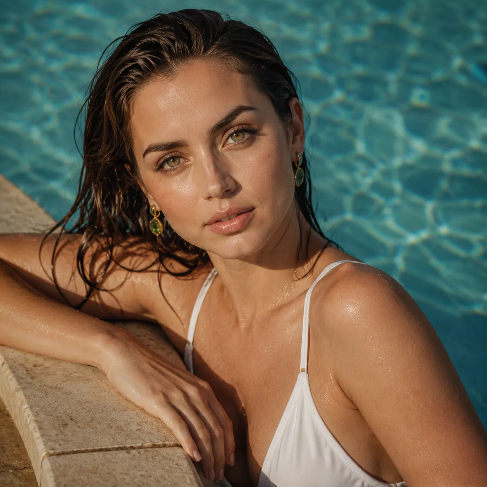

# Realistic, Minimalist

[← Back to the collection](../../README.md) · Category: [UI & Graphic](../../gallery/ui-graphic.md) · Model: `Vinano Studio` · ID: `vn-01552`

<a href="https://vinano.ai?utm_source=github&utm_medium=readme&utm_campaign=awesome-image-video-prompts-updating&utm_content=prompt-page-image"></a>

<sub>Preview generated with <a href="https://vinano.ai?utm_source=github&utm_medium=readme&utm_campaign=awesome-image-video-prompts-updating&utm_content=prompt-page-caption">vinano.ai</a></sub>

## Prompt

```text
{
 "version_control": {
 "target_style": "High-End Fashion Editorial",
 "fidelity_level": "Absolute 1:1 Identity Lock",
 "rendering_engine_constraints": "No CGI, No Illustration, No AI Smoothing"
 },
 "subject_profile": {
 "identity": {
 "name": "Ana de Armas",
 "age_group": "Adult Woman",
 "biometric_integrity": "Preserve 100% original bone structure, facial asymmetry, moles, and eye shape. Zero morphing or enhancement."
 },
 "anatomy_and_skin": {
 "texture": "Visible pores, micro-creases, subtle translucency",
 "physics": "Natural water droplets, soft wet sheen, realistic surface tension on skin",
 "tone": "Natural base skin tone, sun-kissed warmth, no artificial glow"
 },
 "face_details": {
 "eyes": "Natural eye color, soft neutral-pink glossy shadow, thin lash-line eyeliner (no wing), separated curled lashes",
 "brows": "Natural density, straight-to-softly-rounded architecture",
 "nose_and_lips": "Subtle pink warmth on nose bridge; full lips, rose-pink gradient, wet glossy finish, blurred edges, no overlining"
 },
 "hair_styling": {
 "state": "Visibly wet, slicked at roots, damp strands",
 "arrangement": "Loose, flowing over shoulders and back, natural messy texture",
 "match_reference": "1:1 color and style match"
 }
 },
 "composition_and_pose": {
 "action": "Leaning on swimming pool edge, body angled 45-degrees",
 "arm_placement": "One arm naturally resting on pool coping",
 "framing": "Medium close-up, three-quarter angle",
 "mood": "Intimate, calm, grounded, confident"
 },
 "attire_and_wardrobe": {
 "primary_garment": "refined minimalist white swimsuit, thin straps, clean lines",
 "fabric_physics": "Realistic tension against wet skin, natural folds and bunching",
 "jewelry": "Statement earrings, natural stones/gold, realistic micro-scratches and reflections"
 },
 "environment_and_lighting": {
 "background": {
 "element": "Turquoise pool water",
 "physics": "Refraction, light-play on pool floor, subtle ripples, realistic movement"
 },
 "lighting_design": {
 "source": "Single-direction natural sunlight",
 "color_temp": "Warm sun-lit tones",
 "exposure": "Slightly underexposed (lowered exposure)",
 "shadows": "Physically accurate contact shadows on collarbones and chest"
 }
 },
 "technical_parameters": {
 "optics": "50mm–85mm focal length equivalent, realistic photographic perspective",
 "depth_of_field": "Shallow, organic bokeh, natural fall-off",
 "resolution_quality": "16k Hyper-Realistic",
 "aspect_ratio": "3:4"
 }
}

Maintain consistent colour harmony and crisp focus across the whole frame.
```

## Try it on vinano.ai

1. Copy the prompt above.
2. Open **[vinano.ai](https://vinano.ai?utm_source=github&utm_medium=readme&utm_campaign=awesome-image-video-prompts-updating&utm_content=prompt-page-try)**, paste it into the image generator and pick a model.
3. Swap any placeholders (brand, product, city, person…) for your own details, then generate.

More prompts like this: [UI & Graphic gallery](../../gallery/ui-graphic.md) · [all categories](../../README.md#contents)
