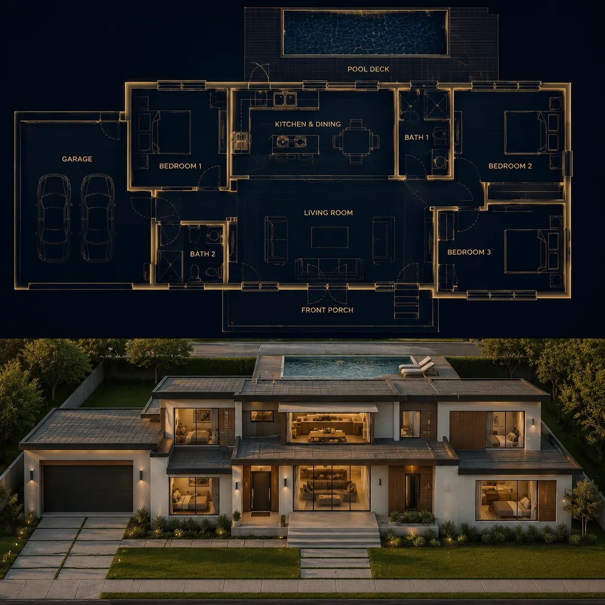

# Realistic, Fantasy

[← Back to the collection](../../README.md) · Category: [UI & Graphic](../../gallery/ui-graphic.md) · Model: `Vinano Studio` · ID: `vn-01556`

<a href="https://vinano.ai?utm_source=github&utm_medium=readme&utm_campaign=awesome-image-video-prompts-updating&utm_content=prompt-page-image"></a>

<sub>Preview generated with <a href="https://vinano.ai?utm_source=github&utm_medium=readme&utm_campaign=awesome-image-video-prompts-updating&utm_content=prompt-page-caption">vinano.ai</a></sub>

## Prompt

```text
{
 "objective": "Create a split architectural visualization where the top is a detailed dark-themed blueprint and the bottom is a true-to-life photorealistic house that matches the blueprint EXACTLY",

 "aspect_ratio": "3:4",

 "composition": {
 "layout": "vertical split",
 "top_section": "blueprint",
 "bottom_section": "realistic render",
 "alignment": "perfect structural correspondence between both sections"
 },

 "top_section": {
 "type": "architectural blueprint",
 "style": "dark luxury blueprint (similar to reference image 2)",

 "visual_style": {
 "background": "deep navy / charcoal blue",
 "lines": "thin glowing beige/gold lines",
 "walls": "slightly extruded 3D effect",
 "labels": "clean modern sans-serif",
 "lighting": "soft ambient glow"
 },

 "content": {
 "rooms": ["3 bedrooms (left, right, bottom-right)",
 "central living room",
 "kitchen + dining (top center)",
 "2 bathrooms",
 "garage (left side connected)",
 "front porch",
 "backyard pool deck"],
 "details": ["furniture outlines (beds, sofa, dining table)",
 "door swings and openings",
 "window placements",
 "circulation paths",
 "exact proportions and spacing"]
 }
 },

 "bottom_section": {
 "type": "true-to-life photorealistic house render",

 "constraint": "MUST MATCH THE BLUEPRINT EXACTLY — no added, removed, or shifted rooms",

 "architecture": {
 "style": "modern single-story house",
 "roof": "flat layered roof",
 "materials": ["smooth concrete walls",
 "wood panel accents",
 "large glass windows"]
 },

 "layout_mapping_rules": ["garage must be on the left side exactly as blueprint",
 "main entrance aligned living room",
 "pool positioned in backyard matching blueprint dimensions",
 "window placements correspond to each room location",
 "bedroom volumes visible externally in correct positions"],

 "environment": {
 "setting": "suburban neighborhood",
 "elements": ["green lawn",
 "minimal landscaping",
 "clean driveway leading to garage",
 "pool deck matching blueprint footprint"]
 },

 "lighting": {
 "time": "golden hour",
 "style": "soft natural light realistic shadows"
 },

 "camera": {
 "angle": "slightly elevated front perspective",
 "lens": "35mm architectural view"
 }
 },

 "consistency_rules": ["room positions must be identical between blueprint and render",
 "no extra structures added in render",
 "all doors and windows must align logically",
 "pool size and placement must match exactly",
 "garage placement must match blueprint"],

 "style": {
 "top": "architectural visualization (dark premium)",
 "bottom": "true-to-life photorealistic modern house",
 "overall": "clean, high-end architectural presentation"
 },

 "negative_constraints": ["no mismatch between blueprint and render",
 "no extra rooms",
 "no fantasy elements",
 "no unrealistic proportions",
 "no cluttered environment"]
}

Aim for an editorial, design-driven look with deliberate negative space.
```

## Try it on vinano.ai

1. Copy the prompt above.
2. Open **[vinano.ai](https://vinano.ai?utm_source=github&utm_medium=readme&utm_campaign=awesome-image-video-prompts-updating&utm_content=prompt-page-try)**, paste it into the image generator and pick a model.
3. Swap any placeholders (brand, product, city, person…) for your own details, then generate.

More prompts like this: [UI & Graphic gallery](../../gallery/ui-graphic.md) · [all categories](../../README.md#contents)
