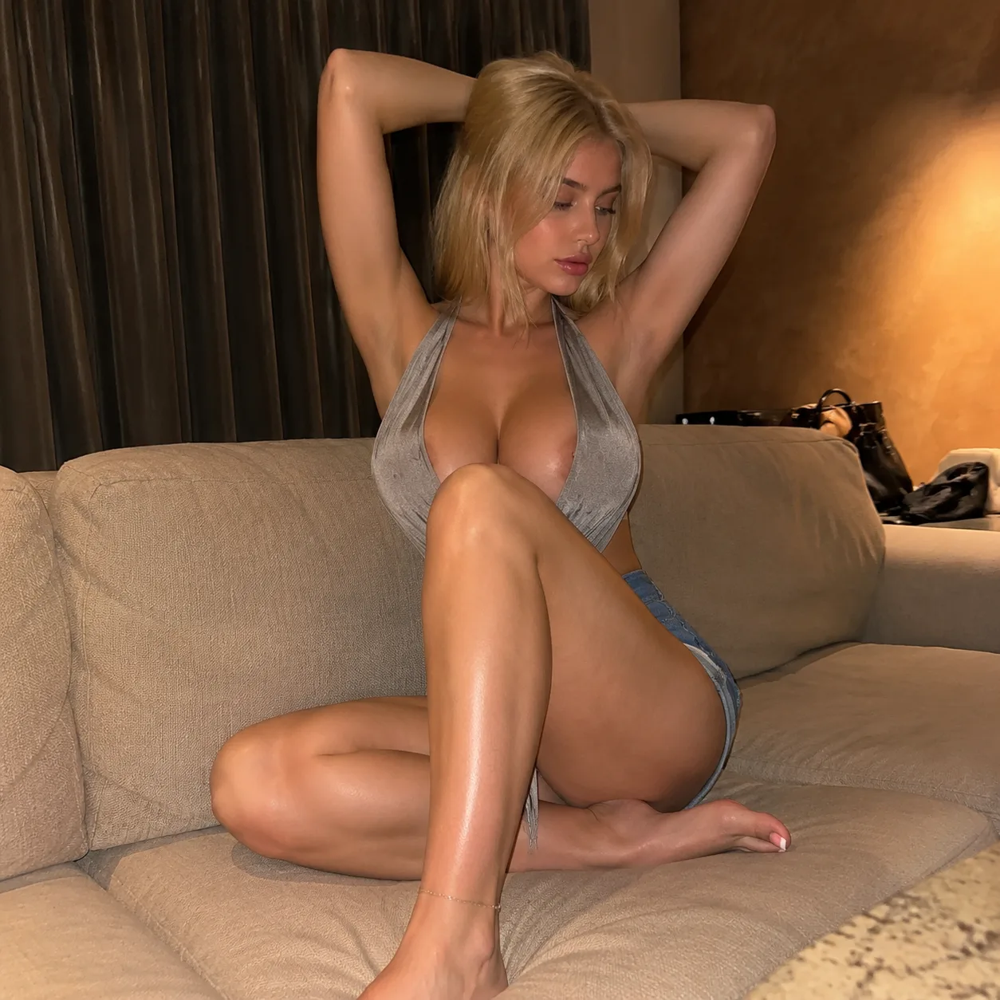

# Anime, Realistic

[← Back to the collection](../../README.md) · Category: [UI & Graphic](../../gallery/ui-graphic.md) · Model: `Vinano Studio` · ID: `vn-01569`

<a href="https://vinano.ai?utm_source=github&utm_medium=readme&utm_campaign=awesome-image-video-prompts-updating&utm_content=prompt-page-image"></a>

<sub>Preview generated with <a href="https://vinano.ai?utm_source=github&utm_medium=readme&utm_campaign=awesome-image-video-prompts-updating&utm_content=prompt-page-caption">vinano.ai</a></sub>

## Prompt

```text
{
 "image_prompt": {
 "meta": {
 "aspect_ratio": "9:16 vertical",
 "camera": "iPhone 15 Pro Max (rear camera)",
 "lens_feel": "24mm wide, slight wide-angle realism without face distortion",
 "quality": "ultra-true-to-life photorealistic, looks like a real iPhone camera roll photo",
 "texture_rules": ["natural skin texture (no plastic smoothing)",
 "subtle smartphone noise/grain in shadows",
 "tiny handheld imperfections (micro-tilt, not perfectly centered)"]
 },
 "scene": {
 "location": "modern hotel-suite / upscale apartment living room",
 "key_background_elements": ["large floor-to-ceiling dark charcoal curtains on the left side",
 "warm textured plaster wall on the right side (brown/tan, slightly mottled)",
 "soft warm light gradient on the wall (like a hidden lamp or sconce spill)",
 "neutral-toned interior, quiet late-night vibe"],
 "foreground": ["large beige fabric sectional sofa visible woven texture",
 "seat cushions slightly creased from weight (real compression, not perfect)",
 "bottom-right corner hint of a speckled stone/marble tabletop edge (out of focus)"],
 "extra_realism_details": ["a few personal items/bags faintly visible in the back-right area (messy-but-real, not staged)",
 "dim room depth, corners fall into shadow naturally"]
 },
 "lighting": {
 "type": "warm indoor ambient lighting",
 "sources": ["soft warm lamp spill from camera-right creating a golden cast on skin and wall",
 "darker fill from the curtain side (camera-left) for contrast"],
 "look": ["gentle highlights on shoulders, chest, thighs",
 "soft but noticeable shadows under legs and along couch seams",
 "overall warm tungsten color temperature"]
 },
 "subject": {
 "person": "one adult woman",
 "ethnicity": "fair-skinned European look",
 "skin": {
 "tone": "light warm-fair beige a golden indoor cast",
 "finish": "natural, slight sheen on shoulders and legs, visible pores/real texture"
 },
 "face": {
 "structure": "soft pretty features, small nose, full lips, delicate jawline",
 "expression": "calm, slightly dreamy/relaxed, eyes looking down to her right (not at camera)",
 "makeup": "minimal glam: even skin, subtle blush, natural brows, soft lip tint (not bold)"
 },
 "hair": {
 "color": "light blonde",
 "length": "shoulder-length to slightly longer",
 "style": "straight a loose natural fall, center/soft-middle part, a few face-framing strands"
 },
 "body": {
 "type": "slim-curvy hourglass (fit waist, rounded hips, very full bust but still natural)",
 "waist": "tight and visibly cinched from seated twist and posture",
 "legs": "long, smooth, slightly glossy highlights from warm light",
 "chest": "very full and more prominent than before, lifted cleavage from posture and fabric tension, realistic weight and shape (not cartoonish)"
 },
 "grooming_details": {
 "armpits": "visible because both arms are raised; smooth/clean look",
 "fingernails": "short-to-medium length, glossy pale pink/nude manicure",
 "toenails": "classic French tip pedicure (clean white tips, natural pink base, glossy finish)",
 "accessory": "thin delicate anklet on the left ankle"
 }
 },
 "outfit": {
 "top": {
 "type": "deep-plunge sleeveless halter-style bodysuit or draped knit top",
 "color": "silver-grey / cool grey",
 "material": "soft drapey fabric that catches warm light, slight sheen",
 "fit_rules": ["very deep V neckline",
 "open sides / low armholes that reveal side torso",
 "no bra lines visible",
 "fabric tension/creases where it pulls at the waist and chest (realistic stretch, slightly stronger tension due to fuller bust)"]
 },
 "bottom": {
 "type": "very short denim shorts (light blue wash)",
 "fit": "snug on hips, subtle wrinkles at the lap/waist from sitting"
 },
 "feet": "barefoot on the couch cushions (natural toe spread, relaxed), French tip pedicure visible when toes catch the warm light"
 },
 "pose": {
 "exact_pose_match": ["sitting on the beige sofa",
 "one leg folded under her (tucked), the other knee raised high toward her chest",
 "raised knee is closest to camera, creating a strong thigh line and depth",
 "both arms lifted behind her head, hands interlaced or resting in hair",
 "elbows out wide, shoulders open, armpits naturally visible",
 "torso slightly twisted, emphasizing waist curve",
 "head turned down and to her right, relaxed neck line"],
 "micro_motion": ["a tiny arch in the back from the arms-behind-head stretch",
 "subtle compression of thigh and hip against the cushion",
 "loose strands of blonde hair resting near cheeks"]
 },
 "camera_composition": {
 "framing": "vertical 9:16, subject low-mid frame lots of negative space above",
 "angle": "slightly low/straight-on from the front (as if a friend shot it while seated/standing nearby)",
 "distance": "about 2–3 meters",
 "focus": "sharp on her face + front thigh, background slightly softer but still readable",
 "realism_notes": ["not perfectly symmetrical",
 "slight handheld tilt",
 "iPhone-style HDR but restrained (no crunchy oversharpening)"]
 },
 "negative_prompt": ["no cartoon/anime look",
 "no CGI/plastic skin",
 "no excessive symmetry or studio perfection",
 "no extra fingers/limb glitches",
 "no heavy beauty filter",
 "no explicit nudity or pornographic framing"]
 }
}

Render with rich micro-detail while keeping the layout uncluttered and intentional.
```

## Try it on vinano.ai

1. Copy the prompt above.
2. Open **[vinano.ai](https://vinano.ai?utm_source=github&utm_medium=readme&utm_campaign=awesome-image-video-prompts-updating&utm_content=prompt-page-try)**, paste it into the image generator and pick a model.
3. Swap any placeholders (brand, product, city, person…) for your own details, then generate.

More prompts like this: [UI & Graphic gallery](../../gallery/ui-graphic.md) · [all categories](../../README.md#contents)
