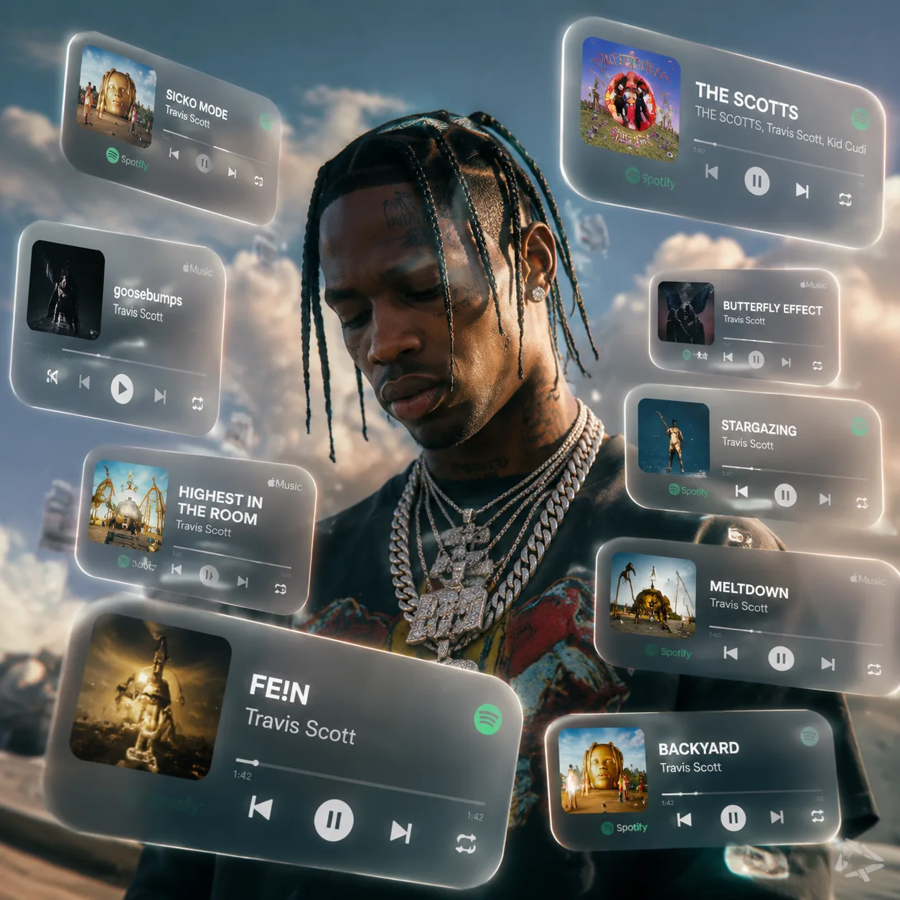

# Realistic, Portrait

[← Back to the collection](../../README.md) · Category: [UI & Graphic](../../gallery/ui-graphic.md) · Model: `Vinano Studio` · ID: `vn-01592`

<a href="https://vinano.ai?utm_source=github&utm_medium=readme&utm_campaign=awesome-image-video-prompts-updating&utm_content=prompt-page-image"></a>

<sub>Preview generated with <a href="https://vinano.ai?utm_source=github&utm_medium=readme&utm_campaign=awesome-image-video-prompts-updating&utm_content=prompt-page-caption">vinano.ai</a></sub>

## Prompt

```text
[PERSONE]: Enter the music artist name here.
Goal: Generate a cinematic, dreamlike AR (Augmented Reality) visual featuring [PERSONE] as the central subject, surrounded by an orbiting system of floating music interface cards.

1. THE SUBJECT & DYNAMIC TRACKLIST
- Character: A premium-quality, realistic portrait of [PERSONE] as the central figure.
- AI AUTOMATION (CRITICAL): Based on the name provided in [PERSONE], identify their top 8 most popular songs. Automatically replace the placeholder list below these real song titles.
- Featured Tracks: [Placeholder for songs like: century, rottweiler, 4 raws, phantom, mist, cali man, LV sandals]. Each song title must appear on its own floating 3D interface card.

2. AR INTERFACE & CARDS
- Style: Numerous 3D Spotify and Apple Music interface cards orbiting the subject at varying depths.
- Material: Translucent frosted glass (glassmorphism) soft rounded edges and subtle glowing borders.
- Movement: Some cards are in the extreme foreground, partially obscuring [PERSONE], while others drift into the distance behind the figure.
- Visual Accents: Dynamic motion blur on the edges of the cards to suggest a swirling, orbiting movement.

3. LIGHTING & COMPOSITION
- Lighting: Natural tones enhanced professional photo quality. The soft glow from the interface cards subtly illuminates the face of [PERSONE].
- Focus: Strong depth of field. The background and extreme foreground cards are artistically blurred, keeping the focus sharp on the artist and the closest player interfaces.
- Composition: A cinematic wide or medium shot that emphasizes the scale of the floating AR elements.

4. AESTHETIC
- High-end editorial music photography, futuristic AR concept, clean and airy vibe. 8k resolution, sophisticated lighting, and realistic textures on the glass cards.

Emphasise material texture and natural light so the final frame feels tactile and premium.
```

## Try it on vinano.ai

1. Copy the prompt above.
2. Open **[vinano.ai](https://vinano.ai?utm_source=github&utm_medium=readme&utm_campaign=awesome-image-video-prompts-updating&utm_content=prompt-page-try)**, paste it into the image generator and pick a model.
3. Swap any placeholders (brand, product, city, person…) for your own details, then generate.

More prompts like this: [UI & Graphic gallery](../../gallery/ui-graphic.md) · [all categories](../../README.md#contents)
