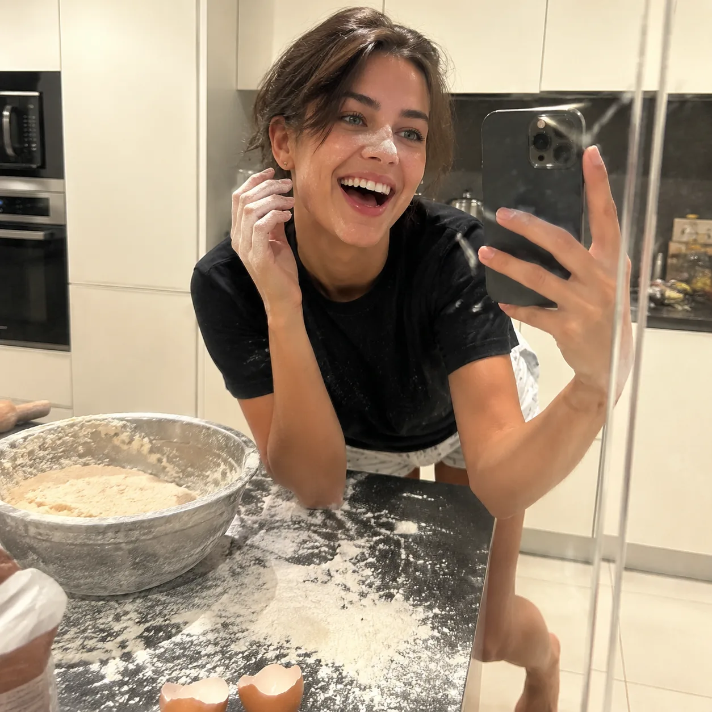

# Realistic, Portrait

[← Back to the collection](../../README.md) · Category: [UI & Graphic](../../gallery/ui-graphic.md) · Model: `Vinano Studio` · ID: `vn-01596`

<a href="https://vinano.ai?utm_source=github&utm_medium=readme&utm_campaign=awesome-image-video-prompts-updating&utm_content=prompt-page-image"></a>

<sub>Preview generated with <a href="https://vinano.ai?utm_source=github&utm_medium=readme&utm_campaign=awesome-image-video-prompts-updating&utm_content=prompt-page-caption">vinano.ai</a></sub>

## Prompt

```text
{
 "prompt_type": "descriptive_portrait",
 "subject_details": {
 "demographics": "Young female, sun-kissed skin, fit and athletic build, strictly matching the reference photo.",
 "facial_features": {
 "expression": "Laughing mouth open, a smudge of white flour on her nose and cheek, playful and messy yet attractive, facial expression matching the reference photo.",
 "eyes": "Bright green eyes, aligned the reference photo angle.",
 "hair": "Slightly messy short-to-medium hair, casually styled, exactly following the reference photo hairstyle."
 },
 "apparel": {
 "dress": "Plain black t-shirt fitting exactly like the reference photo pose, paired tiny pajama shorts.",
 "accessories": "None.",
 "footwear": "Barefoot."
 }
 },
 "pose_and_action": {
 "body_position": "Leaning over the kitchen island counter, elbows resting on the surface, body position strictly following the reference photo.",
 "hands": "Hands lightly dusted flour. One hand holds the phone, the other is near her face, matching the reference photo hand positions exactly.",
 "camera_angle": "Eye-level mirror selfie captured in a reflective kitchen cabinet or window, camera angle matching the reference photo precisely."
 },
 "background_environment": {
 "location": "Messy kitchen.",
 "lighting_source": "Bright overhead kitchen lights.",
 "objects": {
 "details": "Bowl of dough, scattered flour on the counter, cracked eggshells."
 }
 },
 "technical_specs": {
 "style": "Playful, domestic, ultra-realistic, high detail on natural skin texture and flour dust, strict adherence to the reference photo for realism.",
 "aspect_ratio": "4:5"
 },
 "constraints": ["Preserve facial identity exactly as in the reference image",
 "No facial reshaping or beautification",
 "No artificial filters or stylization",
 "Maintain natural proportions and lighting"],
 "output_goal": "Create a playful, ultra-realistic mirror selfie portrait of a young woman in a messy kitchen, laughing naturally flour on her face, perfectly matching the reference photo in pose, expression, and identity."
}

Emphasise material texture and natural light so the final frame feels tactile and premium.
```

## Try it on vinano.ai

1. Copy the prompt above.
2. Open **[vinano.ai](https://vinano.ai?utm_source=github&utm_medium=readme&utm_campaign=awesome-image-video-prompts-updating&utm_content=prompt-page-try)**, paste it into the image generator and pick a model.
3. Swap any placeholders (brand, product, city, person…) for your own details, then generate.

More prompts like this: [UI & Graphic gallery](../../gallery/ui-graphic.md) · [all categories](../../README.md#contents)
