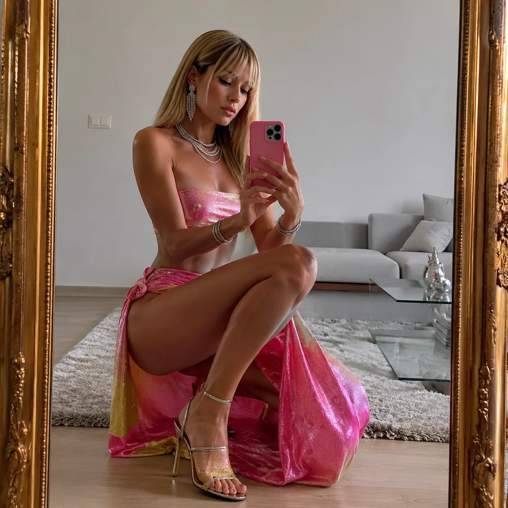

# Realistic, Minimalist

[← Back to the collection](../../README.md) · Category: [UI & Graphic](../../gallery/ui-graphic.md) · Model: `Vinano Studio` · ID: `vn-01608`

<a href="https://vinano.ai?utm_source=github&utm_medium=readme&utm_campaign=awesome-image-video-prompts-updating&utm_content=prompt-page-image"></a>

<sub>Preview generated with <a href="https://vinano.ai?utm_source=github&utm_medium=readme&utm_campaign=awesome-image-video-prompts-updating&utm_content=prompt-page-caption">vinano.ai</a></sub>

## Prompt

```text
{
 "specification_metadata": {
 "version": "16.0_modular_atomic",
 "rendering_engine": "8K true-to-life photorealistic Hyper-Definition",
 "aspect_ratio": "9:16",
 "style_intent": "High-End Influencer Lifestyle Photography"
 },
 "subject_schema": {
 "biometrics": {
 "identity": "Young Western woman",
 "physique": "Athletic / Toned build",
 "facial_profile": {
 "complexion": "Clear / Flawless",
 "features": "Refined / Sharp",
 "skin_shader": "Luminous / Natural texture"
 }
 },
 "capillary_logic": {
 "color": "Long, sleek blonde",
 "style": "Straightened / High-sheen",
 "fringe_logic": "Messy bangs spread naturally across the forehead",
 "physics": "Silky texture / Individual strand rendering"
 },
 "performance_kinematics": {
 "pose_archetype": "Crouching low mirror selfie",
 "spatial_orientation": "Full-body reflection",
 "gesture": "Holding device both hands at a slight downward tilt"
 }
 },
 "wardrobe_schema": {
 "apparel_system": {
 "type": "Avant-Garde Two-Piece Set",
 "fabric_logic": {
 "texture": "Shimmery / Glittery / Reflective",
 "material": "High-luster metallic weave"
 },
 "chroma_profile": {
 "primary": "Vibrant Hot Pink",
 "accent": "Light Yellow"
 },
 "garment_architecture": {
 "upper": "Strapless bandeau / Diagonal midriff cutout",
 "lower": "High-waisted maxi skirt / Dramatic thigh-high slit / Hip-knot detailing"
 }
 },
 "accessory_system": {
 "material": "Polished Silver",
 "items": [{ "type": "Necklace", "detail": "Layered silver chains" },
 { "type": "Earrings", "detail": "Ornate silver chandeliers" },
 { "type": "Bracelets", "detail": "Multiple thin silver bands" }]
 }
 },
 "hardware_node": {
 "device_spec": {
 "model": "iPhone 16 Pro Max",
 "finish": "Silver / Gray Titanium",
 "peripheral": "Hot Pink phone case (High-saturation pop color)"
 }
 },
 "environmental_rig": {
 "scenography": {
 "interior_style": "Modern refined minimalist",
 "surfaces": {
 "floor": "Light wood planks",
 "rug": "Light grey shag / High-pile texture",
 "walls": "Neutral matte white"
 },
 "props": {
 "mirror": "Large floor-length mirror an ornate gold frame"
 }
 },
 "illumination_architecture": {
 "source_type": "Natural soft indoor daylight",
 "distribution": "Even / Diffused",
 "shadow_logic": "Soft-ambient / Zero harsh contrast"
 }
 },
 "technical_logic_node": {
 "optical_parameters": {
 "shot_type": "Wide-angle mirror reflection",
 "perspective": "Eye-level / Slightly tilted downward",
 "focus_mapping": "Sharp focus on subject and garment textures"
 },
 "color_theory": {
 "base_palette": ["Monochromatic grays", "Metallic silver"],
 "contrast_element": "Hot pink focal point"
 },
 "post_processing_directives": {
 "resolution": "8K UHD",
 "denoising": "Off / Film grain retention",
 "filtering": "Professional editorial grade"
 }
 }
}

Aim for an editorial, design-driven look with deliberate negative space.
```

## Try it on vinano.ai

1. Copy the prompt above.
2. Open **[vinano.ai](https://vinano.ai?utm_source=github&utm_medium=readme&utm_campaign=awesome-image-video-prompts-updating&utm_content=prompt-page-try)**, paste it into the image generator and pick a model.
3. Swap any placeholders (brand, product, city, person…) for your own details, then generate.

More prompts like this: [UI & Graphic gallery](../../gallery/ui-graphic.md) · [all categories](../../README.md#contents)
