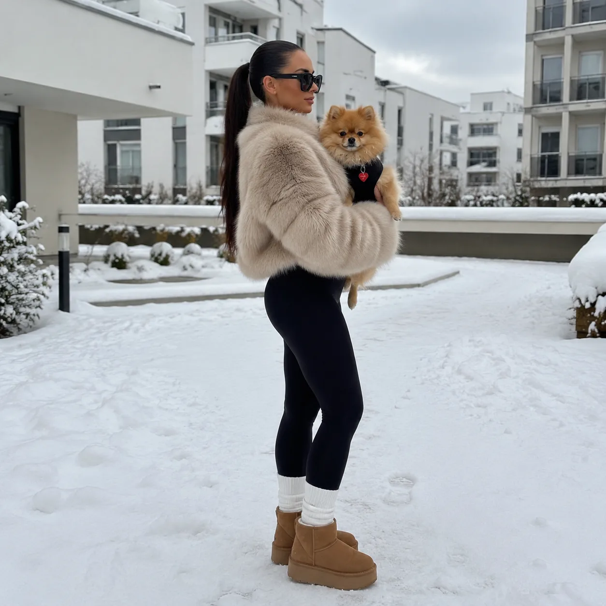

# Realistic, Ai Art

[← Back to the collection](../../README.md) · Category: [UI & Graphic](../../gallery/ui-graphic.md) · Model: `Vinano Studio` · ID: `vn-01618`

<a href="https://vinano.ai?utm_source=github&utm_medium=readme&utm_campaign=awesome-image-video-prompts-updating&utm_content=prompt-page-image"></a>

<sub>Preview generated with <a href="https://vinano.ai?utm_source=github&utm_medium=readme&utm_campaign=awesome-image-video-prompts-updating&utm_content=prompt-page-caption">vinano.ai</a></sub>

## Prompt

```text
{
 "title": "Winter Lifestyle Fashion Photograph",
 "description": "An ultra-realistic winter lifestyle fashion photograph taken outdoors in a modern residential area under an overcast sky. A young woman, in a relaxed side profile facing right, stands in a snow-covered courtyard surrounded by contemporary white apartment buildings. She wears oversized black sunglasses, a fitted black bodysuit, a voluminous beige fur jacket, white ribbed socks, and brown platform UGG boots. In her arms, she holds a small fluffy Pomeranian dog in a black harness a red heart tag, looking at the camera. The soft, diffused daylight and shallow depth of field create a candid, luxurious, and authentic atmosphere natural textures and lifelike proportions.",
 "photographer_perspective": {
 "lens": "50–85mm",
 "focus": "Shallow depth of field, sharp focus on the woman and dog.",
 "lighting": "Soft, diffused cold daylight under an overcast sky.",
 "color_temperature": "Realistic winter color temperature low contrast.",
 "aesthetic": "Editorial luxury casual, candid yet composed, true-to-life."
 },
 "subjects": {
 "woman": {
 "pose": "Side profile facing right, relaxed and naturally balanced.",
 "attire": ["Oversized black luxury sunglasses",
 "Fitted black bodysuit / catsuit",
 "Short beige fur jacket voluminous sleeves",
 "White ribbed socks",
 "Brown platform UGG boots worn winter soles"],
 "details": "Authentic human proportions, natural posture, realistic skin texture, no plastic smoothness."
 },
 "dog": {
 "breed": "Small fluffy Pomeranian",
 "accessories": "Black harness a subtle red heart tag",
 "pose": "Looking directly toward the camera",
 "details": "Detailed fur strands, soft natural shine, expressive eyes."
 }
 },
 "environment": {
 "location": "Modern residential area courtyard.",
 "elements": "Contemporary white multi-story apartment buildings balconies.",
 "condition": "All surfaces naturally covered in fresh snow.",
 "atmosphere": "True-to-life winter atmosphere, no artificial perfection."
 }
}

Keep edges clean and the overall composition balanced for a polished, gallery-ready result.
```

## Try it on vinano.ai

1. Copy the prompt above.
2. Open **[vinano.ai](https://vinano.ai?utm_source=github&utm_medium=readme&utm_campaign=awesome-image-video-prompts-updating&utm_content=prompt-page-try)**, paste it into the image generator and pick a model.
3. Swap any placeholders (brand, product, city, person…) for your own details, then generate.

More prompts like this: [UI & Graphic gallery](../../gallery/ui-graphic.md) · [all categories](../../README.md#contents)
