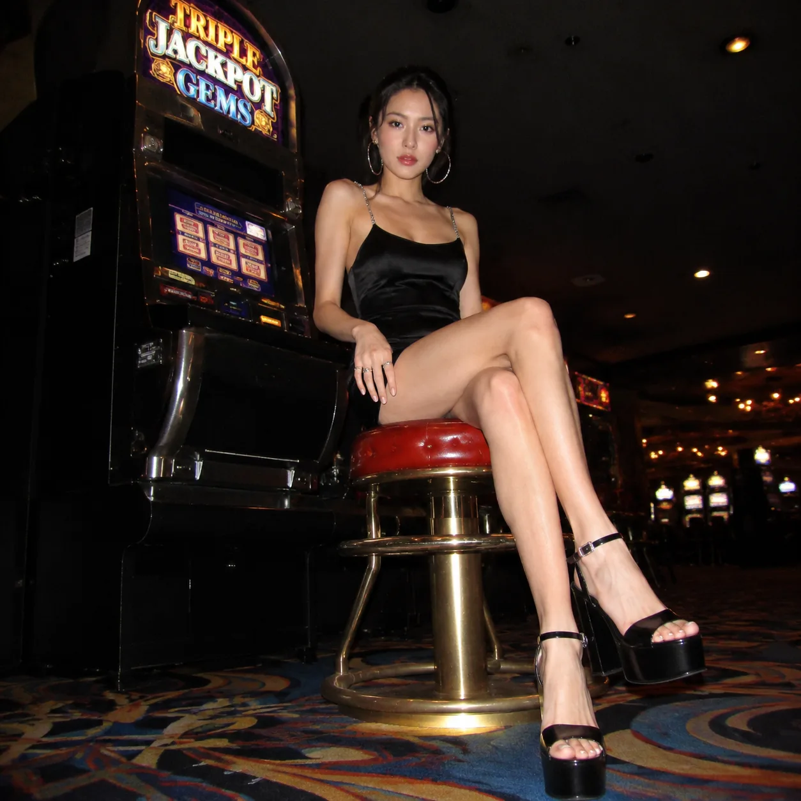

# Realistic, Character

[← Back to the collection](../../README.md) · Category: [UI & Graphic](../../gallery/ui-graphic.md) · Model: `Vinano Studio` · ID: `vn-01620`

<a href="https://vinano.ai?utm_source=github&utm_medium=readme&utm_campaign=awesome-image-video-prompts-updating&utm_content=prompt-page-image"></a>

<sub>Preview generated with <a href="https://vinano.ai?utm_source=github&utm_medium=readme&utm_campaign=awesome-image-video-prompts-updating&utm_content=prompt-page-caption">vinano.ai</a></sub>

## Prompt

```text
{
 "image_generation_request": {
 "meta_settings": {
 "aspect_ratio": "9:16",
 "model_version": "v6.0",
 "stylize_value": 250,
 "quality": "High"
 },
 "subject_definition": {
 "identity_source": {
 "method": "Image Reference",
 "instruction": "Strictly preserve facial features and hair from the uploaded reference image."
 },
 "body_language": {
 "pose": "Seated on a high stool, body angled 30 degrees to the left, legs elegantly crossed at the knee to elongate the silhouette.",
 "hands": "Resting casually on the upper thighs, fingers relaxed, showcasing rings.",
 "gaze": "Looking slightly down towards the camera lens or directly into the flash."
 }
 },
 "fashion_and_styling": {
 "garment_main": {
 "item": "Black mini slip dress",
 "fabric": "Satin or high-sheen silk blend",
 "fit": "Skin-tight, fitted bodycon silhouette",
 "details": ["Spaghetti straps made of glittering rhinestones",
 "Deep scoop neckline",
 "Mini hemline exposing legs"]
 },
 "footwear": {
 "item": "Platform sandals",
 "style": "Chunky block heel, 1990s/Y2K inspired",
 "material": "Black patent leather or satin",
 "details": "Silver buckle ankle strap, open toe"
 },
 "jewelry": {
 "ears": "Oversized sterling silver hoop earrings",
 "hands": "Multiple delicate silver stacking rings"
 }
 },
 "environmental_context": {
 "location": "Vintage Casino Floor",
 "flooring": {
 "type": "Patterned carpeting",
 "texture": "Worn nylon",
 "design": "Psychedelic swirls in teal, burnt orange, and royal blue",
 "vibe": "Retro Las Vegas aesthetic"
 },
 "furniture": {
 "item": "Casino bar stool",
 "material": "Tufted red faux leather seat",
 "base": "Tarnished bronze or gold metal pedestal footrest"
 },
 "props_and_background": {
 "primary_prop": "Slot machine",
 "prop_details": "Illuminated marquee reading 'TRIPLE JACKPOT GEMS', glowing buttons, glass screen reflections",
 "atmosphere": "Smoky, crowded, dimly lit background bokeh lights from other machines"
 }
 },
 "photography_technical": {
 "camera_simulation": "Early 2000s Digital Compact Camera (e.g., Sony Cybershot or Canon PowerShot)",
 "lighting_style": {
 "type": "Direct On-Camera Flash",
 "characteristics": ["Harsh shadows directly behind the subject",
 "High contrast",
 "Overexposed specular highlights on skin and fabric",
 "Vignetted corners"]
 },
 "composition": {
 "angle": "Extreme low angle (Worm's-eye view)",
 "focus": "Sharp focus on subject, slight blur on background",
 "framing": "Full body shot emphasizing long legs and platform shoes"
 },
 "post_processing": {
 "filters": "Vintage digicam aesthetic",
 "grain": "ISO 800 digital noise",
 "saturation": "High saturation, slightly blown-out whites"
 }
 },
 "compiled_prompts": {
 "main_prompt": "Low angle worm's-eye view shot, direct flash photography. A young woman sitting on a red tufted leather casino stool. She is wearing a fitted black satin mini slip dress sparkling rhinestone spaghetti straps and chunky black platform block heels ankle buckles. To her left is a large glowing slot machine neon text 'TRIPLE JACKPOT GEMS'. The floor is a gaudy retro casino carpet teal and orange swirls. Background is a dimly lit gambling floor. Aesthetic is Y2K party photography, candid snapshot, harsh flash lighting, hard shadows, high contrast, digital noise, 2000s digicam style, ultra-realistic texture on skin and fabric.",
 }
 }

Aim for an editorial, design-driven look with deliberate negative space.
```

## Try it on vinano.ai

1. Copy the prompt above.
2. Open **[vinano.ai](https://vinano.ai?utm_source=github&utm_medium=readme&utm_campaign=awesome-image-video-prompts-updating&utm_content=prompt-page-try)**, paste it into the image generator and pick a model.
3. Swap any placeholders (brand, product, city, person…) for your own details, then generate.

More prompts like this: [UI & Graphic gallery](../../gallery/ui-graphic.md) · [all categories](../../README.md#contents)
