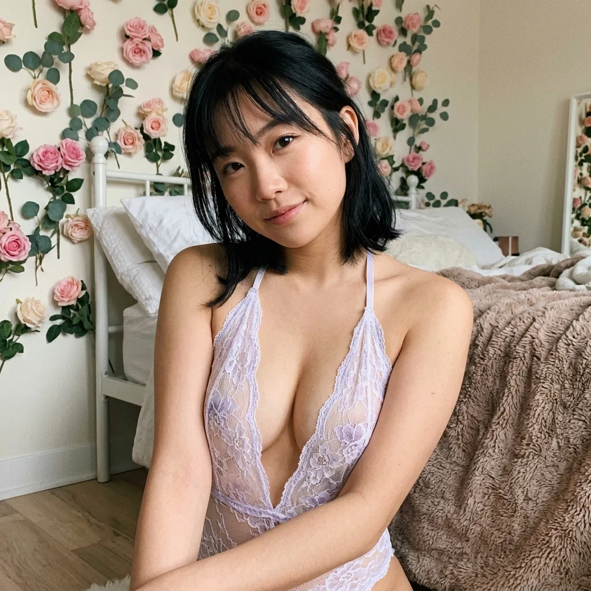

# Portrait, Ai Art

[← Back to the collection](../../README.md) · Category: [UI & Graphic](../../gallery/ui-graphic.md) · Model: `Vinano Image Pro` · ID: `vn-01624`

<a href="https://vinano.ai?utm_source=github&utm_medium=readme&utm_campaign=awesome-image-video-prompts-updating&utm_content=prompt-page-image"></a>

<sub>Preview generated with <a href="https://vinano.ai?utm_source=github&utm_medium=readme&utm_campaign=awesome-image-video-prompts-updating&utm_content=prompt-page-caption">vinano.ai</a></sub>

## Prompt

```text
{ "subject": { "description": "Young Asian woman in a sheer deep-V lace halter, sitting in a floral-decorated bedroom.", "age": "early 20s", "expression": { "eyes": { "look": "direct", "energy": "gentle, softly seductive", "direction": "at lens" }, "mouth": { "position": "closed, slight curve", "energy": "soft" }, "overall": "inviting and calm" }, "face": { "preserve_original": true, "makeup": "soft pink blush, glossy coral lips, subtle eyeliner" }, "hair": { "color": "black", "style": "shoulder-length bob, wispy bangs", "effect": "tucked behind left ear, slightly relaxed" }, "body": { "frame": "slender, feminine", "waist": "partially visible", "chest": "prominent cleavage, extreme deep plunge", "legs": "out of frame", "skin": { "visible_areas": "face, neck, shoulders, chest, arms", "tone": "fair, warm undertones", "texture": "velvety and warm to the touch", "lighting_effect": "diffused glow catching soft highlights" } }, "pose": { "position": "leaning slightly forward", "base": "sitting on floor", "overall": "relaxed, intimate approach" }, "clothing": { "top": { "type": "halter bodysuit", "color": "white and pale lilac", "details": "sheer floral lace, scalloped edges, thin neck straps, extremely deep V-neck", "effect": "revealing, delicate" }, "bottom": { "type": "none visible", "color": "", "details": "" } } }, "photography": { "camera_style": "smartphone portrait aesthetic, slight overexposure", "angle": "high-angle, slightly off-center", "shot_type": "chest-up portrait", "aspect_ratio": "3:4", "texture": "soft digital, slight random grain", "lighting": "soft front diffused light", "depth_of_field": "shallow, f/2.8 equivalent blurring background" }, "background": { "setting": "cozy bedroom", "wall_color": "off-white", "elements": ["wall heavily decorated dense pink and cream roses", "white metal bed frame", "brown fluffy blanket", "white pillows", "light wood floor"], "atmosphere": "romantic, private", "lighting": "soft ambient, gentle shadow fall-off" }, "the_vibe": { "energy": "lingering softness", "mood": "sweet seduction", "aesthetic": "soft girl, floral pastel", "authenticity": "casual indoor snapshot, slightly imperfect framing", "intimacy": "invading personal space, close proximity", "story": "a quiet afternoon spent waiting", "caption_energy": "feeling pretty today" }, "constraints": { "must_keep": ["deep-V lace halter", "flower wall background", "soft skin texture"], "avoid": ["heavy makeup", "harsh directional shadows", "complex accessories"] }, "negative_prompt": ["harsh lighting", "deformed features", "extra limbs", "watermark", "text", "oversaturated", "masculine features", "messy background"] } Render with rich micro-detail while keeping the layout uncluttered and intentional.
```

## Try it on vinano.ai

1. Copy the prompt above.
2. Open **[vinano.ai](https://vinano.ai?utm_source=github&utm_medium=readme&utm_campaign=awesome-image-video-prompts-updating&utm_content=prompt-page-try)**, paste it into the image generator and pick a model.
3. Swap any placeholders (brand, product, city, person…) for your own details, then generate.

More prompts like this: [UI & Graphic gallery](../../gallery/ui-graphic.md) · [all categories](../../README.md#contents)
