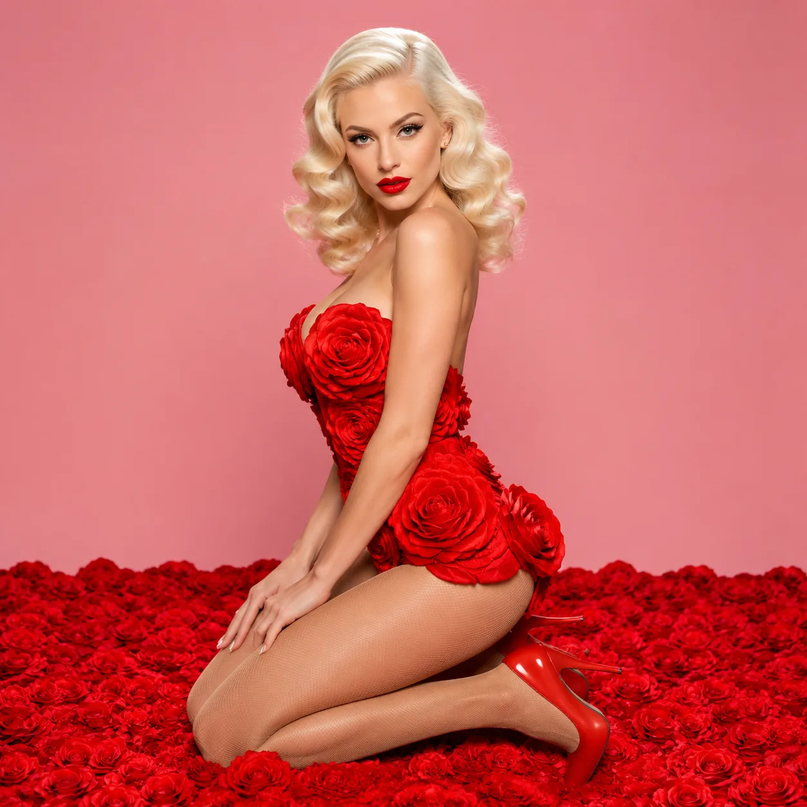

# Portrait, Vintage

[← Back to the collection](../../README.md) · Category: [UI & Graphic](../../gallery/ui-graphic.md) · Model: `Vinano Studio` · ID: `vn-01646`

<a href="https://vinano.ai?utm_source=github&utm_medium=readme&utm_campaign=awesome-image-video-prompts-updating&utm_content=prompt-page-image"></a>

<sub>Preview generated with <a href="https://vinano.ai?utm_source=github&utm_medium=readme&utm_campaign=awesome-image-video-prompts-updating&utm_content=prompt-page-caption">vinano.ai</a></sub>

## Prompt

```text
{
 "visual_style": {
 "pose": {
 "position": "Kneeling seated on heels",
 "body_orientation": "Side profile torso slight twist toward camera",
 "spine_posture": "Upright gentle curve",
 "head_angle": "Turned toward camera (three-quarter view)",
 "gaze": "Direct confident eye contact",
 "arms": "Relaxed, hands resting on thighs",
 "energy": "Stylized fashion editorial posture"
 },

 "colors": {
 "primary_palette": ["Vivid Crimson Red (floral elements)",
 "Soft Pastel Pink (background)",
 "Platinum Blonde (hair)"],
 "secondary_palette": ["Warm natural skin tones",
 "Neutral tan hosiery tones"],
 "contrast_profile": "High saturation reds contrasted muted pink background",
 "color_distribution": {
 "dominant": "Red",
 "supporting": "Pink",
 "accent": "Blonde highlights"
 }
 },

 "composition": {
 "framing": "Vertical portrait",
 "shot_type": "Medium-full body",
 "subject_placement": "Centered",
 "foreground": "Dense red floral layer",
 "midground": "Subject",
 "background": "Flat pastel studio backdrop",
 "visual_lines": "S-curve silhouette guiding viewer focus upward",
 "depth": "Three-layer depth separation"
 },

 "outfits": {
 "garment_concept": "Rose-inspired sculptural fashion elements",
 "material_visual": "Soft textile or plush floral forms",
 "legwear": "Fine mesh tights",
 "footwear": "Gloss red pointed-toe heels",
 "hair": {
 "style": "Old Hollywood waves",
 "volume": "High",
 "tone": "Platinum blonde"
 },
 "makeup": {
 "lip_color": "Matte vivid red",
 "eyes": "Defined liner and lashes",
 "skin_finish": "Smooth glam contour"
 }
 },

 "lighting": {
 "type": "Studio soft diffused lighting",
 "direction": "Frontal key slight side shaping",
 "shadow_profile": "Minimal harsh shadows",
 "highlight_behavior": "Even skin illumination",
 "environment_reflection": "Matte backdrop light absorption"
 },

 "effects": {
 "post_processing": ["High red saturation",
 "Soft glam skin smoothing",
 "Clean digital polish"],
 "texture_emphasis": ["Floral softness",
 "Smooth skin rendering",
 "Matte backdrop"],
 "aesthetic": ["Glam editorial",
 "Romantic studio fashion",
 "Vintage Hollywood influence"]
 }
 }
}

Maintain consistent colour harmony and crisp focus across the whole frame.
```

## Try it on vinano.ai

1. Copy the prompt above.
2. Open **[vinano.ai](https://vinano.ai?utm_source=github&utm_medium=readme&utm_campaign=awesome-image-video-prompts-updating&utm_content=prompt-page-try)**, paste it into the image generator and pick a model.
3. Swap any placeholders (brand, product, city, person…) for your own details, then generate.

More prompts like this: [UI & Graphic gallery](../../gallery/ui-graphic.md) · [all categories](../../README.md#contents)
