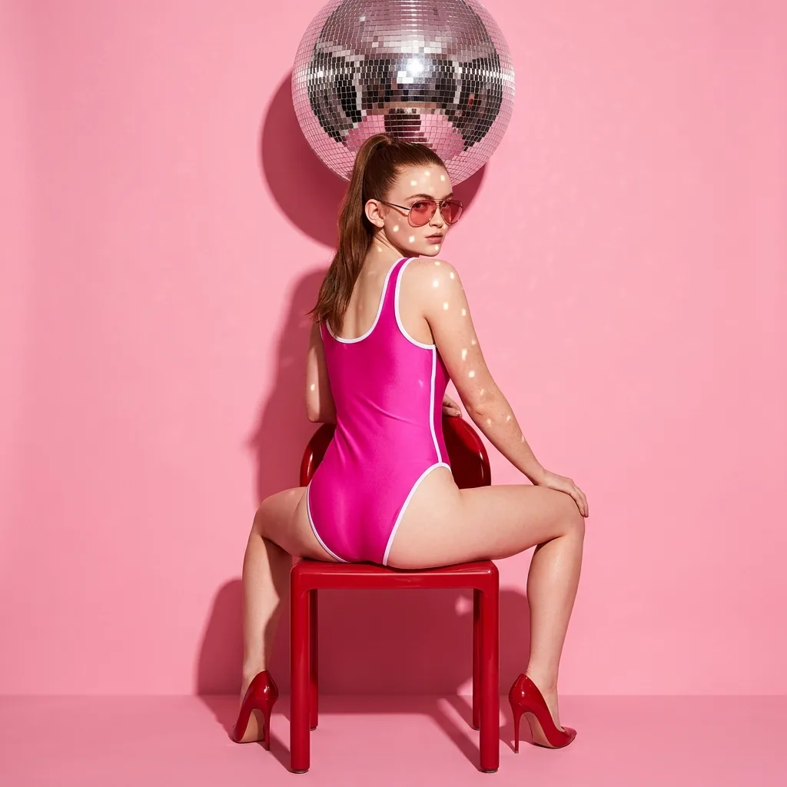

# Minimalist, Ai Art

[← Back to the collection](../../README.md) · Category: [UI & Graphic](../../gallery/ui-graphic.md) · Model: `Vinano Image Pro` · ID: `vn-01663`

<a href="https://vinano.ai?utm_source=github&utm_medium=readme&utm_campaign=awesome-image-video-prompts-updating&utm_content=prompt-page-image"></a>

<sub>Preview generated with <a href="https://vinano.ai?utm_source=github&utm_medium=readme&utm_campaign=awesome-image-video-prompts-updating&utm_content=prompt-page-caption">vinano.ai</a></sub>

## Prompt

```text
{
 "style_summary": "Retro-modern disco-pop aesthetic high-saturation monochromatic tones.",
 "pose": {
 "orientation": "Over-the-shoulder look",
 "description": "Sadie Sink is positioned front to the camera open legs sitting on a reversed red glossy chair creating a focal point in the upper half of the frame.",
 "stance": "High-cut silhouette emphasizing the chest, legs and red glossy high heels."
 },
 "colors": {
 "primary_palette": ["Bubblegum Pink", "Fuchsia", "Hot Pink"],
 "accent_colors": ["Metallic Silver", "White"],
 "skin_tones": "Warm, natural tan highlights",
 "vibe": "Monochromatic and high-energy."
 },
 "composition": {
 "framing": "Vertical, medium-full shot",
 "subject_placement": "Centered silhouette",
 "background": "refined minimalist, solid-colored flat wall",
 "depth": "Shallow, a sharp drop-off shadow on the background to create a 3D pop effect."
 },
 "outfits_and_props": {
 "clothing": "High-leg pink spandex bodysuit white piping/trim",
 "accessories": "Rose-tinted transparent aviator-style sunglasses",
 "key_prop": "A large, multi-faceted metallic silver disco ball",
 "hair": "High ponytail, sleek and brunette."
 },
 "lighting": {
 "type": "Hard studio lighting",
 "direction": "Side-lit from the left",
 "shadows": "Sharp, defined shadows on the wall and body contours",
 "highlights": "Specular highlights on the bodysuit and disco ball facets",
 "special_lighting": "Caustic light reflections (small squares of light) projected onto the subject's skin from the disco ball."
 },
 "effects_and_texture": {
 "finish": "Glossy and high-contrast",
 "texture": "Reflective surfaces (disco ball), matte background, and smooth spandex sheen",
 "saturation": "High",
 "grain": "Clean, digital finish minimal noise."
 }
}

Aim for an editorial, design-driven look with deliberate negative space.
```

## Try it on vinano.ai

1. Copy the prompt above.
2. Open **[vinano.ai](https://vinano.ai?utm_source=github&utm_medium=readme&utm_campaign=awesome-image-video-prompts-updating&utm_content=prompt-page-try)**, paste it into the image generator and pick a model.
3. Swap any placeholders (brand, product, city, person…) for your own details, then generate.

More prompts like this: [UI & Graphic gallery](../../gallery/ui-graphic.md) · [all categories](../../README.md#contents)
