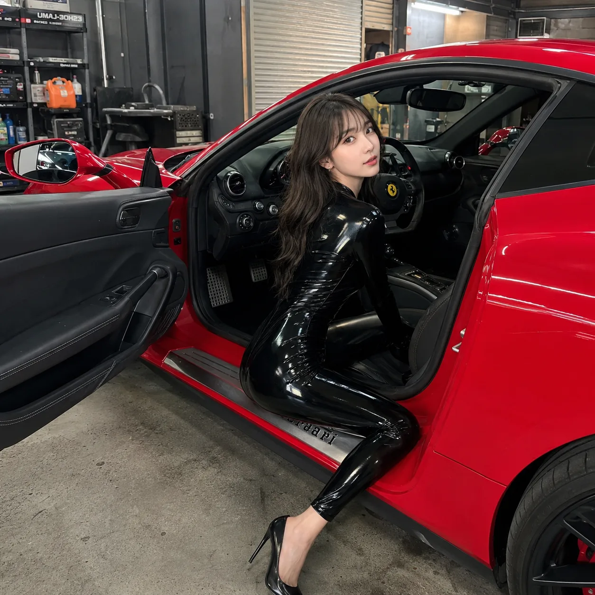

# Realistic, Ai Art

[← Back to the collection](../../README.md) · Category: [UI & Graphic](../../gallery/ui-graphic.md) · Model: `Vinano Studio` · ID: `vn-01673`

<a href="https://vinano.ai?utm_source=github&utm_medium=readme&utm_campaign=awesome-image-video-prompts-updating&utm_content=prompt-page-image"></a>

<sub>Preview generated with <a href="https://vinano.ai?utm_source=github&utm_medium=readme&utm_campaign=awesome-image-video-prompts-updating&utm_content=prompt-page-caption">vinano.ai</a></sub>

## Prompt

```text
{
  "meta": {
    "aspect_ratio": "9:16",
    "quality": "true-to-life photorealistic",
    "resolution": "4k",
    "camera": "Smartphone camera",
    "lens": "Standard lens",
    "style": "Candid garage photography, natural light mixed overhead fluorescent",
    "composition": "Full-body shot of Sakura Miyawaki sitting on the door sill of a red sports car in a garage, looking back at the camera."
  },
  "scene": {
    "location": "Car garage/workshop interior",
    "environment": ["Interior and open door of a red Ferrari", "Concrete floor", "Metal garage door and dark walls", "Workshop equipment and shelving in the background"],
    "time": "Daytime (indoors)",
    "atmosphere": "Casual, industrial, candid"
  },
  "lighting": {
    "type": "Mixed artificial and ambient daylight",
    "source": "Overhead fluorescent shop lights and light from an open garage door",
    "effect": "Functional, even lighting some shadows and highlights on the car and subject."
  },
  "subject": {
    "identity": "Sakura Miyawaki, the Japanese K-pop idol her signature large, deep-set double eyelid eyes, a high straight nasal bridge, and a delicate pointed chin. Her hair is long, wavy dark brown, almost black, styled soft curtain bangs.",
    "body": {
      "pose": "Sitting on the red door sill of the car, body turned towards the interior.",
      "physique": "Slender, athletic hourglass figure elegant proportions"
    },
    "outfit": {
      "clothing": "Glossy black latex bodysuit, black stiletto pumps."
    }
  },
  "realism_focus": {
    "textures": "Wavy hair strands, glossy black latex of bodysuit, leather car interior, metal door sill, rubber tires, concrete floor",
    "imperfections": "Natural creases in clothing, realistic reflections on car paint and interior"
  }
}

Maintain consistent colour harmony and crisp focus across the whole frame.
```

## Try it on vinano.ai

1. Copy the prompt above.
2. Open **[vinano.ai](https://vinano.ai?utm_source=github&utm_medium=readme&utm_campaign=awesome-image-video-prompts-updating&utm_content=prompt-page-try)**, paste it into the image generator and pick a model.
3. Swap any placeholders (brand, product, city, person…) for your own details, then generate.

More prompts like this: [UI & Graphic gallery](../../gallery/ui-graphic.md) · [all categories](../../README.md#contents)
