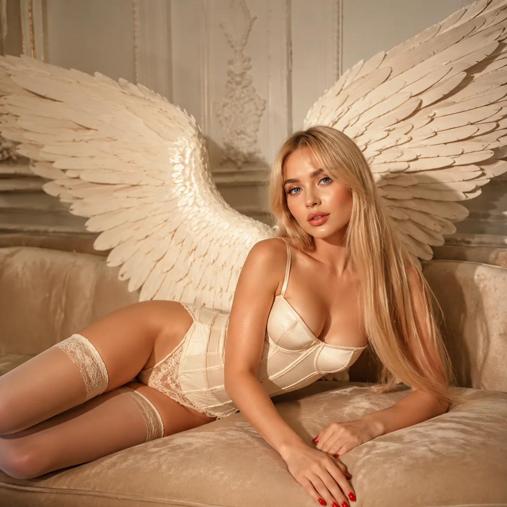

# Realistic, Cinematic

[← Back to the collection](../../README.md) · Category: [UI & Graphic](../../gallery/ui-graphic.md) · Model: `Vinano Studio` · ID: `vn-01684`

<a href="https://vinano.ai?utm_source=github&utm_medium=readme&utm_campaign=awesome-image-video-prompts-updating&utm_content=prompt-page-image"></a>

<sub>Preview generated with <a href="https://vinano.ai?utm_source=github&utm_medium=readme&utm_campaign=awesome-image-video-prompts-updating&utm_content=prompt-page-caption">vinano.ai</a></sub>

## Prompt

```text
{
 "image_generation_prompt": {
 "subject": {
 "description": "Young woman a strong resemblance to Sabrina Carpenter.",
 "hair": "Extra-long, straight, and sleek hair cascading down the shoulders and back, featuring a clean center part and soft silk-like physics.",
 "face": "Enchanting expression large blue eyes, slightly parted lips, and a flawless porcelain skin texture a soft-focus glow.",
 "body": "Slender and toned physique smooth skin, captured in a reclining pose that emphasizes graceful curves."
 },
 "attire": {
 "clothing": "A delicate cream-colored corset bodysuit structured boning and visible stitching, paired matching thin-strap lingerie and sheer thigh-high stockings lace trim.",
 "style": "Ethereal Boudoir / Angelic Fantasy."
 },
 "styling_and_accessories": {
 "jewelry": ["Large architectural white angel wings layered, sculptural feather-like scales",
 "Subtle red manicured nails"]
 },
 "environment": {
 "setting": "An opulent indoor lounge featuring a plush velvet or suede sofa.",
 "background": "An ornate wall classical plaster molding and decorative wainscoting in a warm off-white tone.",
 "water": "None"
 },
 "pose": {
 "posture": "Reclining horizontally on a sofa, propped up slightly by the elbows, creating a dynamic diagonal composition.",
 "arms": "One arm extended forward hands resting gently on the sofa surface, the other tucked slightly behind.",
 "angle": "Eye-level medium shot, focusing on the interplay between the subject and the wings."
 },
 "lighting_and_mood": {
 "lighting": "Warm, directional studio lighting creating a soft spotlight effect on the subject, gentle shadows cast by the wings against the wall.",
 "mood": "Dreamy, angelic, and high-fashion editorial.",
 "colors": "A monochrome-inspired palette of cream, ivory, and beige warm golden undertones."
 },
 "camera_and_technical": {
 "style": "Ultra true-to-life photorealistic, RAW photo.",
 "lens": "35mm wide-angle lens to capture the span of the wings.",
 "aperture": "f/2.0 for a shallow depth of field that keeps the wall texture soft.",
 "quality_tags": ["8k resolution",
 "highly detailed",
 "soft-focus skin",
 "filmic, cinematic lighting",
 "hyper-realistic texture",
 "Vogue editorial style"]
 }
 }
}

Preserve realistic proportions and depth for a confident, professional finish.
```

## Try it on vinano.ai

1. Copy the prompt above.
2. Open **[vinano.ai](https://vinano.ai?utm_source=github&utm_medium=readme&utm_campaign=awesome-image-video-prompts-updating&utm_content=prompt-page-try)**, paste it into the image generator and pick a model.
3. Swap any placeholders (brand, product, city, person…) for your own details, then generate.

More prompts like this: [UI & Graphic gallery](../../gallery/ui-graphic.md) · [all categories](../../README.md#contents)
