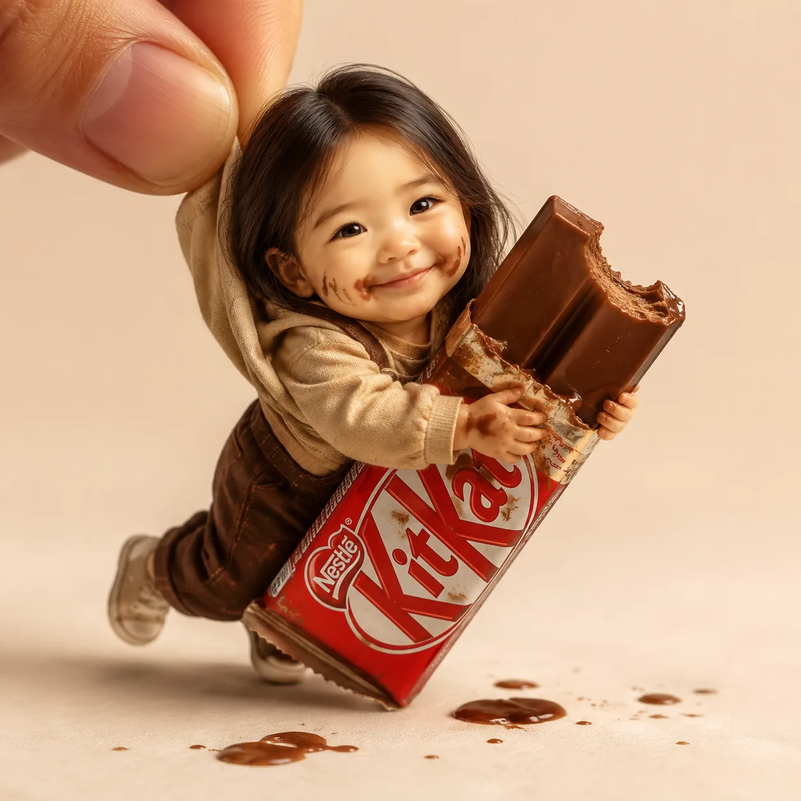

# Realistic, Minimalist

[← Back to the collection](../../README.md) · Category: [UI & Graphic](../../gallery/ui-graphic.md) · Model: `Vinano Studio` · ID: `vn-01692`

<a href="https://vinano.ai?utm_source=github&utm_medium=readme&utm_campaign=awesome-image-video-prompts-updating&utm_content=prompt-page-image"></a>

<sub>Preview generated with <a href="https://vinano.ai?utm_source=github&utm_medium=readme&utm_campaign=awesome-image-video-prompts-updating&utm_content=prompt-page-caption">vinano.ai</a></sub>

## Prompt

```text
Use the uploaded photo as the sole reference for identity. Maintain maximum facial resemblance, preserving facial features, proportions, expression, hairstyle, skin tone, and natural asymmetries extreme accuracy.
Create an adorable handmade premium collectible male doll a slightly oversized head, a small slender body, soft felt and fabric textures, realistic 3D facial details, lifelike glass eyes, and handcrafted stitching. The tiny doll tightly hugs a giant KitKat bar almost as large as himself, several bite marks already taken from it.
He wears a playful, satisfied smile chocolate smudges around his lips, cheeks, and fingertips. A few drops of melted chocolate are scattered on the floor beneath him. A giant human finger gently lifts him by the back of his shirt collar, but he stubbornly refuses to let go of the KitKat, creating a humorous and adorable scene.
Emphasize dramatic size contrast, warm bright lighting, a clean refined minimalist background, premium diorama craftsmanship, macro photography, shallow depth of field, ultra-realistic textures, and exceptional facial fidelity to the uploaded reference photo.She smiles proudly, traces of chocolate on her mouth, cheeks, and hands. A few drops of melted chocolate lie on the floor. A giant human finger gently lifts her by the back of her collar while she refuses to let go of the feasible Chocolate Strong scale contrast; warm, bright, clean atmosphere; refined minimalist background; premium diorama macro photography; soft depth of field; professional photographic quality; and extreme facial fidelity to the original photo

Keep edges clean and the overall composition balanced for a polished, gallery-ready result.
```

## Try it on vinano.ai

1. Copy the prompt above.
2. Open **[vinano.ai](https://vinano.ai?utm_source=github&utm_medium=readme&utm_campaign=awesome-image-video-prompts-updating&utm_content=prompt-page-try)**, paste it into the image generator and pick a model.
3. Swap any placeholders (brand, product, city, person…) for your own details, then generate.

More prompts like this: [UI & Graphic gallery](../../gallery/ui-graphic.md) · [all categories](../../README.md#contents)
