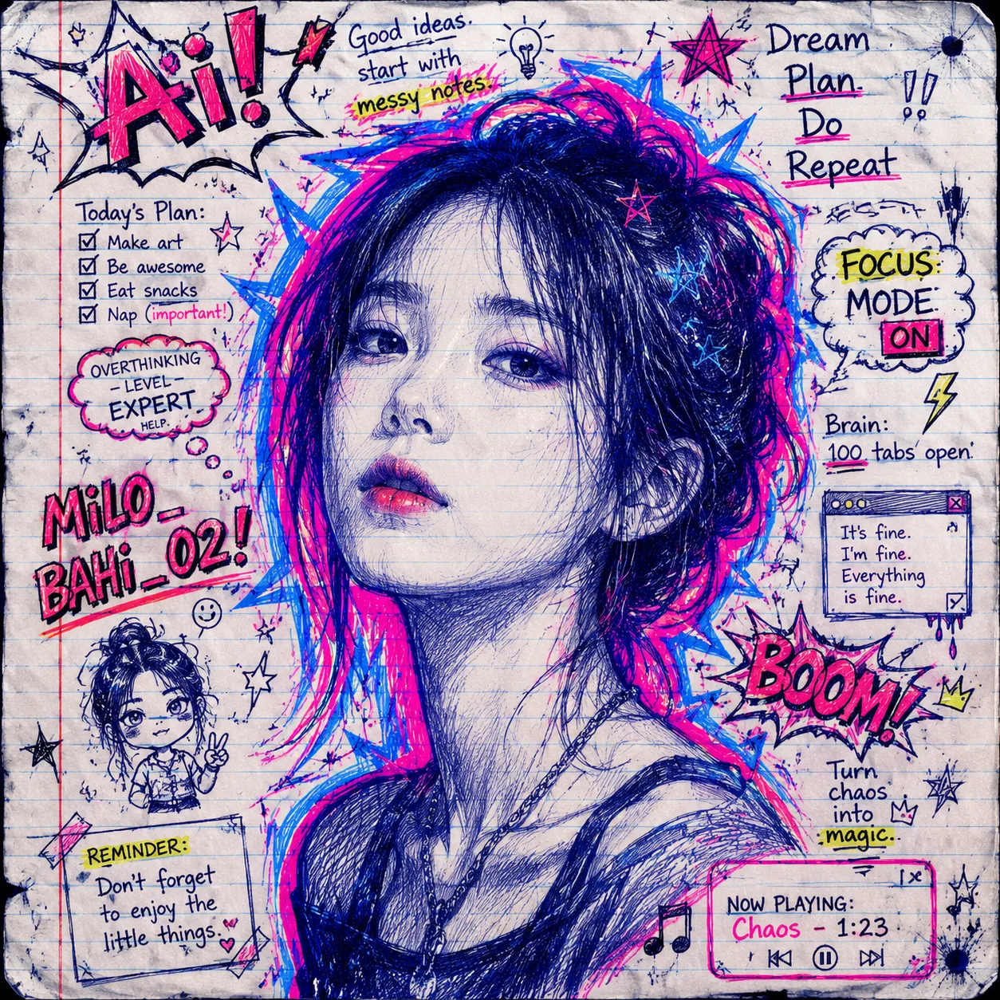

# Realistic, Portrait

[← Back to the collection](../../README.md) · Category: [UI & Graphic](../../gallery/ui-graphic.md) · Model: `Vinano Studio` · ID: `vn-01710`

<a href="https://vinano.ai?utm_source=github&utm_medium=readme&utm_campaign=awesome-image-video-prompts-updating&utm_content=prompt-page-image"></a>

<sub>Preview generated with <a href="https://vinano.ai?utm_source=github&utm_medium=readme&utm_campaign=awesome-image-video-prompts-updating&utm_content=prompt-page-caption">vinano.ai</a></sub>

## Prompt

```text
Use the uploaded image as an img-to-img reference, preserving full facial likeness and identity, and create artwork that appears drawn on lined notebook paper ballpoint pen, ink, and neon markers, showing realistic ink absorption, layered pressure, smudges, stains, wrinkles, and worn edges. The style blends chaotic doodle art, comic annotations, and rough sketches thick-thin line variation, loose strokes, messy marks, dynamic hatching, and an energetic, spontaneous, slightly chaotic mood, rendered in high detail at 4k bold outer glow lighting and vibrant contrast. Use a portrait composition a thick border around the head, surrounding the subject arrows, stars, underlines, scribbles, speech bubbles, overlapping notes, checkboxes, playful icons (lightning bolts, lightbulbs, music notes, a small self-caricature), and handwritten comic sound effects like “Ai!” and “MiLO_BAHi_02!”. Apply one style variation: Pop Bold (cyan and magenta), Neon Highlight (neon pink and yellow highlighter look), Electric Graffiti (electric blue and neon red graffiti outlines), or Dense Sketch (blue linework red accents, dense and alive). Render with rich micro-detail while keeping the layout uncluttered and intentional.
```

## Try it on vinano.ai

1. Copy the prompt above.
2. Open **[vinano.ai](https://vinano.ai?utm_source=github&utm_medium=readme&utm_campaign=awesome-image-video-prompts-updating&utm_content=prompt-page-try)**, paste it into the image generator and pick a model.
3. Swap any placeholders (brand, product, city, person…) for your own details, then generate.

More prompts like this: [UI & Graphic gallery](../../gallery/ui-graphic.md) · [all categories](../../README.md#contents)
