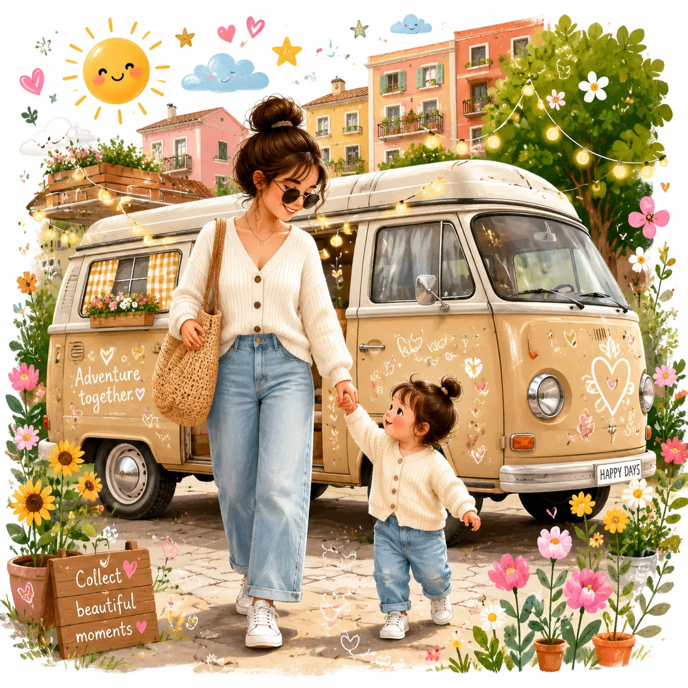

# Realistic, Character

[← Back to the collection](../../README.md) · Category: [UI & Graphic](../../gallery/ui-graphic.md) · Model: `Vinano Studio` · ID: `vn-01736`

<a href="https://vinano.ai?utm_source=github&utm_medium=readme&utm_campaign=awesome-image-video-prompts-updating&utm_content=prompt-page-image"></a>

<sub>Preview generated with <a href="https://vinano.ai?utm_source=github&utm_medium=readme&utm_campaign=awesome-image-video-prompts-updating&utm_content=prompt-page-caption">vinano.ai</a></sub>

## Prompt

```text
Turn my uploaded photo into a heartwarming whimsical children’s storybook illustration. A young mother holding her toddler’s hand beside a vintage beige camper van in a cozy urban neighborhood. Transform the realistic photo into a colorful hand-drawn artwork soft pastel tones, playful doodles, smiling sun, fluffy clouds, flowers, stars, hearts, cute plants, and string lights. Bright apartment buildings in the background reimagined in a cheerful cartoon style. Keep the characters’ pose, clothing, and interaction faithful to the original photo while adding charming storybook details and a warm family atmosphere.

Style: modern children’s book illustration, kawaii aesthetic, hand-painted digital art, vibrant colors, textured brush strokes, clean outlines, adorable character design, whimsical environment, cozy neighborhood vibes, highly detailed, magical everyday life, storybook cover quality.

Composition: full-body mother and child in the center, camper van behind them, colorful flowers and doodles surrounding the scene, balanced layout, white background decorative elements, cute and uplifting mood.

Lighting: soft daylight, warm highlights, dreamy glow, gentle shadows.

Quality: masterpiece, ultra detailed, charming illustration, high resolution, professional children’s book artwork, joyful and nostalgic feeling.

Maintain consistent colour harmony and crisp focus across the whole frame.
```

## Try it on vinano.ai

1. Copy the prompt above.
2. Open **[vinano.ai](https://vinano.ai?utm_source=github&utm_medium=readme&utm_campaign=awesome-image-video-prompts-updating&utm_content=prompt-page-try)**, paste it into the image generator and pick a model.
3. Swap any placeholders (brand, product, city, person…) for your own details, then generate.

More prompts like this: [UI & Graphic gallery](../../gallery/ui-graphic.md) · [all categories](../../README.md#contents)
