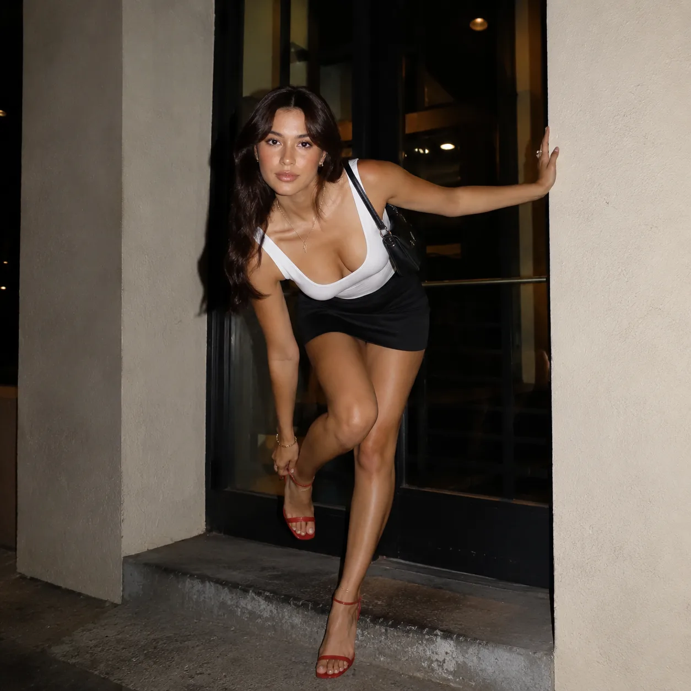

# Portrait, Character

[← Back to the collection](../../README.md) · Category: [UI & Graphic](../../gallery/ui-graphic.md) · Model: `Vinano Studio` · ID: `vn-01739`

<a href="https://vinano.ai?utm_source=github&utm_medium=readme&utm_campaign=awesome-image-video-prompts-updating&utm_content=prompt-page-image"></a>

<sub>Preview generated with <a href="https://vinano.ai?utm_source=github&utm_medium=readme&utm_campaign=awesome-image-video-prompts-updating&utm_content=prompt-page-caption">vinano.ai</a></sub>

## Prompt

```text
{
 "character_identity": {
 "name_placeholder": "YOUR_CHARACTER",
 "gender_presentation": "female",
 "age_range": "custom based on reference image",
 "ethnicity_placeholder": "auto-detected from reference image",
 "body_type": "auto-detected from reference image",
 "skin_tone": "sampled from reference image",
 "facial_structure": "auto-detected from reference image",
 "reference_image": "URL or local path to your character reference"
 },

 "hair": {
 "color": "sampled from reference image",
 "length": "sampled from reference image",
 "style": "sampled from reference image",
 "parting": "sampled from reference image",
 "volume": "sampled from reference image",
 "movement": "sampled from reference image"
 },

 "accessories": {
 "earrings": "small gold hoop earrings",
 "necklace": "thin gold chain small cross pendant",
 "bracelet": "minimal gold bracelet",
 "anklet": "thin gold anklet",
 "rings": "minimal gold rings",
 "bag": {
 "type": "small shoulder bag",
 "color": "black",
 "strap": "thin strap",
 "position": "resting on shoulder behind arm"
 }
 },

 "makeup": {
 "style": "natural glam",
 "skin": "dewy skin finish",
 "eyes": "soft eyeliner, subtle mascara",
 "brows": "natural full brows",
 "lips": "neutral pink glossy lips",
 "blush": "soft peach blush"
 },

 "gaze": {
 "direction": "directly toward camera",
 "expression": "neutral confident expression",
 "eye_intensity": "soft but engaging",
 "head_position": "slightly tilted forward"
 },

 "mood": {
 "vibe": "casual nightlife fashion photo",
 "energy": "confident, spontaneous",
 "atmosphere": "urban evening aesthetic",
 "tone": "stylish candid moment"
 },

 "outfit": {
 "top": {
 "type": "low scoop neck tank top",
 "color": "white",
 "fit": "tight fitted",
 "fabric": "stretch cotton"
 },
 "bottom": {
 "type": "mini skirt",
 "color": "black",
 "fit": "high waist fitted"
 },
 "shoes": {
 "type": "strappy heeled sandals",
 "color": "red",
 "heel_height": "medium",
 "style": "minimal straps"
 }
 },

 "pose": {
 "body_position": "stepping out of a doorway onto a small concrete step",
 "left_arm": "extended outward touching the wall for balance",
 "right_arm": "reaching down toward ankle as if adjusting shoe",
 "left_leg": "supporting body weight on step",
 "right_leg": "slightly lifted forward",
 "torso": "leaning forward slightly",
 "shoulders": "angled slightly toward camera"
 },

 "posture": {
 "balance": "casual off-balance step",
 "spine": "slightly bent forward",
 "hips": "angled",
 "stance": "dynamic mid-movement pose"
 },

 "camera": {
 "angle": "slightly low eye-level perspective",
 "framing": "full body portrait",
 "distance": "about 1.5–2 meters from subject",
 "lens": "35mm street photography lens",
 "focus": "sharp focus on subject",
 "depth_of_field": "moderate background blur"
 },

 "lighting": {
 "type": "direct flash photography",
 "style": "nighttime flash aesthetic",
 "shadow": "hard shadows behind subject",
 "color_temperature": "neutral flash white",
 "contrast": "high contrast"
 },

 "background": {
 "location": "apartment building entrance",
 "door": "black metal framed glass door",
 "walls": "light beige textured walls",
 "floor": "concrete step",
 "environment": "urban nighttime exterior",
 "background_details": "dim city lights faintly visible"
 },

 "composition": {
 "subject_position": "center frame slightly leaning left",
 "leading_lines": "door frame and wall edges guiding toward subject",
 "crop": "full body including feet",
 "orientation": "vertical portrait"
 },

 "photography_style": {
 "genre": "street style fashion photography",
 "camera_style": "paparazzi / candid flash look",
 }

Aim for an editorial, design-driven look with deliberate negative space.
```

## Try it on vinano.ai

1. Copy the prompt above.
2. Open **[vinano.ai](https://vinano.ai?utm_source=github&utm_medium=readme&utm_campaign=awesome-image-video-prompts-updating&utm_content=prompt-page-try)**, paste it into the image generator and pick a model.
3. Swap any placeholders (brand, product, city, person…) for your own details, then generate.

More prompts like this: [UI & Graphic gallery](../../gallery/ui-graphic.md) · [all categories](../../README.md#contents)
