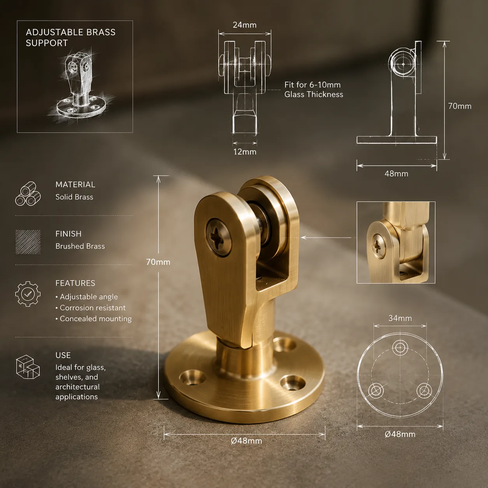

# Realistic, Infographic

[← Back to the collection](../../README.md) · Category: [UI & Graphic](../../gallery/ui-graphic.md) · Model: `Vinano Studio` · ID: `vn-01741`

<a href="https://vinano.ai?utm_source=github&utm_medium=readme&utm_campaign=awesome-image-video-prompts-updating&utm_content=prompt-page-image"></a>

<sub>Preview generated with <a href="https://vinano.ai?utm_source=github&utm_medium=readme&utm_campaign=awesome-image-video-prompts-updating&utm_content=prompt-page-caption">vinano.ai</a></sub>

## Prompt

```text
Premium technical infographic of [OBJECT]. Use the reference image only to understand the shape and structure of the object, without copying the same photo, angle, composition, or background. Reinterpret the subject in a new professional and realistic photograph, clean and well-lit, a suitable and more aesthetic background. Keep the object as a real photo, not an illustration. Add a technical blueprint-style overlay white lines, arrows, dimensions, labels, and small diagrams of parts, materials, measurements, and functionality. Clear, elegant, and informative composition. Include a sketch box in the upper left corner the title “OBJECT”. 4:5 Dimension. Maintain consistent colour harmony and crisp focus across the whole frame.
```

## Try it on vinano.ai

1. Copy the prompt above.
2. Open **[vinano.ai](https://vinano.ai?utm_source=github&utm_medium=readme&utm_campaign=awesome-image-video-prompts-updating&utm_content=prompt-page-try)**, paste it into the image generator and pick a model.
3. Swap any placeholders (brand, product, city, person…) for your own details, then generate.

More prompts like this: [UI & Graphic gallery](../../gallery/ui-graphic.md) · [all categories](../../README.md#contents)
