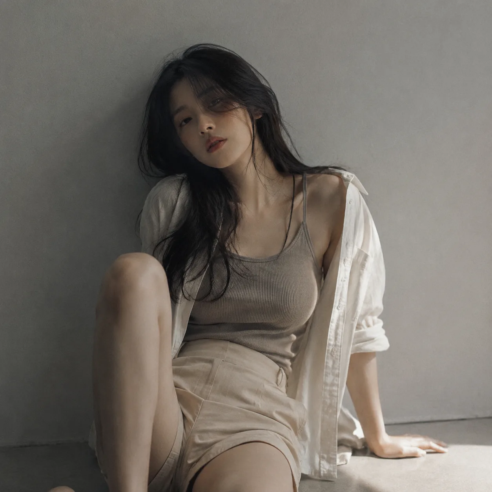

# Realistic, Portrait

[← Back to the collection](../../README.md) · Category: [UI & Graphic](../../gallery/ui-graphic.md) · Model: `Vinano Studio` · ID: `vn-01745`

<a href="https://vinano.ai?utm_source=github&utm_medium=readme&utm_campaign=awesome-image-video-prompts-updating&utm_content=prompt-page-image"></a>

<sub>Preview generated with <a href="https://vinano.ai?utm_source=github&utm_medium=readme&utm_campaign=awesome-image-video-prompts-updating&utm_content=prompt-page-caption">vinano.ai</a></sub>

## Prompt

```text
9:16 vertical — editorial portrait, single subject soft black mist filter, subtle haze, gentle highlight bloom, muted tones minimal indoor space, clean background, slight texture young Korean woman, minimal makeup, natural skin texture outfit: fitted ribbed knit top or soft camisole layered under a loose shirt, paired high-waisted shorts or skirt; fabric slightly clings to body shape, soft and natural, no revealing elements hair: slightly messy, natural volume pose: sitting on floor one leg bent and the other relaxed, body slightly leaning, shoulders not aligned, head tilted composition: subject slightly off-center, negative space present expression: calm, slightly distant, natural lips lighting: soft side light, gentle shadow falloff mood: understated, quiet, subtly sensual through natural body lines, relaxed and unposed quality: fine grain, slight softness, realistic look Aim for an editorial, design-driven look with deliberate negative space.
```

## Try it on vinano.ai

1. Copy the prompt above.
2. Open **[vinano.ai](https://vinano.ai?utm_source=github&utm_medium=readme&utm_campaign=awesome-image-video-prompts-updating&utm_content=prompt-page-try)**, paste it into the image generator and pick a model.
3. Swap any placeholders (brand, product, city, person…) for your own details, then generate.

More prompts like this: [UI & Graphic gallery](../../gallery/ui-graphic.md) · [all categories](../../README.md#contents)
