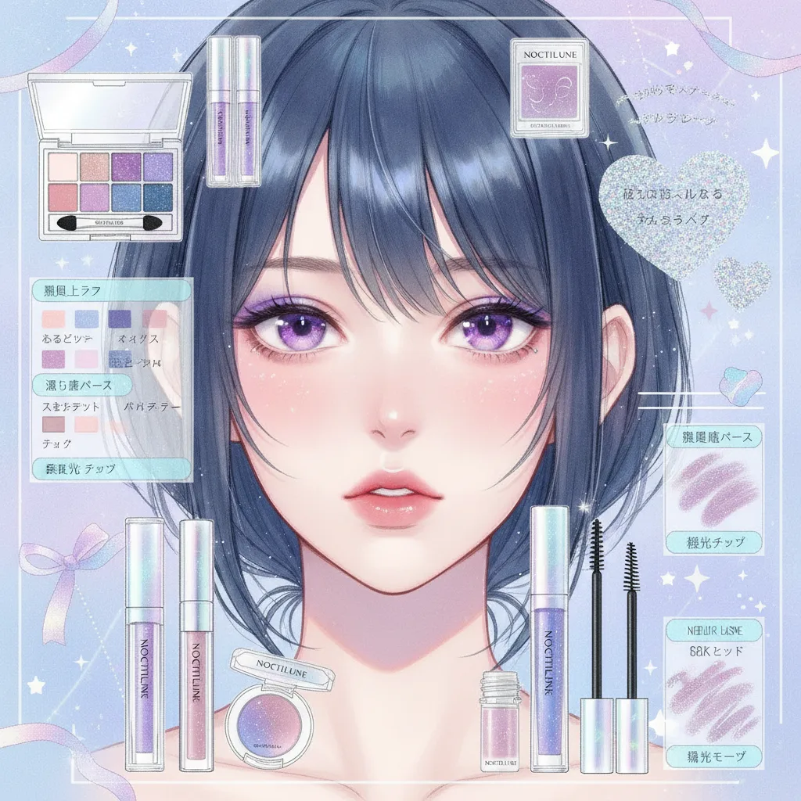

# Anime, Infographic

[← Back to the collection](../../README.md) · Category: [UI & Graphic](../../gallery/ui-graphic.md) · Model: `Vinano Image` · ID: `vn-01748`

<a href="https://vinano.ai?utm_source=github&utm_medium=readme&utm_campaign=awesome-image-video-prompts-updating&utm_content=prompt-page-image"></a>

<sub>Preview generated with <a href="https://vinano.ai?utm_source=github&utm_medium=readme&utm_campaign=awesome-image-video-prompts-updating&utm_content=prompt-page-caption">vinano.ai</a></sub>

## Prompt

```text
アップロードされた画像のキャラクターを解析し、
そのキャラクターの魅力・世界観・人格性・空気感を最大限に引き出す、
超高密度な「架空コスメブランド広告 × メイクレシピポスター」を制作する。

━━━━━━━━━━━━━━━━━━
【最重要ルール】
━━━━━━━━━━━━━━━━━━

アップロード画像の元イラストの絵柄を絶対維持。

・線画
・塗り
・ブラシ感
・アニメ塗り
・厚塗り感
・彩度設計
・影色
・発光感
・空気感
・キャラクターデザイン
を忠実保持する。

別絵柄化禁止。
リアル化禁止。
3D化禁止。
AI特有の別人化禁止。
顔立ち改変禁止。

メイクは、
「元からそのキャラクターがしていた」
ように自然に統合。

キャラクター本人だと一目で分かる状態を維持。

━━━━━━━━━━━━━━━━━━
【タイトル生成ルール】
━━━━━━━━━━━━━━━━━━

タイトルは毎回完全新規生成。

「◯◯の作り方」を、
量産型メイクタイトルにしない。

禁止：
・透明感少女
・儚げ
・純欲
・天使系
・色素薄い
などのテンプレ化。

AIはキャラクターを解析し、
その存在概念・人格・記憶・都市感・時間帯・感情・音楽性・夢・ノイズ・温度感・退廃感・幻想性から、
毎回オリジナルタイトルを生成。

タイトルは
“メイクジャンル”
ではなく、
“キャラクターを表すアートタイトル”
として設計。

例：
・「午前4時の雨色ドールの作り方」
・「終電逃避行メイク」
・「深海アイドルフェイス設計図」
・「観測不能ヒロイン化計画」
・「微熱銀河メイク」
・「ネオン睡眠不足フェイス」
・「放課後エラーメイク」
・「月光ノイズ肌」
・「重力反抗型ドールフェイス」
など。

毎回違う雑誌特集のように。

━━━━━━━━━━━━━━━━━━
【メイク設計】
━━━━━━━━━━━━━━━━━━

AIがキャラクターを解析し、

・顔立ち
・瞳色
・目の形
・髪色
・髪質
・肌色
・骨格印象
・服装
・世界観
・性格性
・感情
・配色
を分析。

その結果から、
最も魅力を引き出す専用メイクを設計。

重要：
キャラクター本人に、
実際に完成後メイクを施した状態で描写する。

メイクは自然に馴染ませる。

例えば：
・瞳色と連動したアイシャドウ
・髪色と調和するチーク
・性格性と一致するリップ質感
・世界観に合うラメ粒子
・服装とリンクした彩度
・空気感と一致する艶感

など。

過剰加工ではなく、
“キャラクター性を増幅する”
方向でメイクする。

━━━━━━━━━━━━━━━━━━
【コスメと完成メイクの整合性】
━━━━━━━━━━━━━━━━━━

画面内に配置される全てのコスメと、
キャラクターに施された完成メイクの

・色
・発色
・ラメ感
・質感
・艶感
・濃度
・粉感
・透明感

を完全一致させる。

「本当にこのコスメを使ってこの顔が完成した」
という説得力を持たせる。

コスメは装飾ではなく、
完成メイクの使用実績として配置。

各コスメには、
どこに使われているかを明示。

例：
・涙袋使用色
・黒目上ラメ
・粘膜ライン
・鼻先チーク
・透明感ベース
・束感トップコート
など。

━━━━━━━━━━━━━━━━━━
【実在ブランド禁止】
━━━━━━━━━━━━━━━━━━

絶対に実在ブランドを使用しない。

禁止：
・実在ブランド名
・既存商品名
・既存パッケージ
・既存ロゴ
・既存UI
・既存広告デザイン
・既存フォント構成
・既存コスメ意匠

全て完全オリジナル。

架空ブランドのみ使用。

未来的・幻想的・透明感ある、
次世代アジアンビューティーブランドとして設計。

ブランド例：
・LUNEAIR
・VELYSS
・NOCTILUNE
・GLASYN
・ÉTOIRIA
など、
完全架空ネーミング。

━━━━━━━━━━━━━━━━━━
【ビジュアル構成】
━━━━━━━━━━━━━━━━━━

構図は、

・ファッション誌風メイクレシピ
・SNS保存特化型美容投稿
・未来的コスメ広告
・日本の美容雑誌
・韓国広告ビジュアル
を融合。

画面中央：
キャラクターの超接写ポートレート。

周囲：
大量のコスメ、
スウォッチ、
メイク工程、
使用箇所説明、
ラベル、
透明UI、
図解要素。

情報量は極めて多い。

しかし広告デザインとして完璧整理。

視線誘導設計済み。

━━━━━━━━━━━━━━━━━━
【コスメデザイン】
━━━━━━━━━━━━━━━━━━

コスメは超高級感。

素材：
・透明アクリル
・ガラス
・偏光樹脂
・半透明ケース
・箔押し
・グロス加工
・ラメ加工
・パール加工

アイテム：
・アイシャドウ
・チーク
・リップ
・グロス
・ライナー
・マスカラ
・パウダー
・コンシーラー
・ハイライト
・ビューラー
・カラコン
など。

━━━━━━━━━━━━━━━━━━
【ラベルデザイン】
━━━━━━━━━━━━━━━━━━

日本語ラベル付き。

デザイン：
・水色ラベル
・ピンクラベル
・白縁
・角丸
・細ゴシック
・手書き文字混在

例：
・「黒目上ラメ」
・「うるみ粘膜色」
・「透明感ベース」
・「微熱チーク」
・「儚光モーヴ」
など。

━━━━━━━━━━━━━━━━━━
【ライティング】
━━━━━━━━━━━━━━━━━━

柔らかい拡散光。

巨大ソフトボックス。

白飛び寸前の高キー。

イラスト本来の色設計を壊さない。

自然な発光感。

━━━━━━━━━━━━━━━━━━
【質感描写】
━━━━━━━━━━━━━━━━━━

超高密度描写：

・束感まつ毛
・瞳の水分感
・虹彩反射
・繊細ラメ
・粉体粒子
・グロス反射
・透明肌
・産毛
・髪の細毛
・ガラス反射
・コスメ表面の微細傷
・使用感
まで描写。

━━━━━━━━━━━━━━━━━━
【背景】
━━━━━━━━━━━━━━━━━━

淡色グラデーション背景。

ハート、
星、
リボン、
透明UI、
グリッター、
コスメスウォッチを自然配置。

━━━━━━━━━━━━━━━━━━
【品質】
━━━━━━━━━━━━━━━━━━

SNSで圧倒的に保存される完成度。

実在する最高峰ビューティー広告レベル。

hyper detailed.
masterpiece.
preserve original anime art style.
maintain original lineart and coloring.
natural integrated makeup.
fictional cosmetics campaign.
dreamy translucent atmosphere.
high density beauty infographic.
Japanese beauty editorial aesthetic.
Asian futuristic cosmetic advertisement.
extremely detailed.
8K.

保持真实比例与空间层次，呈现专业、稳重的最终效果。
```

## Try it on vinano.ai

1. Copy the prompt above.
2. Open **[vinano.ai](https://vinano.ai?utm_source=github&utm_medium=readme&utm_campaign=awesome-image-video-prompts-updating&utm_content=prompt-page-try)**, paste it into the image generator and pick a model.
3. Swap any placeholders (brand, product, city, person…) for your own details, then generate.

More prompts like this: [UI & Graphic gallery](../../gallery/ui-graphic.md) · [all categories](../../README.md#contents)
