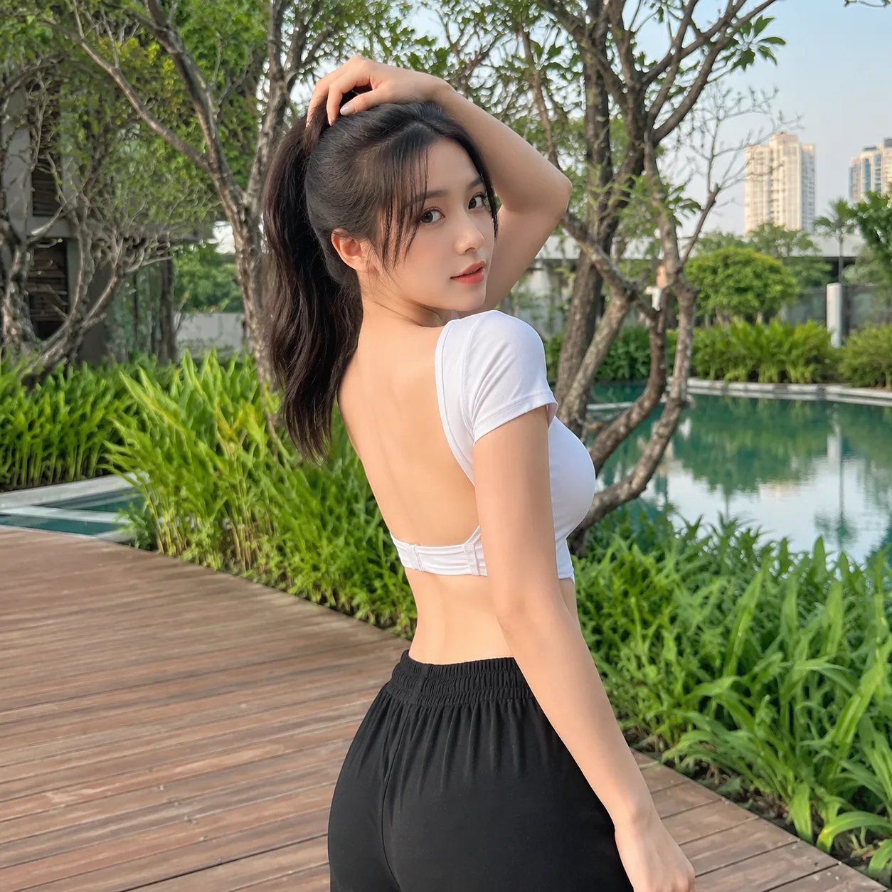

# Realistic, Landscape

[← Back to the collection](../../README.md) · Category: [UI & Graphic](../../gallery/ui-graphic.md) · Model: `Vinano Studio` · ID: `vn-01756`

<a href="https://vinano.ai?utm_source=github&utm_medium=readme&utm_campaign=awesome-image-video-prompts-updating&utm_content=prompt-page-image"></a>

<sub>Preview generated with <a href="https://vinano.ai?utm_source=github&utm_medium=readme&utm_campaign=awesome-image-video-prompts-updating&utm_content=prompt-page-caption">vinano.ai</a></sub>

## Prompt

```text
{
 "image_generation_prompt": {
 "style": "Hyper-realistic photograph",
 "subject": {
 "demographic": "Young woman",
 "pose": {
 "angle": "Slightly rear three-quarter angle",
 "posture": "Gracefully turning upper body and head toward camera, natural S-curve",
 "arms": "One arm raised gently holding hair, other arm resting naturally by side",
 "vibe": "Candid, effortless"
 },
 "face_and_identity": {
 "constraint": "Use uploaded photo as exact and only reference",
 "preservation": "100% facial structure, bone proportions, eyes, nose, lips, skin texture, natural asymmetry",
 "prohibitions": "No alterations, filters, or stylization",
 "expression": "Calm, subtly confident, slightly curious"
 },
 "hair": "Dark, straight, silky, tied in mid-height ponytail loose front strands framing face",
 "outfit": {
 "top": "Fitted white backless crop top short sleeves",
 "bottom": "Loose-fitting black pants sitting comfortably at the waist",
 "contrast": "Clean black-and-white"
 }
 },
 "environment": {
 "location": "Outdoors on a wooden deck beside a modern landscaped swimming pool",
 "elements": ["Lush green plants",
 "Small trees",
 "Calm reflective water",
 "Contemporary buildings faintly visible in distance"]
 },
 "technical_details": {
 "lighting": "Natural soft daylight (late afternoon), even illumination, gentle highlights on cheekbones/shoulders/back, soft diffused light, no harsh shadows",
 "colors": "Fresh natural palette, greens, soft blues, warm wood tones, neutral clothing",
 "mood": "Serene, stylish, lifestyle-oriented, peaceful, effortlessly fashionable",
 "focus": "Natural anatomy, realistic skin texture, subtle highlights/reflections, photographic depth-of-field (editorial feel)"
 },
 "full_prompt_text": "A hyper-realistic photograph of a young woman standing outdoors on a wooden deck beside a modern landscaped swimming pool. Lush green plants, small trees, and calm reflective water surround her, contemporary buildings faintly visible in the distance. She is captured from a slightly rear three-quarter angle, gracefully turning her upper body and head toward the camera, forming a natural S-curve in her posture. One arm is raised above her head, gently holding her hair, while the other arm rests naturally by her side, giving a candid, effortless feel. Face & Identity: Use the uploaded photo as the exact and only reference. Preserve the face 100%: facial structure, bone proportions, eyes, nose, lips, skin texture, and natural asymmetry. No alterations, filters, or stylization. Expression must remain calm, subtly confident, and slightly curious. Hair & Outfit: Dark, straight, silky hair tied in a mid-height ponytail, loose front strands framing her face. She wears a fitted white backless crop top short sleeves exposing her shoulders and upper back, paired loose-fitting black pants sitting comfortably at the waist. Lighting & Mood: Natural soft daylight, likely late afternoon, evenly illuminating skin and clothing. Gentle highlights accentuate cheekbones, shoulder, and back. Soft, diffused lighting ensures no harsh shadows. Colors & Atmosphere: Fresh, natural palette dominated by greens, soft blues, warm wood tones, and neutral clothing colors. The mood is serene, stylish, and lifestyle-oriented. Extra: Focus on natural anatomy, realistic skin texture, and photographic depth-of-field."
 }
}

Render with rich micro-detail while keeping the layout uncluttered and intentional.
```

## Try it on vinano.ai

1. Copy the prompt above.
2. Open **[vinano.ai](https://vinano.ai?utm_source=github&utm_medium=readme&utm_campaign=awesome-image-video-prompts-updating&utm_content=prompt-page-try)**, paste it into the image generator and pick a model.
3. Swap any placeholders (brand, product, city, person…) for your own details, then generate.

More prompts like this: [UI & Graphic gallery](../../gallery/ui-graphic.md) · [all categories](../../README.md#contents)
