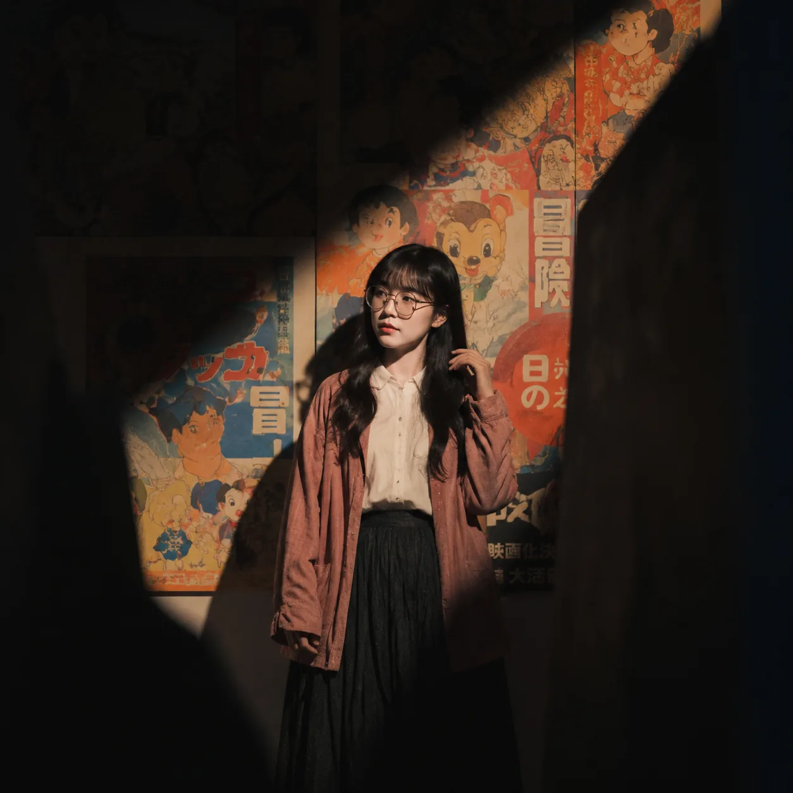

# Anime, Realistic

[← Back to the collection](../../README.md) · Category: [UI & Graphic](../../gallery/ui-graphic.md) · Model: `Vinano Studio` · ID: `vn-01757`

<a href="https://vinano.ai?utm_source=github&utm_medium=readme&utm_campaign=awesome-image-video-prompts-updating&utm_content=prompt-page-image"></a>

<sub>Preview generated with <a href="https://vinano.ai?utm_source=github&utm_medium=readme&utm_campaign=awesome-image-video-prompts-updating&utm_content=prompt-page-caption">vinano.ai</a></sub>

## Prompt

```text
Use my reference photo to preserve the exact facial features, hairstyle, bangs, facial proportions, skin tone, body posture, and overall silhouette high identity consistency.

Cinematic portrait of a woman standing alone inside a dark exhibition room. She wears a vintage white shirt layered a soft pink outer jacket and a black vintage-textured skirt. Minimal makeup. Front-profile pose her body facing the camera, relaxed posture, one shoulder slightly lowered, hands gently adjusting her hair. Calm, mysterious expression an intellectual and elegant aura.

She is positioned in the lower center of the frame, surrounded by darkness. A single dramatic diagonal spotlight cuts across the scene from the upper right to the lower left, illuminating only half of her body while the rest fades into shadow. Behind her is a colorful vintage Japanese mural wall filled retro cartoon illustrations and traditional artistic details.

Foreground shadows naturally frame the composition like torn darkness, creating a moody museum atmosphere lonely artistic energy and a contemplative cinematic mood. Realistic photography subtle film grain, analog texture, muted blacks, and vibrant mural accents.

Camera angle: eye-level shot, medium-close portrait framing, subject captured at approximately a 70-degree side profile angle, slight distance from the subject for environmental storytelling, centered cinematic composition.

Camera settings: cinematic low-light photography, shallow depth of field, realistic shadow falloff, Kodak Portra film color grading.

Lighting: harsh focused spotlight from the upper right creating a strong diagonal beam and deep high-contrast shadows, minimal ambient light, rich blacks, soft warm highlights along the face and glasses edges.

Vibe: mysterious, artistic, museum-core aesthetic, intelligent quiet energy, melancholic cinematic atmosphere, indie film still, luxury editorial photography, solitary nighttime mood, understated elegance.

Style: ultra-realistic cinematic photography, analog grain, editorial fashion portrait, natural skin texture, subtle imperfections, realistic color science, masterpiece quality.

Negative prompt: anime, smiling, overexposed lighting, extra limbs, bad anatomy, overly colorful outfit, cyberpunk neon, blurry face, low quality, distorted hands, unrealistic skin, HDR overload, exaggerated makeup, busy composition, duplicate person.

Maintain consistent colour harmony and crisp focus across the whole frame.
```

## Try it on vinano.ai

1. Copy the prompt above.
2. Open **[vinano.ai](https://vinano.ai?utm_source=github&utm_medium=readme&utm_campaign=awesome-image-video-prompts-updating&utm_content=prompt-page-try)**, paste it into the image generator and pick a model.
3. Swap any placeholders (brand, product, city, person…) for your own details, then generate.

More prompts like this: [UI & Graphic gallery](../../gallery/ui-graphic.md) · [all categories](../../README.md#contents)
