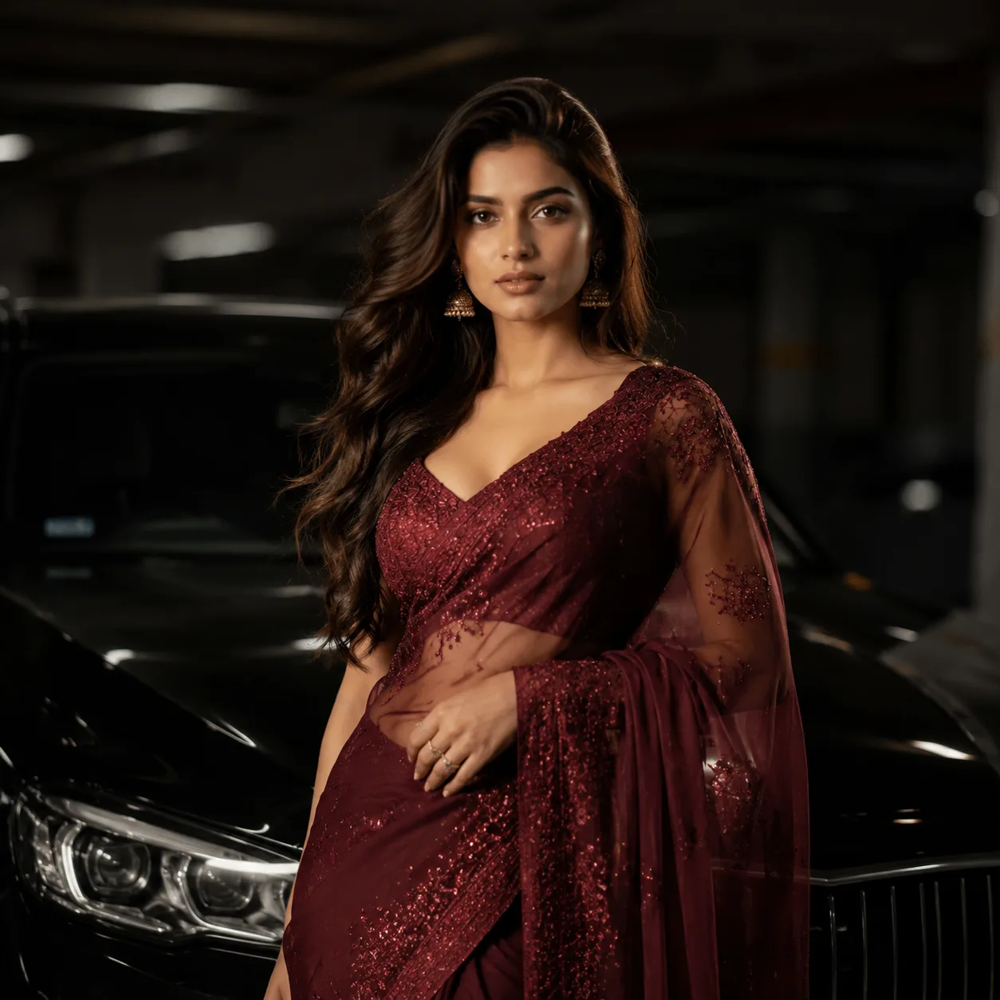

# Realistic, Portrait

[← Back to the collection](../../README.md) · Category: [UI & Graphic](../../gallery/ui-graphic.md) · Model: `Vinano Studio` · ID: `vn-01761`

<a href="https://vinano.ai?utm_source=github&utm_medium=readme&utm_campaign=awesome-image-video-prompts-updating&utm_content=prompt-page-image"></a>

<sub>Preview generated with <a href="https://vinano.ai?utm_source=github&utm_medium=readme&utm_campaign=awesome-image-video-prompts-updating&utm_content=prompt-page-caption">vinano.ai</a></sub>

## Prompt

```text
{
 "image_generation_prompt": {
 "style": "Ultra-realistic cinematic fashion photography",
 "subject": {
 "type": "Female model",
 "pose": "Standing confidently, slight body angle, direct eye contact camera",
 "expression": "Calm, elegant, confident",
 "appearance": {
 "skin_tone": "Warm medium complexion natural glow",
 "face": "Sharp symmetrical facial features, defined eyebrows, soft glam makeup, nude glossy lips",
 "hair": "Long dark brown wavy hair, side-parted, flowing naturally over shoulders"
 },
 "outfit": {
 "clothing": "Deep maroon saree sheer fabric and heavy embroidered blouse",
 "fabric_details": "Sequined embroidery, fine threadwork, subtle shimmer",
 "fit": "Perfectly tailored, elegant drape",
 "accessories": ["Traditional gold jhumka earrings",
 "Minimal rings"]
 }
 },
 "environment": {
 "location": "Indoor parking garage",
 "background": "Luxury black car softly visible behind subject",
 "lighting": {
 "type": "Professional cinematic flash lighting",
 "key_light": "Soft frontal light highlighting facial contours",
 "fill_light": "Balanced shadows for depth",
 "background_light": "Low ambient light for dramatic contrast"
 }
 },
 "camera": {
 "camera_type": "Full-frame DSLR",
 "lens": "85mm portrait lens",
 "aperture": "f/1.8",
 "iso": 100,
 "shutter_speed": "1/160s",
 "focus": "Tack sharp focus on eyes, shallow depth of field"
 },
 "rendering": {
 "quality": "8K ultra-high resolution",
 "texture_detail": "Hyper-detailed skin texture, realistic fabric fibers, natural highlights",
 "color_grading": "Moody cinematic tones rich maroon and neutral shadows",
 "realism": "true-to-life photorealistic, zero artificial look"
 },
 "composition": {
 "framing": "Mid-length portrait",
 "rule_of_thirds": true,
 "vibe": "Luxury, elegance, high-fashion editorial"
 },
 "post_processing": {
 "retouching": "Minimal, natural skin retouching",
 "noise": "None",
 "sharpness": "Crisp but natural"
 }
 }
}

Emphasise material texture and natural light so the final frame feels tactile and premium.
```

## Try it on vinano.ai

1. Copy the prompt above.
2. Open **[vinano.ai](https://vinano.ai?utm_source=github&utm_medium=readme&utm_campaign=awesome-image-video-prompts-updating&utm_content=prompt-page-try)**, paste it into the image generator and pick a model.
3. Swap any placeholders (brand, product, city, person…) for your own details, then generate.

More prompts like this: [UI & Graphic gallery](../../gallery/ui-graphic.md) · [all categories](../../README.md#contents)
