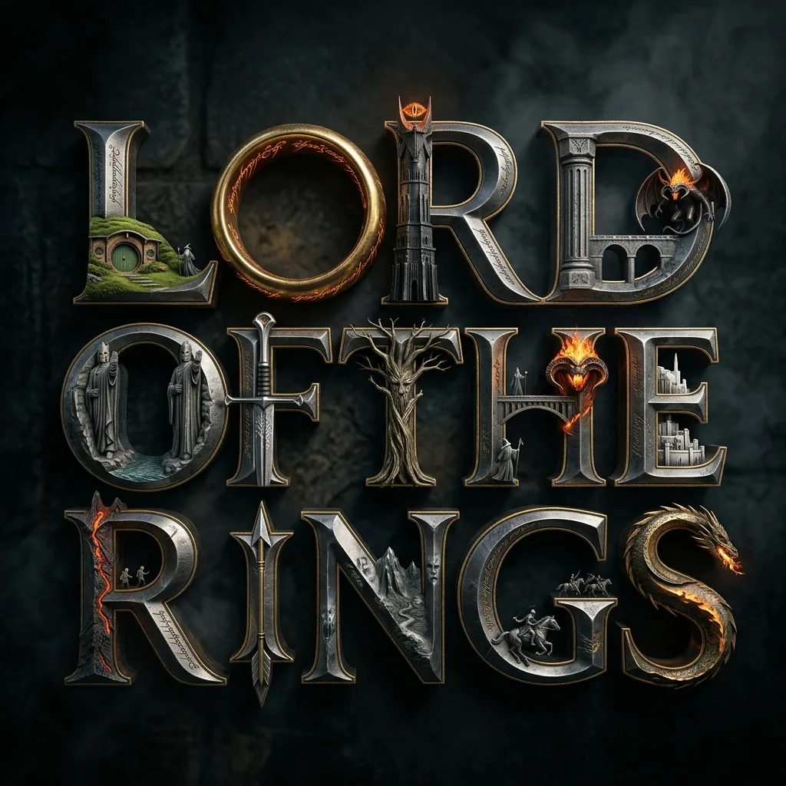

# Realistic, Character

[← Back to the collection](../../README.md) · Category: [UI & Graphic](../../gallery/ui-graphic.md) · Model: `Vinano Image Pro` · ID: `vn-01764`

<a href="https://vinano.ai?utm_source=github&utm_medium=readme&utm_campaign=awesome-image-video-prompts-updating&utm_content=prompt-page-image"></a>

<sub>Preview generated with <a href="https://vinano.ai?utm_source=github&utm_medium=readme&utm_campaign=awesome-image-video-prompts-updating&utm_content=prompt-page-caption">vinano.ai</a></sub>

## Prompt

```text
Create a premium-quality 3D metallic typography composition of the title [MOVIE / SERIES NAME], set against a dark, textured background that reflects the tone, genre, and emotional atmosphere of the story, delivering a cinematic, premium visual impact.

Each individual letter is sculpted as a cinematic form, seamlessly merging a different iconic scene from the movie or series into the letter itself. Scenes are translated into architectural elements, environments, characters, props, lighting, and atmospheric details, transformed into elegant, readable letterforms rather than literal collages.

Every letter acts as a mini visual narrative, instantly recognizable to fans, while no two letters repeat the same scene or story moment. The full title feels cohesive, balanced, and unified as a single artwork.

The typography is rendered in polished metallic materials (gold, silver, steel, or [COLOR]), featuring realistic reflections, fine engravings, and subtle surface wear for cinematic authenticity.

Dramatic studio lighting soft rim highlights and deep shadows enhances depth, scale, and mood, blending seamlessly the embedded scenes.

Ultra-sharp focus, premium 3D render quality, cinematic depth of field, luxury title-card aesthetic, ultra-high resolution.

No cartoon style, no flat illustration — pure cinematic realism sculptural artistry.

Keep edges clean and the overall composition balanced for a polished, gallery-ready result.
```

## Try it on vinano.ai

1. Copy the prompt above.
2. Open **[vinano.ai](https://vinano.ai?utm_source=github&utm_medium=readme&utm_campaign=awesome-image-video-prompts-updating&utm_content=prompt-page-try)**, paste it into the image generator and pick a model.
3. Swap any placeholders (brand, product, city, person…) for your own details, then generate.

More prompts like this: [UI & Graphic gallery](../../gallery/ui-graphic.md) · [all categories](../../README.md#contents)
