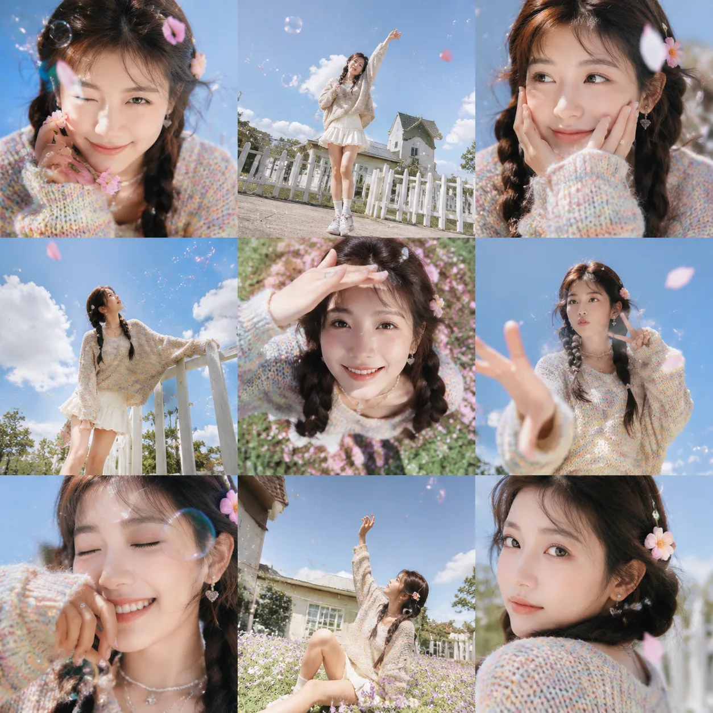

# Realistic, Portrait

[← Back to the collection](../../README.md) · Category: [UI & Graphic](../../gallery/ui-graphic.md) · Model: `Vinano Studio` · ID: `vn-01775`

<a href="https://vinano.ai?utm_source=github&utm_medium=readme&utm_campaign=awesome-image-video-prompts-updating&utm_content=prompt-page-image"></a>

<sub>Preview generated with <a href="https://vinano.ai?utm_source=github&utm_medium=readme&utm_campaign=awesome-image-video-prompts-updating&utm_content=prompt-page-caption">vinano.ai</a></sub>

## Prompt

```text
A vibrant 3×3 grid photo collage containing nine unique and expressive poses based on the uploaded female facial photos. The scene captures a beautiful summer day a bright blue sky, fluffy clouds, and warm sunlight producing crisp natural shadows. Soft bokeh, sparkling highlights, soap bubbles reflecting sunlight, and floating flower petals create a dreamy atmosphere.

The character wears an oversized pastel sweater, a fashionable skirt, layered silver necklaces, and cute accessories. A light breeze adds natural movement to the hair and clothing. Images switch freely between 35mm wide-angle full-body shots and 85mm close-up beauty portraits, featuring playful camera interactions, cheek poses, over-the-shoulder glances, peace signs, and candid smiling expressions. The collage combines top-down views, low-angle shots, and intimate close-ups for a dynamic editorial composition. Rendered in ultra-realistic 2K delicate skin texture, realistic fabric details, vibrant colors, soft filmic, cinematic lighting, and the polished look of a premium Korean lifestyle magazine and luxury social media campaign.

Maintain consistent colour harmony and crisp focus across the whole frame.
```

## Try it on vinano.ai

1. Copy the prompt above.
2. Open **[vinano.ai](https://vinano.ai?utm_source=github&utm_medium=readme&utm_campaign=awesome-image-video-prompts-updating&utm_content=prompt-page-try)**, paste it into the image generator and pick a model.
3. Swap any placeholders (brand, product, city, person…) for your own details, then generate.

More prompts like this: [UI & Graphic gallery](../../gallery/ui-graphic.md) · [all categories](../../README.md#contents)
