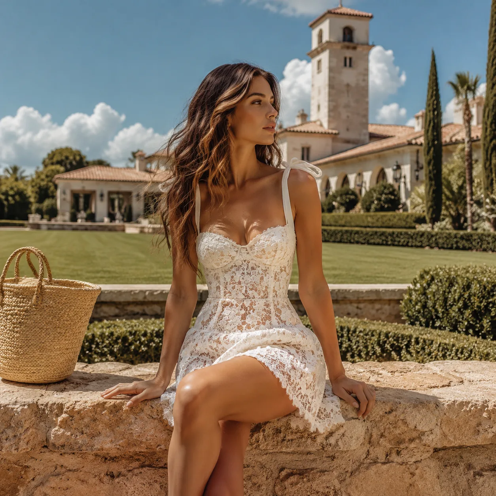

# Realistic, Portrait

[← Back to the collection](../../README.md) · Category: [UI & Graphic](../../gallery/ui-graphic.md) · Model: `Vinano Studio` · ID: `vn-01777`

<a href="https://vinano.ai?utm_source=github&utm_medium=readme&utm_campaign=awesome-image-video-prompts-updating&utm_content=prompt-page-image"></a>

<sub>Preview generated with <a href="https://vinano.ai?utm_source=github&utm_medium=readme&utm_campaign=awesome-image-video-prompts-updating&utm_content=prompt-page-caption">vinano.ai</a></sub>

## Prompt

```text
{
 "prompt_details": {
 "subject": {
 "description": "Young woman a faired complexion and voluminous, layered brunette hair featuring honey-blonde highlights styled in loose, glamorous waves.",
 "features": "Soft facial features, full lips, neutral expression, gazing off-camera to the right.",
 "skin_texture": "Smooth, sun-kissed skin realistic texture and subtle sheen."
 },
 "outfit": {
 "garment": "White semi-sheer lace mini dress a delicate floral pattern.",
 "details": "Spaghetti straps tied in bows at the shoulders, sweetheart neckline, fitted bodice, flowy skirt a scalloped raw-edge hem.",
 "style": "Coquette aesthetic, summer resort wear, romantic and feminine."
 },
 "accessories": {
 "item": "Woven straw market basket or tote bag placed on the ledge behind the subject.",
 "texture": "Natural dried palm leaf texture."
 },
 "pose": {
 "action": "Sitting gracefully on a textured stone garden wall.",
 "body_language": "One leg bent at the knee, hands resting gently on the stone surface, posture upright but relaxed."
 },
 "environment": {
 "setting": "Luxurious Mediterranean-style estate or villa garden.",
 "foreground": "Rough-hewn beige stone wall/ledge.",
 "background": "Manicured green lawn, sculpted hedges, large estate building Spanish colonial architecture (stucco walls, tiled roof, tower), bright blue sky fluffy white cumulus clouds.",
 "atmosphere": "High-end vacation, tranquil, affluent summer day."
 },
 "lighting": {
 "type": "Bright natural daylight.",
 "quality": "Sun-drenched illumination, soft but distinct shadows indicating overhead sun, realistic global illumination."
 },
 "mood": {
 "vibe": "Elegant, dreamy, serene, sophisticated, 'old money' aesthetic.",
 "tone": "Warm, bright, and airy."
 },
 "camera_settings": {
 "lens": "50mm portrait lens.",
 "aperture": "f/2.8 for slight background separation while keeping the subject sharp.",
 "shutter_speed": "1/250s.",
 "iso": "100.",
 "perspective": "Eye-level shot capturing the subject and the estate background."
 },
 "technical_specs": {
 "quality": "Ultra-true-to-life photorealistic, 8k resolution, raw photo style, highly detailed textures (lace, stone, hair), masterpiece, cinematic composition.",
 "engine": "Unreal Engine 5 render style or high-end DSLR photography."
 }
 }
}

Aim for an editorial, design-driven look with deliberate negative space.
```

## Try it on vinano.ai

1. Copy the prompt above.
2. Open **[vinano.ai](https://vinano.ai?utm_source=github&utm_medium=readme&utm_campaign=awesome-image-video-prompts-updating&utm_content=prompt-page-try)**, paste it into the image generator and pick a model.
3. Swap any placeholders (brand, product, city, person…) for your own details, then generate.

More prompts like this: [UI & Graphic gallery](../../gallery/ui-graphic.md) · [all categories](../../README.md#contents)
