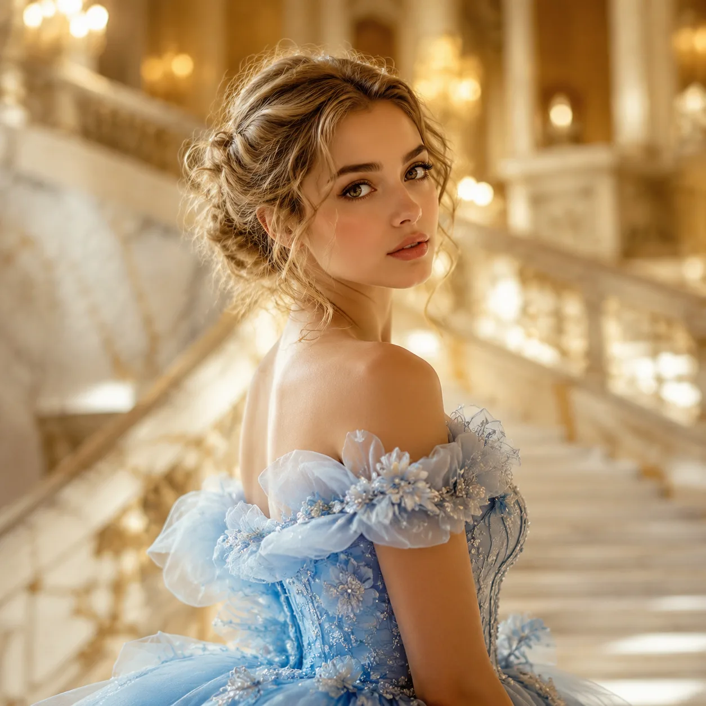

# Realistic, Portrait

[← Back to the collection](../../README.md) · Category: [UI & Graphic](../../gallery/ui-graphic.md) · Model: `Vinano Studio` · ID: `vn-01785`

<a href="https://vinano.ai?utm_source=github&utm_medium=readme&utm_campaign=awesome-image-video-prompts-updating&utm_content=prompt-page-image"></a>

<sub>Preview generated with <a href="https://vinano.ai?utm_source=github&utm_medium=readme&utm_campaign=awesome-image-video-prompts-updating&utm_content=prompt-page-caption">vinano.ai</a></sub>

## Prompt

```text
{
 "prompt_metadata": {
 "title": "Cinematic Royal Portrait: Ana de Armas",
 "version": "2.0",
 "generation_type": "true-to-life photorealistic Cinematic",
 "aspect_ratio": "3:4",
 "quality_preset": "Ultra-High-Resolution / 8K / RAW",
 "aesthetic_style": "Fairytale Royal / Ethereal Elegance"
 },
 "subject": {
 "identity": {
 "name": "Ana de Armas",
 "likeness_fidelity": "100% accurate facial features",
 "ethnicity_match": "Authentic skin tone and bone structure"
 },
 "physical_features": {
 "eyes": {
 "color": "Deep brown",
 "details": "Luminous catch-lights, sharp focus on iris texture"
 },
 "complexion": {
 "texture": "Visible skin pores, natural imperfections, luminous warm glow",
 "finish": "Soft-focus dewiness"
 },
 "hair": {
 "style": "Intricate blonde updo",
 "texture": "Soft, loose ringlet curls framing the face",
 "detail": "Fine individual strands visible, silk-like sheen"
 },
 "makeup": {
 "style": "Natural / refined minimalist",
 "details": "Soft peach blush, nude glossy lips, light mascara"
 }
 },
 "pose": {
 "composition": "Close-up portrait",
 "stance": "Graceful and poised, slight tilt of the head",
 "expression": "Serene, regal, and enigmatic"
 }
 },
 "wardrobe": {
 "garment": "Grand Powder-Blue Ball Gown",
 "bodice_details": {
 "type": "Structured corset",
 "neckline": "Off-shoulder ruffled sleeves",
 "embellishments": "Hand-stitched 3D floral appliqués"
 },
 "skirt_details": {
 "material": "Layered silk tulle",
 "volume": "Voluminous and airy",
 "translucency": "Subtle light-filtering through fabric layers"
 }
 },
 "environment": {
 "location": "Grand Palace Interior",
 "architecture": {
 "primary_element": "Wide marble staircase",
 "material": "Polished white Calacatta marble gold veining",
 "backdrop": "Ornate balustrades, distant vaulted ceilings"
 },
 "atmosphere": {
 "vibe": "Dreamy, luxurious, and timeless",
 "depth": "Extreme shallow depth of field (bokeh background)"
 }
 },
 "lighting_and_color": {
 "lighting_scheme": {
 "primary_source": "Cinematic soft-box simulation",
 "secondary_source": "Warm ambient glow from palace chandeliers",
 "effects": "Subtle bloom, ethereal light rays, volumetric golden hour glow"
 },
 "color_palette": {
 "dominants": ["Powder blue", "Creamy white", "Soft gold"],
 "accents": ["Warm skin tones", "Deep amber highlights"]
 }
 },
 "technical_rendering": {
 "camera_settings": {
 "lens": "85mm prime lens simulation",
 "aperture": "f/1.2 for creamy bokeh",
 "sensor": "Full-frame digital cinema camera"
 },
 "image_fidelity": {
 "texture_mapping": "High-fidelity fabric weave and marble grain",
 "post_processing": "Subtle film grain, HDR, color graded for fairytale cinema",
 "anti_aliasing": "Ultra-sharp edges on subject, smooth gradients in background"
 }
 }
}

Aim for an editorial, design-driven look with deliberate negative space.
```

## Try it on vinano.ai

1. Copy the prompt above.
2. Open **[vinano.ai](https://vinano.ai?utm_source=github&utm_medium=readme&utm_campaign=awesome-image-video-prompts-updating&utm_content=prompt-page-try)**, paste it into the image generator and pick a model.
3. Swap any placeholders (brand, product, city, person…) for your own details, then generate.

More prompts like this: [UI & Graphic gallery](../../gallery/ui-graphic.md) · [all categories](../../README.md#contents)
