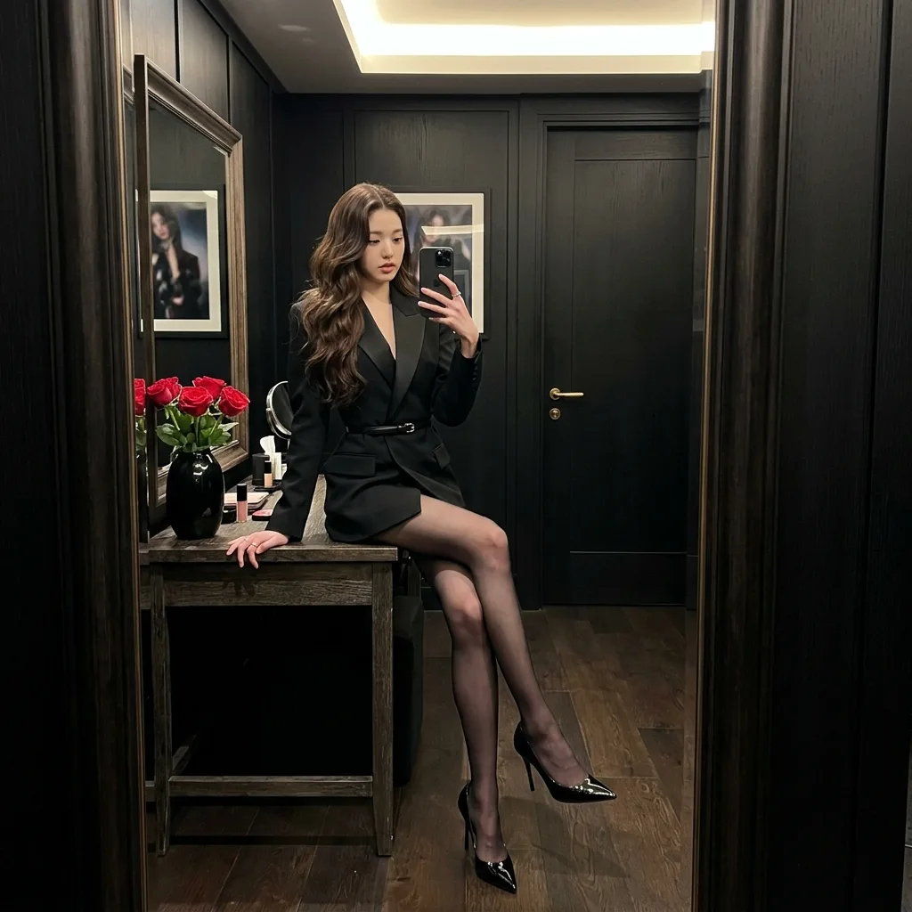

# Realistic, Minimalist

[← Back to the collection](../../README.md) · Category: [UI & Graphic](../../gallery/ui-graphic.md) · Model: `Vinano Image Pro` · ID: `vn-01787`

<a href="https://vinano.ai?utm_source=github&utm_medium=readme&utm_campaign=awesome-image-video-prompts-updating&utm_content=prompt-page-image"></a>

<sub>Preview generated with <a href="https://vinano.ai?utm_source=github&utm_medium=readme&utm_campaign=awesome-image-video-prompts-updating&utm_content=prompt-page-caption">vinano.ai</a></sub>

## Prompt

```text
{
  "meta": {
    "quality": "ultra-true-to-life photorealistic, 8k, raw style, highly detailed",
    "camera_model": "iPhone 15 Pro Max, mobile photography aesthetic",
    "lens_spec": "24mm wide angle, f/1.8 aperture",
    "aspect_ratio": "9:16",
    "style_preset": "high-fashion editorial, mirror selfie aesthetic",
    "technical_rules": "no skin smoothing, natural skin texture, sharp focus"
  },
  "scene": {
    "location": "luxury dressing room, modern dark interior",
    "time_of_day": "evening, artificial indoor lighting",
    "atmosphere": "sophisticated, intimate, chic",
    "background_elements": ["black refined minimalist door", "sleek dark wood paneling", "framed k-pop editorial art"],
    "props": ["smartphone", "black vase red roses", "vanity desk"]
  },
  "subject": {
    "identity": {
      "name_reference": "Wonyoung from IVE",
      "biometric_details": "ultra-slim proportions, doll-like features, signature beauty marks under eyes, long neck",
      "ethnicity_age": "Korean, early 20s"
    },
    "physical": {
      "body_type": "extremely slender, long legs, graceful posture",
      "skin_details": "porcelain tone, subtle glow, natural skin grain",
      "hair_style": "long voluminous dark brown waves, side-parted",
      "facial_features": "almond-shaped eyes, slim nose, plump heart-shaped lips"
    }
  },
  "wardrobe": {
    "outfit_description": "plunging black blazer dress, structured shoulders, thin gold-buckle belt",
    "materials": "matte wool-blend, satin lapels, sheer black hosiery",
    "footwear": "pointed-toe black patent leather stiletto pumps",
    "accessories": ["silver rings", "thin black bra peeking through"]
  },
  "pose_action": {
    "primary_pose": "sitting on the edge of a wooden desk",
    "body_language": "legs crossed elegantly, holding phone for a mirror selfie, slight lean",
    "expression": "cool, composed gaze, slight pout",
    "interaction": "taking a mirror selfie, looking at phone screen"
  },
  "lighting": {
    "setup": "overhead softbox, warm interior accent lights",
    "effects": "specular highlights on hair and shoes, soft shadows",
    "color_grading": "moody, high-contrast, deep blacks, warm skin tones"
  },
  "composition": {
    "shot_type": "full-body mirror selfie",
    "camera_angle": "eye-level, slightly angled",
    "focus_point": "sharp focus on subject and mirror reflection",
    "depth_of_field": "slight fall-off in background"
  },
  "realism_focus": {
    "textures": ["patent leather sheen", "sheer nylon texture", "wood grain"],
    "imperfections": ["natural fabric folds", "mirror surface dust"]
  }
}

Maintain consistent colour harmony and crisp focus across the whole frame.
```

## Try it on vinano.ai

1. Copy the prompt above.
2. Open **[vinano.ai](https://vinano.ai?utm_source=github&utm_medium=readme&utm_campaign=awesome-image-video-prompts-updating&utm_content=prompt-page-try)**, paste it into the image generator and pick a model.
3. Swap any placeholders (brand, product, city, person…) for your own details, then generate.

More prompts like this: [UI & Graphic gallery](../../gallery/ui-graphic.md) · [all categories](../../README.md#contents)
