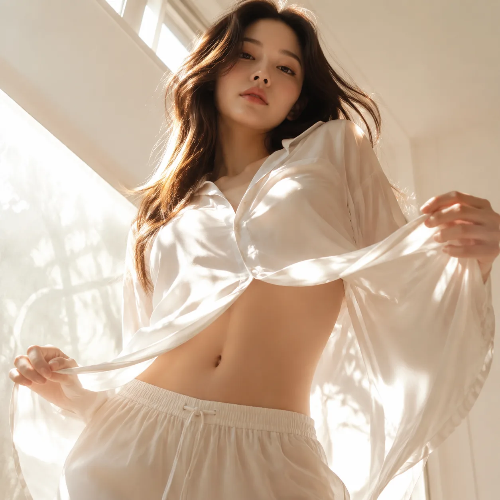

# Realistic, Cinematic

[← Back to the collection](../../README.md) · Category: [UI & Graphic](../../gallery/ui-graphic.md) · Model: `Vinano Studio` · ID: `vn-01790`

<a href="https://vinano.ai?utm_source=github&utm_medium=readme&utm_campaign=awesome-image-video-prompts-updating&utm_content=prompt-page-image"></a>

<sub>Preview generated with <a href="https://vinano.ai?utm_source=github&utm_medium=readme&utm_campaign=awesome-image-video-prompts-updating&utm_content=prompt-page-caption">vinano.ai</a></sub>

## Prompt

```text
A highly realistic photo of an adult East Asian woman in her early 20s, photographed from a dramatic low angle looking upward. She has a natural, elegant face, soft clear skin, light natural makeup, slightly tousled long dark brown hair, and a calm, subtly alluring expression while looking down toward the camera.

She is wearing a loose white silk shirt instead of a knit top. The shirt is lightweight, glossy, soft, and fluid, a luxurious silk texture. She gently lifts and opens the hem of the white silk shirt both hands, creating a flowing curve of fabric across the frame. The shirt catches the sunlight beautifully, showing delicate highlights, soft folds, and a refined semi-sheer quality. Her lower body is styled relaxed white drawstring lounge pants.

Composition: extreme low-angle shot from around waist level, camera pointing upward toward her face and torso. The midriff is visible, the fabric stretched lightly between her hands. Her face appears near the top of the frame, while the torso and silk shirt dominate the foreground. Vertical composition, intimate fashion editorial framing.

Lighting: strong natural sunlight streaming in from a window above and behind her, creating radiant sunbeams and scattered dappled light patterns across her skin, shirt, and the scene. Bright backlighting, glowing rim light on the hair, warm highlights, soft shadows, airy and luminous mood.

Background: minimal bright interior near a window, clean modern room, soft pale walls, morning or afternoon sunlight flooding the space. The environment should feel quiet, warm, and serene.

Style: ultra-realistic fashion photograph, cinematic sunlight, natural skin texture, premium editorial aesthetic, soft and airy mood, high detail, realistic color grading, elegant and sensual without explicit nudity, 4K quality.

Important details: white silk shirt, not knit, loose and glossy fabric, sunlight passing through and reflecting on the material, visible soft folds, low-angle perspective, luminous atmosphere, adult subject only.

Emphasise material texture and natural light so the final frame feels tactile and premium.
```

## Try it on vinano.ai

1. Copy the prompt above.
2. Open **[vinano.ai](https://vinano.ai?utm_source=github&utm_medium=readme&utm_campaign=awesome-image-video-prompts-updating&utm_content=prompt-page-try)**, paste it into the image generator and pick a model.
3. Swap any placeholders (brand, product, city, person…) for your own details, then generate.

More prompts like this: [UI & Graphic gallery](../../gallery/ui-graphic.md) · [all categories](../../README.md#contents)
