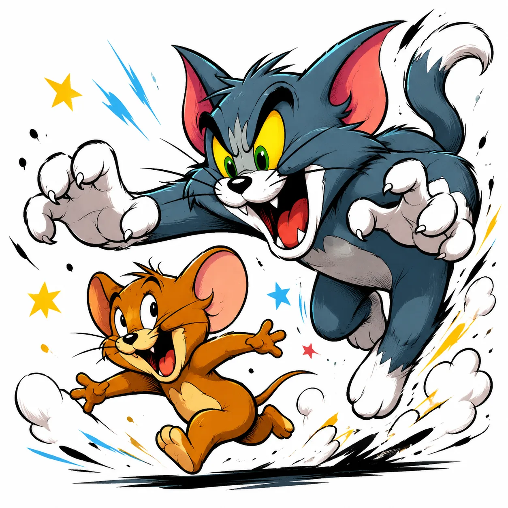

# Anime, Character

[← Back to the collection](../../README.md) · Category: [UI & Graphic](../../gallery/ui-graphic.md) · Model: `Vinano Studio` · ID: `vn-01791`

<a href="https://vinano.ai?utm_source=github&utm_medium=readme&utm_campaign=awesome-image-video-prompts-updating&utm_content=prompt-page-image"></a>

<sub>Preview generated with <a href="https://vinano.ai?utm_source=github&utm_medium=readme&utm_campaign=awesome-image-video-prompts-updating&utm_content=prompt-page-caption">vinano.ai</a></sub>

## Prompt

```text
{
 "render_manifest": {
 "engine_release": "v15_visual_fusion_core",
 "task_type": "Reference Image → Stylized Illustration",
 "render_output": {
 "medium": "High-detail digital artwork",
 "quality": "Ultra HD / Print-ready",
 "style_handling": "Layered independent style synthesis"
 }
 },

 "art_style_stack": {

 "style_A": {
 "tag": "PLAYFUL_CARICATURE_FORM",
 "design_rules": {
 "body_design": "Stylized exaggeration preserved likeness",
 "edge_treatment": "Strong expressive contours",
 "form_warp": "Personality-led distortions",
 "emotion": "Lively, fun, energetic"
 }
 },

 "style_B": {
 "tag": "DYNAMIC_INK_ART",
 "design_rules": {
 "line_style": "Organic hand-drawn ink strokes",
 "paint_system": {
 "palette": "Bold, high-saturation colors",
 "surface_detail": ["soft shading", "light cross-hatching", "gesture strokes"]
 },
 "scene_logic": {
 "backdrop": "Clean white refined minimalist space",
 "motion_effects": "Illustrative kinetic accents"
 },
 "visual_feel": "Modern comic illustration"
 }
 },

 "style_C": {
 "tag": "CEL_SHADED_GRAPHIC",
 "design_rules": {
 "color_behavior": "Flat fills minimal blending",
 "shadow_style": "Hard-edged, high-contrast shading",
 "outline_style": "Crisp graphic ink lines",
 "render_goal": "Animation and vector-ready look"
 }
 },

 "style_D": {
 "tag": "KODOMO_ANIME_INFLUENCE",
 "design_rules": {
 "shape_language": "Smooth rounded geometry",
 "color_behavior": "Bright solid tones",
 "art_direction": "Classic child-friendly anime style",
 "tone": "Cheerful and light-hearted"
 }
 },

 "style_E": {
 "tag": "CLASSIC_SLAPSTICK_CARTOON",
 "design_rules": {
 "pose_physics": "Elastic squash-and-stretch motion",
 "facial_expression": "Over-the-top animated reactions",
 "ink_weight": "Thick bold cartoon outlines",
 "energy_level": "High-motion, exaggerated action"
 }
 }
 },

 "final_processing": {
 "image_finish": {
 "edge_clarity": "Enhanced line sharpness",
 "color_tuning": "Vibrant illustration grading"
 },
 "layout_rules": {
 "framing": "Centered character focus",
 "background_cleanliness": "Noise-free, studio clean"
 }
 }
}

Maintain consistent colour harmony and crisp focus across the whole frame.
```

## Try it on vinano.ai

1. Copy the prompt above.
2. Open **[vinano.ai](https://vinano.ai?utm_source=github&utm_medium=readme&utm_campaign=awesome-image-video-prompts-updating&utm_content=prompt-page-try)**, paste it into the image generator and pick a model.
3. Swap any placeholders (brand, product, city, person…) for your own details, then generate.

More prompts like this: [UI & Graphic gallery](../../gallery/ui-graphic.md) · [all categories](../../README.md#contents)
