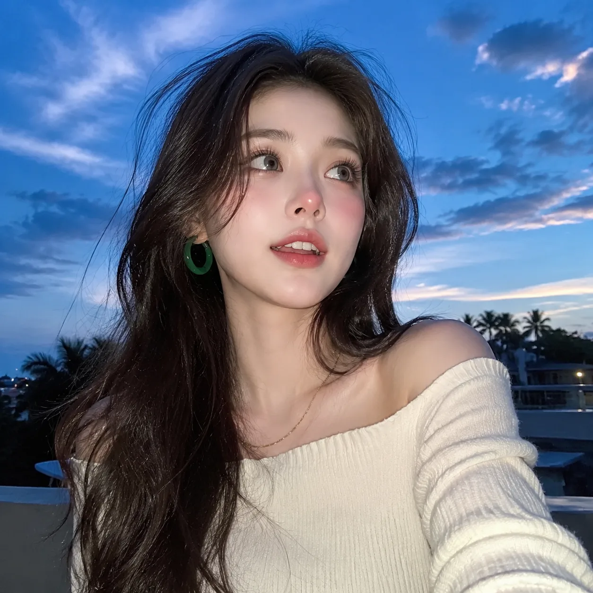

# Realistic, Portrait

[← Back to the collection](../../README.md) · Category: [UI & Graphic](../../gallery/ui-graphic.md) · Model: `Vinano Studio` · ID: `vn-01818`

<a href="https://vinano.ai?utm_source=github&utm_medium=readme&utm_campaign=awesome-image-video-prompts-updating&utm_content=prompt-page-image"></a>

<sub>Preview generated with <a href="https://vinano.ai?utm_source=github&utm_medium=readme&utm_campaign=awesome-image-video-prompts-updating&utm_content=prompt-page-caption">vinano.ai</a></sub>

## Prompt

```text
Reference Face: 100%, no alternation, no modification facial features, just keep it exactly as they are), Generate an ultra-realistic, highly ultra-detailed, 8k resolution, true-to-life portrait of a young woman in her 20s.8 Clothes Wearing: A fitted, ribbed, long-sleeved off-the-shoulder top in a creamy white or pale beige color. The fabric has a distinct horizontal ribbing texture. The neckline is wide and straight (boat neck style), fully exposingthe collarbones and shoulders.
She is wearing a delicate, thin gold chain necklace and a chunky green hoop earring visible on her left ear. The Background: An outdoor setting at dusk or early evening featuring a deep blue sky scattered wispy white clouds.
In the lower background, there are silhouettes of trees (possibly palm or tropical) and a building railing or roofline, suggesting a rooftop or balcony environment.The Pose Setting: A high-angle selfie shot where the subject is looking away from the lens, glancing upward and to her right a candid, spontaneous expression. Her mouth is slightly parted in a natural, relaxed manner, showing her teeth. The angle suggests she is holding the camera an extended arm in front of her.
The Hairstyle: Long, voluminous dark brown hair styled in loose, soft waves that cascade over her shoulders and frame her face. The hair has a slightly messy, windblown texturewith a center part and natural flyaways, adding to the candid feel. Make-up Style: "Douyin-style makeup look: Porcelain skin mesmerizing gray contact lenses and long, separated doll-like eyelashes. Heavy soft pink blush applied to the apples of the cheeks and tip of the nose for a youthful flush.

Maintain consistent colour harmony and crisp focus across the whole frame.
```

## Try it on vinano.ai

1. Copy the prompt above.
2. Open **[vinano.ai](https://vinano.ai?utm_source=github&utm_medium=readme&utm_campaign=awesome-image-video-prompts-updating&utm_content=prompt-page-try)**, paste it into the image generator and pick a model.
3. Swap any placeholders (brand, product, city, person…) for your own details, then generate.

More prompts like this: [UI & Graphic gallery](../../gallery/ui-graphic.md) · [all categories](../../README.md#contents)
