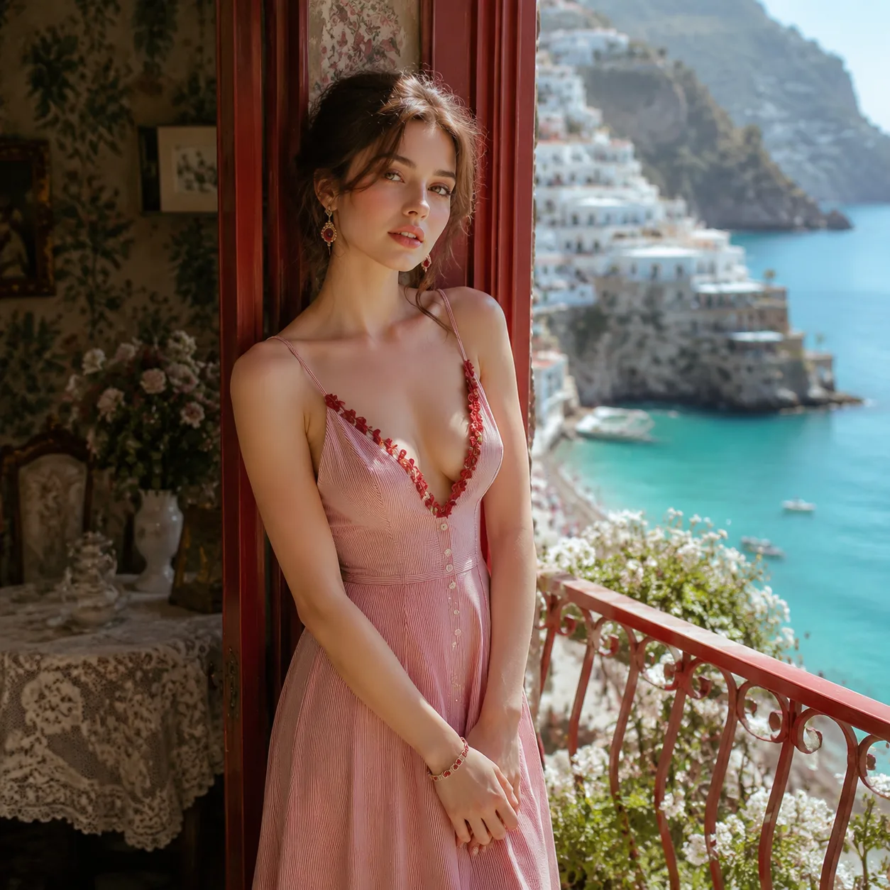

# Realistic, Portrait

[← Back to the collection](../../README.md) · Category: [UI & Graphic](../../gallery/ui-graphic.md) · Model: `Vinano Studio` · ID: `vn-01819`

<a href="https://vinano.ai?utm_source=github&utm_medium=readme&utm_campaign=awesome-image-video-prompts-updating&utm_content=prompt-page-image"></a>

<sub>Preview generated with <a href="https://vinano.ai?utm_source=github&utm_medium=readme&utm_campaign=awesome-image-video-prompts-updating&utm_content=prompt-page-caption">vinano.ai</a></sub>

## Prompt

```text
true-to-life photorealistic romantic European travel editorial portrait of a beautiful young woman, standing in an open crimson-red balcony doorway of a luxurious Italian coastal villa. She wears a pink-and-white micro pinstripe sundress a deep plunging neckline delicate red velvet floral ruffle trim along the inner V-neckline. Front buttons, thin straps, elegant ruby-red drop earrings, delicate gold red stone bracelet. Fair pinkish flawless skin, natural soft-glam makeup, large brown striking eyes, subtle peach blush, pink-rosy plumpy lips. Dark brown hair styled in a messy romantic low updo loose face-framing wavy strands. Her body is turned slightly away from camera while leaning gently against the doorframe, hands relaxed together in front of her body. She looks toward the camera a soft dreamy expression, lips slightly parted. Vintage floral wallpaper, lace-covered table, flowers and antique decor inside the room. Bright Mediterranean coastline, turquoise water, white cliffside buildings and flower boxes visible outside the balcony. Eye-level shot, medium portrait framing, 85mm lens, f/1.8, shallow depth of field, creamy bokeh, natural window light, soft diffused daylight, warm filmic tones, luxury travel magazine aesthetic, highly detailed, true-to-life photorealistic, cinematic, elegant, romantic atmosphere.

Negative prompt: standing centered, ruffles around entire cups, dark moody lighting, harsh shadows, heavy makeup, modern interior, wide-angle distortion, cartoon, CGI, blur, watermark.

Aim for an editorial, design-driven look with deliberate negative space.
```

## Try it on vinano.ai

1. Copy the prompt above.
2. Open **[vinano.ai](https://vinano.ai?utm_source=github&utm_medium=readme&utm_campaign=awesome-image-video-prompts-updating&utm_content=prompt-page-try)**, paste it into the image generator and pick a model.
3. Swap any placeholders (brand, product, city, person…) for your own details, then generate.

More prompts like this: [UI & Graphic gallery](../../gallery/ui-graphic.md) · [all categories](../../README.md#contents)
