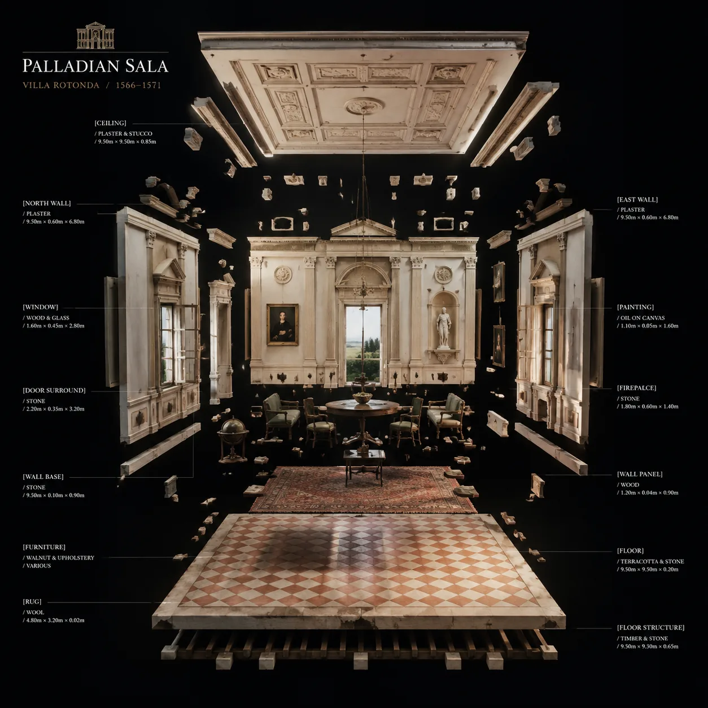

# ROOM TYPE pulled apart in 3D, every surface

[← Back to the collection](../../README.md) · Category: [UI & Graphic](../../gallery/ui-graphic.md) · Model: `Vinano Studio` · ID: `vn-01821`

<a href="https://vinano.ai?utm_source=github&utm_medium=readme&utm_campaign=awesome-image-video-prompts-updating&utm_content=prompt-page-image"></a>

<sub>Preview generated with <a href="https://vinano.ai?utm_source=github&utm_medium=readme&utm_campaign=awesome-image-video-prompts-updating&utm_content=prompt-page-caption">vinano.ai</a></sub>

## Prompt

```text
[ROOM TYPE] pulled apart in 3D, every surface and object floating at its exact position, slightly separated. EXPLOSION: ceiling lifted, four walls sliding outward, floor dropped, furniture floating in place, objects orbiting their surfaces, light sources still emitting across the exploded void. The ghost of the room readable in the arrangement. Labels on architectural elements only: "[SURFACE]" / "[MATERIAL]" / "[DIMENSION]" LIGHTING: each element still lit by its original source, windows casting light across the gap, lamps throwing cones into empty space. BACKGROUND: deep dark, the room floats in void. TITLE: "[ROOM NAME]" / SUBTITLE: "[BUILDING TYPE] [PERIOD]" Mood: architectural model that became a universe. 4K, extraordinary spatial clarity, tack sharp. Keep edges clean and the overall composition balanced for a polished, gallery-ready result.
```

## Try it on vinano.ai

1. Copy the prompt above.
2. Open **[vinano.ai](https://vinano.ai?utm_source=github&utm_medium=readme&utm_campaign=awesome-image-video-prompts-updating&utm_content=prompt-page-try)**, paste it into the image generator and pick a model.
3. Swap any placeholders (brand, product, city, person…) for your own details, then generate.

More prompts like this: [UI & Graphic gallery](../../gallery/ui-graphic.md) · [all categories](../../README.md#contents)
