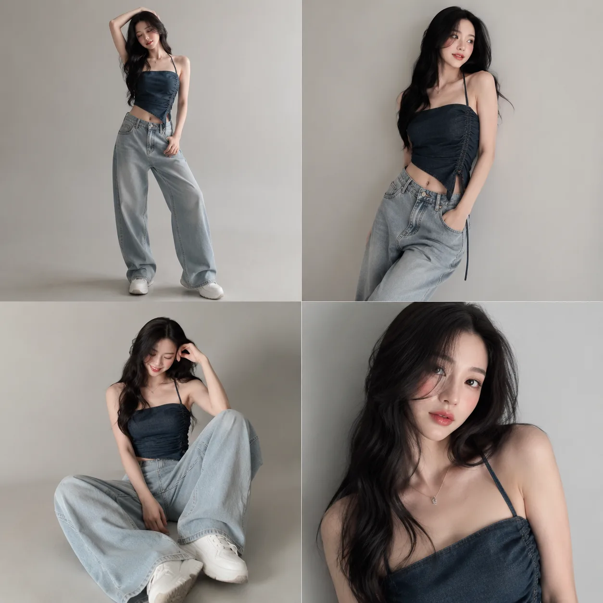

# Realistic, Portrait

[← Back to the collection](../../README.md) · Category: [UI & Graphic](../../gallery/ui-graphic.md) · Model: `Vinano Studio` · ID: `vn-01838`

<a href="https://vinano.ai?utm_source=github&utm_medium=readme&utm_campaign=awesome-image-video-prompts-updating&utm_content=prompt-page-image"></a>

<sub>Preview generated with <a href="https://vinano.ai?utm_source=github&utm_medium=readme&utm_campaign=awesome-image-video-prompts-updating&utm_content=prompt-page-caption">vinano.ai</a></sub>

## Prompt

```text
{
 "scene_type": "smartphone fashion portrait series",
 "composition": {
 "layout": "4-photo grid collage",
 "camera": "smartphone photography",
 "framing": ["full body standing",
 "leaning wall pose",
 "casual seated pose",
 "upper body close-up"],
 "angle": "eye-level, natural candid perspective",
 "aspect_ratio": "1:1 collage"
 },
 "subject": {
 "gender": "female",
 "age": "early 20s",
 "aesthetic": "extremely beautiful, soft feminine street style",
 "appearance": {
 "skin_tone": "smooth fair complexion",
 "face": "soft feminine features, delicate jawline, naturally pretty",
 "expression": "confident, playful, relaxed",
 "eyes": "expressive soft gaze",
 "hair": {
 "color": "deep black",
 "style": "long loose waves",
 "texture": "silky natural movement"
 },
 "makeup": "clean girl makeup, dewy skin, soft pink blush, glossy lips"
 },
 "outfit": {
 "top": "dark denim asymmetrical ruched camisole top thin straps and side drawstring detail",
 "bottom": "light wash ultra baggy wide-leg jeans",
 "shoes": "chunky white sneakers",
 "style": "modern Korean-inspired casual streetwear, effortless denim-on-denim aesthetic"
 },
 "pose_style": "relaxed candid fashion poses natural movement",
 "body_language": "soft confidence, feminine energy, effortless cool-girl vibe"
 },
 "environment": {
 "location": "minimal studio setup",
 "background": "clean light gray seamless backdrop",
 "floor": "neutral matte studio floor",
 "lighting": {
 "type": "soft diffused studio lighting",
 "tone": "cool neutral",
 "shadows": "soft realistic shadows",
 "highlights": "gentle glow on skin and denim texture"
 }
 },
 "style": {
 "photography_type": "smartphone editorial fashion photography",
 "visual_tone": "minimal, airy, trendy",
 "mood": "fresh, stylish, youthful confidence",
 "color_palette": "washed denim blue, soft gray, white",
 "contrast": "low to medium",
 "grain": "light natural grain"
 },
 "rendering": {
 "realism": "ultra-realistic",
 "detail_level": "high fabric and skin texture detail",
 "sharpness": "high",
 "depth_of_field": "natural smartphone depth",
 "post_processing": "clean editing slightly soft finish"
 },
 "atmosphere": "effortless Gen-Z fashion aesthetic, casual luxury streetwear energy, modern feminine charm"
}

Aim for an editorial, design-driven look with deliberate negative space.
```

## Try it on vinano.ai

1. Copy the prompt above.
2. Open **[vinano.ai](https://vinano.ai?utm_source=github&utm_medium=readme&utm_campaign=awesome-image-video-prompts-updating&utm_content=prompt-page-try)**, paste it into the image generator and pick a model.
3. Swap any placeholders (brand, product, city, person…) for your own details, then generate.

More prompts like this: [UI & Graphic gallery](../../gallery/ui-graphic.md) · [all categories](../../README.md#contents)
