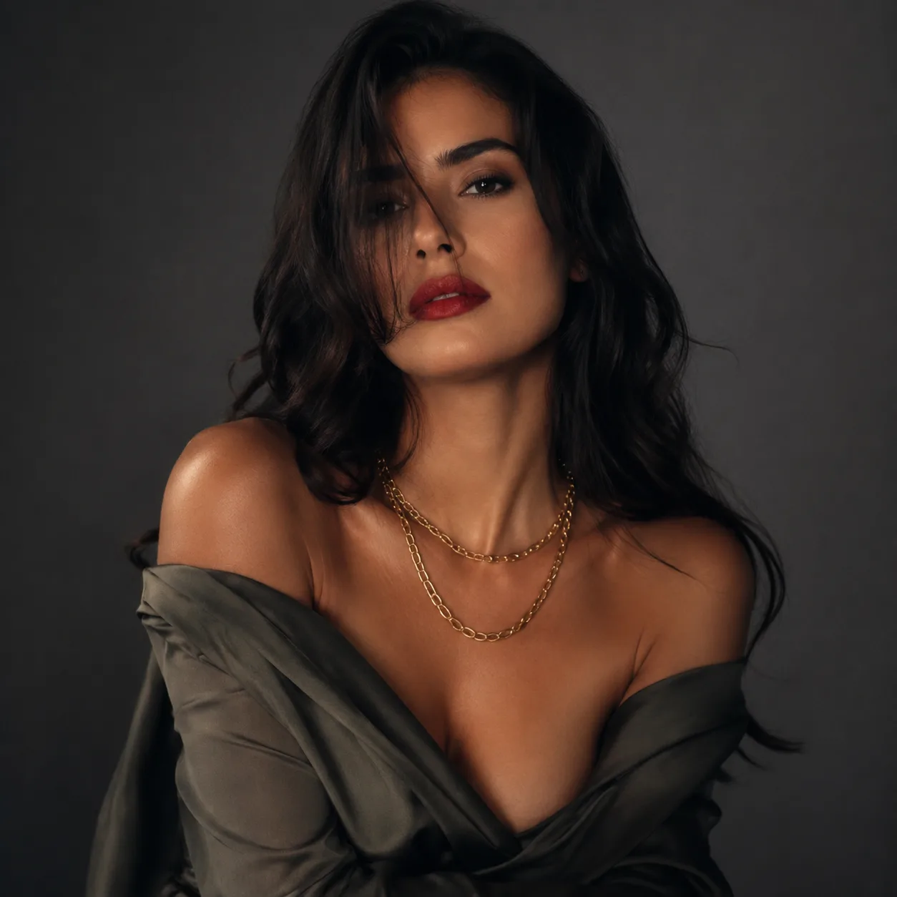

# Realistic, Portrait

[← Back to the collection](../../README.md) · Category: [UI & Graphic](../../gallery/ui-graphic.md) · Model: `Vinano Studio` · ID: `vn-01843`

<a href="https://vinano.ai?utm_source=github&utm_medium=readme&utm_campaign=awesome-image-video-prompts-updating&utm_content=prompt-page-image"></a>

<sub>Preview generated with <a href="https://vinano.ai?utm_source=github&utm_medium=readme&utm_campaign=awesome-image-video-prompts-updating&utm_content=prompt-page-caption">vinano.ai</a></sub>

## Prompt

```text
{
 "image_request": {
 "style": {
 "genre": "High-fashion editorial portrait",
 "vibe": "Luxury magazine aesthetic",
 "mood": "Elegant, bold, confident",
 "aspect_ratio": "4:4"
 },
 "lighting": {
 "type": "Dramatic filmic, cinematic lighting",
 "tone": "Warm highlights soft shadows",
 "environment": "Studio",
 "background": "Dark gray, smooth, minimal"
 },
 "subject": {
 "identity_lock": "Use the provided reference image",
 "face_constraints": "Maintain 100% exact facial features, proportions, asymmetry, and realism",
 "gender": "Woman",
 "expression": "Sensual, confident, calm",
 "gaze": "Soft and alluring, partially obscured by hair"
 },
 "hair": {
 "length": "Long",
 "style": "Loose, cascading over the shoulders",
 "detail": "Some strands falling over the face for mystery"
 },
 "makeup": {
 "style": "Subtle yet striking editorial makeup",
 "lips": "Intense red lipstick",
 "skin": "Natural, realistic texture",
 "overall_finish": "High-fashion, refined"
 },
 "wardrobe": {
 "outfit": "Draped garment",
 "color": "Muted gray-green",
 "design": "Off-shoulder, exposing shoulders and collarbones"
 },
 "accessories": {
 "jewelry": ["Gold necklace",
 "Layered gold chains"]
 },
 "pose": {
 "body_language": "Confident, elegant, bold",
 "posture": "Relaxed yet powerful editorial stance"
 },
 "camera": {
 "quality": "Ultra-realistic, ultra-detailed",
 "style": "High-end fashion photography",
 "focus": "Sharp facial detail natural depth"
 },
 "final_notes": {
 "realism": "true-to-life photorealistic skin, hair, and fabric textures",
 "editing": "No face alteration, no over-smoothing, no stylization",
 "overall_feel": "Luxury birthday editorial photoshoot"
 }
 }
}

Maintain consistent colour harmony and crisp focus across the whole frame.
```

## Try it on vinano.ai

1. Copy the prompt above.
2. Open **[vinano.ai](https://vinano.ai?utm_source=github&utm_medium=readme&utm_campaign=awesome-image-video-prompts-updating&utm_content=prompt-page-try)**, paste it into the image generator and pick a model.
3. Swap any placeholders (brand, product, city, person…) for your own details, then generate.

More prompts like this: [UI & Graphic gallery](../../gallery/ui-graphic.md) · [all categories](../../README.md#contents)
