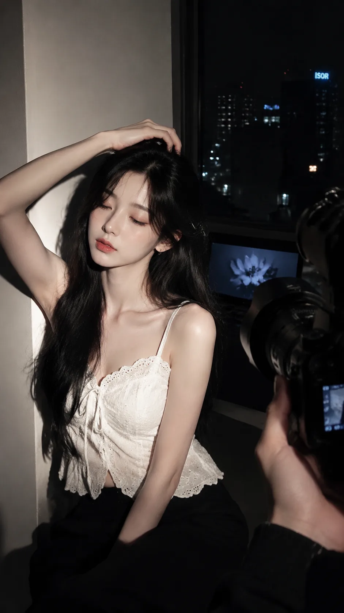

# Behind-the-scenes indoor photography at night, high-contrast

[← Back to the collection](../../README.md) · Category: [UI & Graphic](../../gallery/ui-graphic.md) · Model: `Vinano Studio` · ID: `vn-01861`

<a href="https://vinano.ai?utm_source=github&utm_medium=readme&utm_campaign=awesome-image-video-prompts-updating&utm_content=prompt-page-image"></a>

<sub>Preview generated with <a href="https://vinano.ai?utm_source=github&utm_medium=readme&utm_campaign=awesome-image-video-prompts-updating&utm_content=prompt-page-caption">vinano.ai</a></sub>

## Prompt

```text
Behind-the-scenes indoor photography at night, high-contrast. The subject is Karina from aespa, featuring her signature sharp V-shaped jawline, large almond-shaped eyes soft makeup, and porcelain skin. She has long, voluminous dark hair in a layered 'wolf-cut' style. Karina is sitting, tilted slightly toward the camera her eyes closed, her right arm raised her hand resting on her head, highlighting her visible collarbones. She wears a soft white eyelet embroidery camisole a small bow tie at the chest and black bottoms. To the right, a professional camera and photographer's hands are visible in the foreground. Background features a window overlooking a dark city a digital screen and a distant lit building. Side-lit from the left, soft but high-contrast, shallow depth of field. --ar 9:16 Aim for an editorial, design-driven look with deliberate negative space.
```

## Try it on vinano.ai

1. Copy the prompt above.
2. Open **[vinano.ai](https://vinano.ai?utm_source=github&utm_medium=readme&utm_campaign=awesome-image-video-prompts-updating&utm_content=prompt-page-try)**, paste it into the image generator and pick a model.
3. Swap any placeholders (brand, product, city, person…) for your own details, then generate.

More prompts like this: [UI & Graphic gallery](../../gallery/ui-graphic.md) · [all categories](../../README.md#contents)
