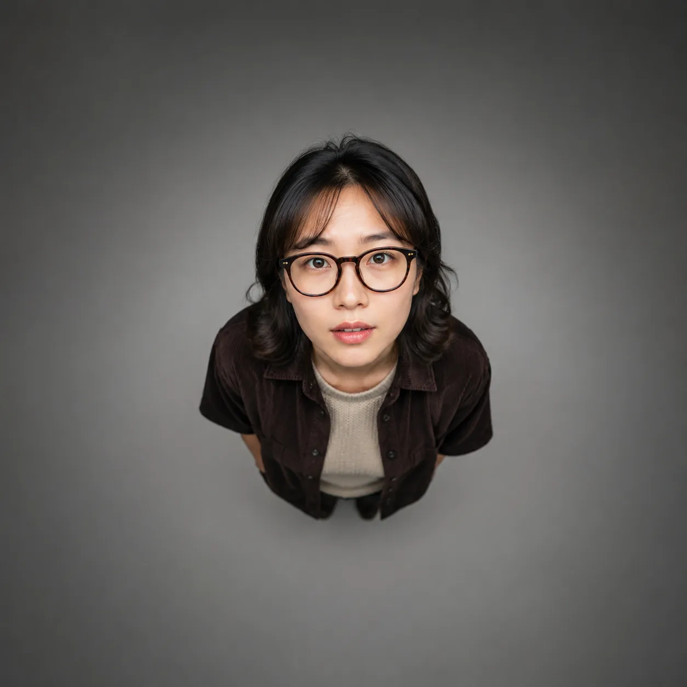

# Realistic, Portrait

[← Back to the collection](../../README.md) · Category: [UI & Graphic](../../gallery/ui-graphic.md) · Model: `Vinano Studio` · ID: `vn-01879`

<a href="https://vinano.ai?utm_source=github&utm_medium=readme&utm_campaign=awesome-image-video-prompts-updating&utm_content=prompt-page-image"></a>

<sub>Preview generated with <a href="https://vinano.ai?utm_source=github&utm_medium=readme&utm_campaign=awesome-image-video-prompts-updating&utm_content=prompt-page-caption">vinano.ai</a></sub>

## Prompt

```text
{
 "type": "image_generation_prompt",
 "style": "ultra-wide angle, aerial portrait, contemporary studio photography",
 "identity_preservation": {
 "use_reference_image": true,
 "strict_identity_lock": true,
 "alter_face": false,
 "notes": "Preserve 100% of the woman’s facial features, proportions, skin texture, and natural expression from the reference image."
 },
 "composition": {
 "camera_angle": "top-down aerial view (approximately 90 degrees above the subject)",
 "framing": "full-body framing emphasis on head and upper torso",
 "negative_space": "large amount of negative space surrounding the subject",
 "perspective_effect": "dramatic isolation and graphic impact"
 },
 "subject": {
 "gender": "female",
 "pose": {
 "body_position": "standing or lying naturally beneath the camera",
 "head_direction": "looking straight up toward the camera",
 "expression": "engaging, slightly curious or inquisitive"
 },
 "appearance": {
 "hair": {
 "style": "natural hairstyle visible texture and volume",
 "notes": "do not alter hair color or structure from reference"
 },
 "eyewear": "round, thick-framed stylish glasses",
 "wardrobe": {
 "outer_layer": "short-sleeve button-up shirt in deep dark brown, corduroy or textured fabric",
 "inner_layer": "light beige or off-white textured sweater or t-shirt worn underneath"
 },
 "skin": {
 "tone": "natural, realistic",
 "texture": "clearly visible, not over-smoothed"
 }
 }
 },
 "environment": {
 "background": {
 "type": "studio backdrop",
 "color": "soft gray gradient",
 "gradient_style": "darker at the edges, lighter at the center directly beneath the subject"
 },
 "setup": "refined minimalist, distraction-free"
 },
 "lighting": {
 "type": "soft, uniform overhead lighting",
 "direction": "from above",
 "effect": ["subtle shadows defining facial features and clothing folds",
 "even illumination no harsh contrast"]
 },
 "camera_settings": {
 "iso": "150–200",
 "aperture": "f/1.28",
 "shutter_speed": "1/200s",
 "resolution": "high-resolution, ultra-detailed"
 },
 "color_grading": {
 "palette": "neutral, modern tones",
 "contrast": "soft and balanced",
 "look": "clean, contemporary"
 },
 "mood": {
 "atmosphere": "refined minimalist, modern, contemplative",
 "focus": "strong subject isolation and visual clarity"
 },
 "output_goal": "Create a high-resolution, top-down aerial studio portrait of a woman against a soft gray gradient background, dramatic perspective, refined minimalist composition, and complete preservation of her facial identity and natural appearance."
}

Emphasise material texture and natural light so the final frame feels tactile and premium.
```

## Try it on vinano.ai

1. Copy the prompt above.
2. Open **[vinano.ai](https://vinano.ai?utm_source=github&utm_medium=readme&utm_campaign=awesome-image-video-prompts-updating&utm_content=prompt-page-try)**, paste it into the image generator and pick a model.
3. Swap any placeholders (brand, product, city, person…) for your own details, then generate.

More prompts like this: [UI & Graphic gallery](../../gallery/ui-graphic.md) · [all categories](../../README.md#contents)
