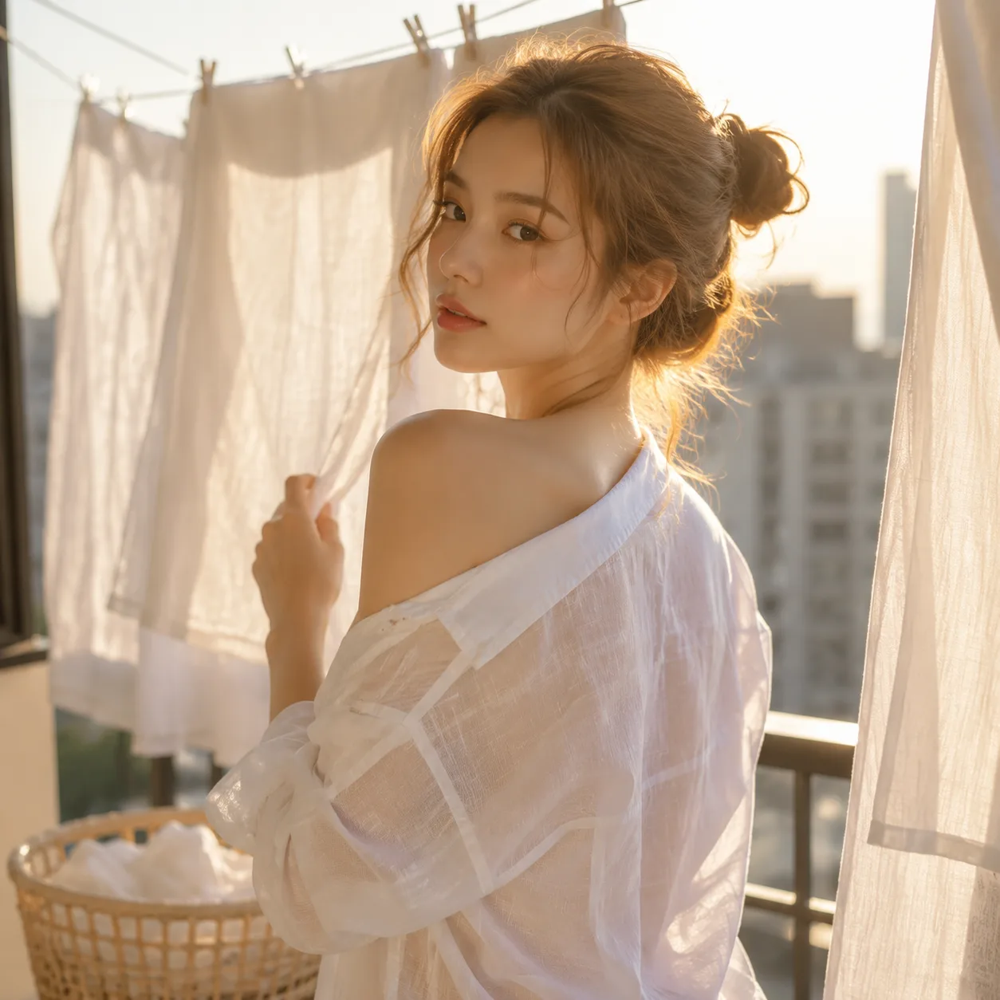

# Cinematic, Ai Art

[← Back to the collection](../../README.md) · Category: [UI & Graphic](../../gallery/ui-graphic.md) · Model: `Vinano Studio` · ID: `vn-01880`

<a href="https://vinano.ai?utm_source=github&utm_medium=readme&utm_campaign=awesome-image-video-prompts-updating&utm_content=prompt-page-image"></a>

<sub>Preview generated with <a href="https://vinano.ai?utm_source=github&utm_medium=readme&utm_campaign=awesome-image-video-prompts-updating&utm_content=prompt-page-caption">vinano.ai</a></sub>

## Prompt

```text
{
  "raw_prompt": "K-pop idol Sana (TWICE) posing on a sunlit balcony among hanging white laundry. She wears an oversized, sheer white button-down shirt slipping off one shoulder. Golden hour backlighting, soft skin textures, urban background, 8k resolution, filmic, cinematic lighting. --ar 9:16",
  "aspect_ratio": "9:16",
  "subjects": [{
      "name": "Sana (TWICE)",
      "physical_features": "Soft brown hair in a loose bun, feline eyes, high nose bridge, fair glowing skin, subtle coral lip tint.",
      "outfit": {
        "garment": "Oversized, translucent white linen button-down shirt, draped open to reveal one shoulder.",
        "footwear": "Barefoot.",
        "accessories": "None."
      },
      "pose_and_expression": "Side profile, looking back over shoulder a soft, dreamy gaze. One hand gently touching hanging fabric."
    }],
  "environment": "Apartment balcony white sheets drying on lines, blurred city buildings in the background, laundry basket at feet.",
  "photography_and_lighting": {
    "camera_style": "Professional DSLR, 50mm lens, shallow depth of field.",
    "lighting": "Warm golden hour sunlight, heavy backlighting creating a glowing rim light effect.",
    "color_grading": "Warm tones, soft contrast, airy and ethereal aesthetic."
  }
}

Emphasise material texture and natural light so the final frame feels tactile and premium.
```

## Try it on vinano.ai

1. Copy the prompt above.
2. Open **[vinano.ai](https://vinano.ai?utm_source=github&utm_medium=readme&utm_campaign=awesome-image-video-prompts-updating&utm_content=prompt-page-try)**, paste it into the image generator and pick a model.
3. Swap any placeholders (brand, product, city, person…) for your own details, then generate.

More prompts like this: [UI & Graphic gallery](../../gallery/ui-graphic.md) · [all categories](../../README.md#contents)
