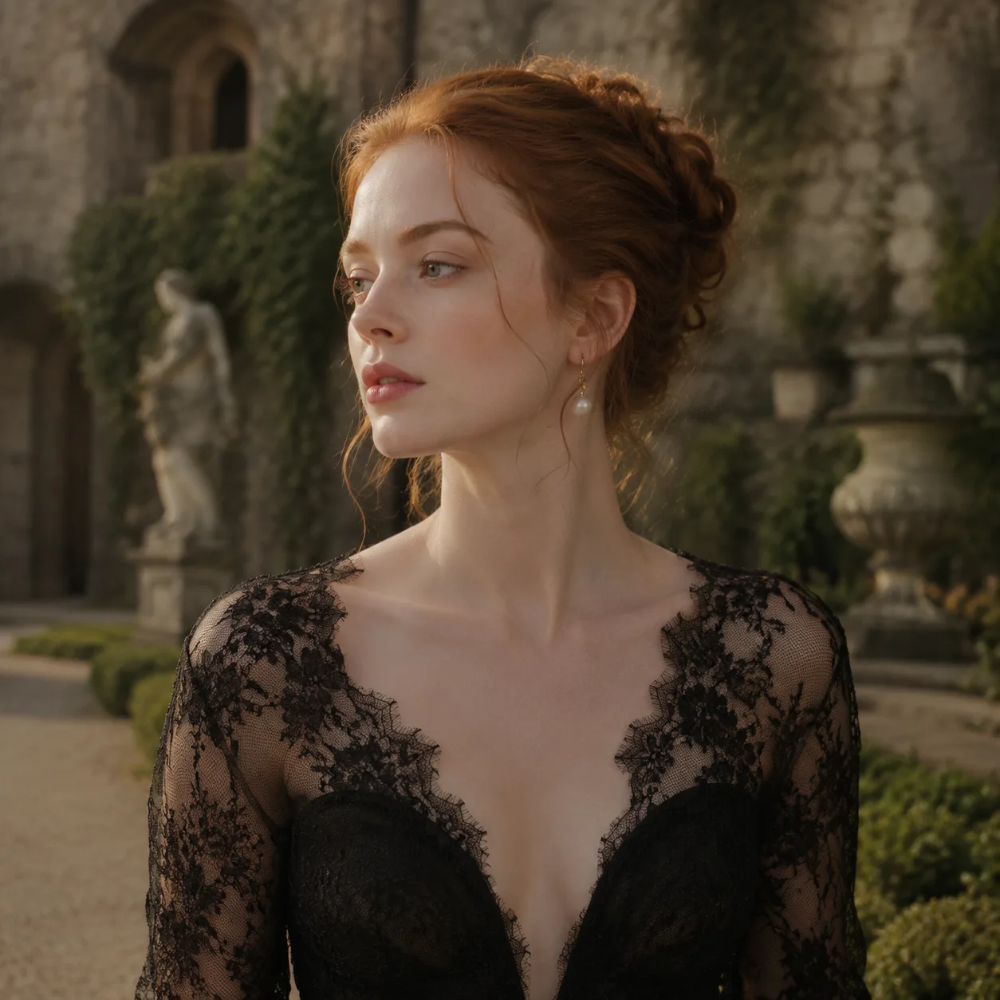

# Realistic, Portrait

[← Back to the collection](../../README.md) · Category: [UI & Graphic](../../gallery/ui-graphic.md) · Model: `Vinano Studio` · ID: `vn-01884`

<a href="https://vinano.ai?utm_source=github&utm_medium=readme&utm_campaign=awesome-image-video-prompts-updating&utm_content=prompt-page-image"></a>

<sub>Preview generated with <a href="https://vinano.ai?utm_source=github&utm_medium=readme&utm_campaign=awesome-image-video-prompts-updating&utm_content=prompt-page-caption">vinano.ai</a></sub>

## Prompt

```text
{
 "subject": {
 "character": "Sadie Sink",
 "age_range": "early to mid 20s",
 "skin_texture": "smooth, natural skin texture, soft porcelain tone",
 "expression": "calm, distant, introspective"
 },

 "pose_and_orientation": {
 "body_direction": "upper body fully facing the camera, straight on",
 "head_direction": "head turned gently to the left, matching the reference image angle",
 "gaze_direction": "looking past the camera to the left, identical to the reference image",
 "shoulders": "even, squared shoulders facing forward",
 "posture": "upright, elegant, noble posture"
 },

 "gaze": {
 "eye_focus": "soft, unfocused gaze into the distance",
 "emotion": "quiet confidence, subtle melancholy, composed elegance"
 },

 "mood": {
 "overall_feeling": "elegant, poetic, timeless",
 "energy": "soft, restrained, aristocratic",
 "atmosphere": "romantic European fine art portrait"
 },

 "hair": {
 "style": "loosely gathered messy bun",
 "structure": "soft volume at the crown, natural irregularity",
 "flyaways": "loose strands framing the face and neck",
 "finish": "natural, matte, effortless"
 },

 "accessories": {
 "earrings": "delicate dangling pearl earrings",
 "style": "classic, minimal, aristocratic",
 "movement": "subtle natural swing"
 },

 "outfit": {
 "reference_instruction": "base the outfit directly on the clothing in the provided reference image",
 "dress_type": "deep V-neck evening dress",
 "fabric": "sheer black lace overlay",
 "lace_detail": "intricate floral lace patterns identical in spirit to the reference",
 "inner_layer": "solid black structured bodice beneath the lace",
 "neckline_behavior": "lace softly draped over shoulders and collarbone as in the reference image",
 "overall_style": "haute couture, timeless, refined, identical silhouette to the reference"
 },

 "lighting": {
 "type": "soft natural daylight",
 "direction": "side lighting from camera right, matching reference",
 "shadow_style": "gentle shadows sculpting cheekbones and jawline",
 "contrast": "low contrast, painterly softness",
 "skin_light": "even, diffused glow"
 },

 "camera": {
 "shot_type": "medium close-up portrait",
 "lens": "85mm portrait lens look",
 "depth_of_field": "shallow depth of field soft background blur",
 "focus": "sharp focus on eyes and facial features"
 },

 "composition": {
 "framing": "vertical portrait",
 "subject_placement": "centered composition subtle negative space",
 "aesthetic": "fine art editorial photography"
 },

 "background": {
 "location": "historic European castle garden",
 "elements": ["ancient stone castle walls",
 "ivy-covered arches",
 "classical European garden statues",
 "trimmed hedges and greenery",
 "stone garden pathways"],
 "time_of_day": "late afternoon",
 "background_style": "romantic, softly blurred, cinematic"
 },

 "color_palette": {
 "dominant_colors": ["soft blush pink",
 "stone gray",
 "deep black",
 "muted garden green"],
 "tone": "warm, slightly desaturated, timeless"
 },

 "style_tags": ["fine art portrait",
 "filmic, cinematic lighting",
 "european aristocracy",
 "romantic realism",
 "fashion editorial",
 "renaissance inspired"],

 "quality": {
 "detail_level": "ultra-detailed",
 "resolution": "high resolution, 8k look",
 "texture_quality": "realistic lace, fabric and skin texture",
 "render_style": "true-to-life photorealistic painterly softness"
 },

 "negative_prompt": {
 "exclude": ["different pose than specified",
 "front-facing gaze",
 "modern clothing",
 "harsh lighting",
 "over-saturated colors",
 "plastic skin",
 "cartoon or illustration style",
 "distorted anatomy",
 "over-sharpening"]
 }
}

Aim for an editorial, design-driven look with deliberate negative space.
```

## Try it on vinano.ai

1. Copy the prompt above.
2. Open **[vinano.ai](https://vinano.ai?utm_source=github&utm_medium=readme&utm_campaign=awesome-image-video-prompts-updating&utm_content=prompt-page-try)**, paste it into the image generator and pick a model.
3. Swap any placeholders (brand, product, city, person…) for your own details, then generate.

More prompts like this: [UI & Graphic gallery](../../gallery/ui-graphic.md) · [all categories](../../README.md#contents)
