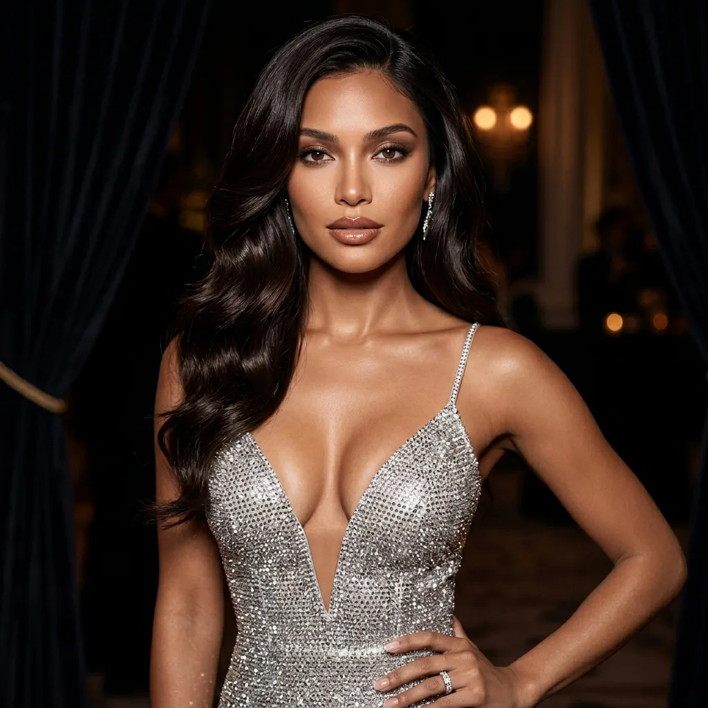

# Realistic, Portrait

[← Back to the collection](../../README.md) · Category: [UI & Graphic](../../gallery/ui-graphic.md) · Model: `Vinano Image Pro` · ID: `vn-01885`

<a href="https://vinano.ai?utm_source=github&utm_medium=readme&utm_campaign=awesome-image-video-prompts-updating&utm_content=prompt-page-image"></a>

<sub>Preview generated with <a href="https://vinano.ai?utm_source=github&utm_medium=readme&utm_campaign=awesome-image-video-prompts-updating&utm_content=prompt-page-caption">vinano.ai</a></sub>

## Prompt

```text
{
  "image_request": {
    "identity_lock": {
      "face_reference": "Use the uploaded reference image",
      "constraints": ["Preserve exact facial features",
        "No face alteration",
        "No morphing or beautification",
        "Maintain true bone structure, proportions, and asymmetry"]
    },
    "subject": {
      "type": "Adult woman Sydney Sweeney ",
      "style": "Luxury high-fashion editorial portrait"
    },
    "face_and_expression": {
      "features": "Striking, refined facial features identical to reference",
      "expression": "Calm, confident, elegant",
      "skin": {
        "finish": "Natural, flawless, realistic texture",
        "tone": "Warm, even, unedited"
      }
    },
    "makeup": {
      "style": "Luxury nude makeup",
      "color_palette": "Brown and bronze tones",
      "eyes": {
        "shadow": "Softly smudged bronze-brown",
        "liner": "Subtle, diffused",
        "lashes": "Defined but natural"
      },
      "contour": "Soft sculpting bronzed warmth",
      "lips": {
        "shape": "Naturally full",
        "finish": "Glossy, well-contoured nude-bronze"
      },
      "overall": "Elegant, high-end, polished without excess"
    },
    "hair": {
      "color": "Deep dark brown / black",
      "length": "Very long",
      "style": "Voluminous, flowing waves",
      "finish": "Glossy, luxurious, red-carpet ready"
    },
    "wardrobe": {
      "dress": {
        "type": "Gala gown",
        "material": "Fully covered in silver crystals",
        "effect": "Intensely reflective, high sparkle",
        "straps": "Thin straps",
        "neckline": "Extremely deep V-neck",
        "slit": "High thigh slit",
        "fit": "Figure-enhancing, elegant, couture-level"
      }
    },
    "lighting": {
      "style": "Cinematic editorial lighting",
      "quality": "Bright highlights on crystals, soft sculpting on face",
      "mood": "Luxurious, dramatic, red-carpet glamour",
      "contrast": "Balanced refined shadows"
    },
    "camera_and_quality": {
      "resolution": "Ultra-HD 8K",
      "realism": "Hyper-realistic photographic quality",
      "focus": "Sharp focus on face, hair, and crystal details",
      "depth_of_field": "Natural, editorial"
    },
    "aesthetic": {
      "theme": "High-glamour evening couture",
      "vibe": ["Elegant",
        "Powerful",
        "Luxury",
        "Timeless"]
    },
    "negative_prompt": ["face alteration",
      "beauty morphing",
      "cartoon",
      "CGI",
      "3D render",
      "plastic skin",
      "over-retouching",
      "low detail",
      "blur",
      "illustration" Ratio 3.4]
  }
 }

Preserve realistic proportions and depth for a confident, professional finish.
```

## Try it on vinano.ai

1. Copy the prompt above.
2. Open **[vinano.ai](https://vinano.ai?utm_source=github&utm_medium=readme&utm_campaign=awesome-image-video-prompts-updating&utm_content=prompt-page-try)**, paste it into the image generator and pick a model.
3. Swap any placeholders (brand, product, city, person…) for your own details, then generate.

More prompts like this: [UI & Graphic gallery](../../gallery/ui-graphic.md) · [all categories](../../README.md#contents)
