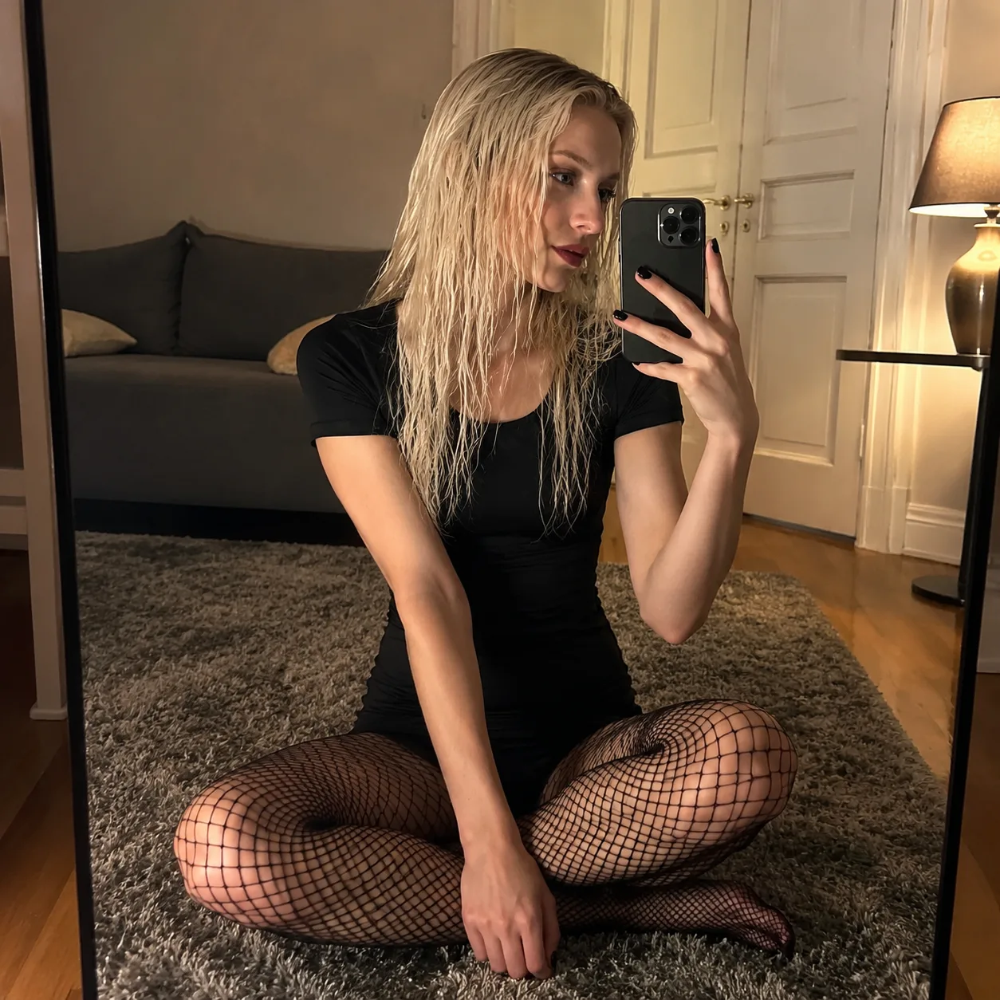

# Realistic, Ai Art

[← Back to the collection](../../README.md) · Category: [UI & Graphic](../../gallery/ui-graphic.md) · Model: `Vinano Studio` · ID: `vn-01896`

<a href="https://vinano.ai?utm_source=github&utm_medium=readme&utm_campaign=awesome-image-video-prompts-updating&utm_content=prompt-page-image"></a>

<sub>Preview generated with <a href="https://vinano.ai?utm_source=github&utm_medium=readme&utm_campaign=awesome-image-video-prompts-updating&utm_content=prompt-page-caption">vinano.ai</a></sub>

## Prompt

```text
{
 "meta": {
 "aspect_ratio": "9:16",
 "quality": "true-to-life photorealistic, raw, unedited smartphone photograph",
 "resolution": "8k",
 "camera": "Smartphone camera (e.g., iPhone 14 Pro)",
 "lens": "Wide-angle smartphone lens",
 "style": "Candid mirror selfie, natural indoor evening light, warm tone",
 "composition": "Full-body mirror shot of a woman sitting on a rug, holding a smartphone to take the photo."
 },
 "scene": {
 "location": "Indoor living room",
 "environment": ["Large grey shag rug on wooden floor",
 "Dark grey sofa in background",
 "White double doors",
 "Warm ambient lighting from a lamp"],
 "time": "Evening",
 "atmosphere": "Casual, relaxed, intimate"
 },
 "lighting": {
 "type": "Warm, dim indoor light",
 "source": "Lamp light from the side and smartphone screen light",
 "effect": "Soft, warm glow shadows, highlighting wet hair and fishnet texture."
 },
 "subject": {
 "identity": "The woman from image_0.png wet platinum blonde hair.",
 "body": {
 "pose": "Sitting cross-legged on the grey rug, looking at the smartphone in her hand, holding it up for a mirror selfie.",
 "physique": "Slim build."
 },
 "outfit": {
 "clothing": "Black short-sleeved mini-dress, black fishnet tights.",
 "accessories": "None visible besides the smartphone."
 }
 },
 "realism_focus": {
 "textures": "Wet hair strands, detailed mesh of the fishnet tights, texture of the grey shag rug, fabric of the black dress.",
 "imperfections": "Natural skin texture, realistic phone reflection in the mirror."
 }
}

Preserve realistic proportions and depth for a confident, professional finish.
```

## Try it on vinano.ai

1. Copy the prompt above.
2. Open **[vinano.ai](https://vinano.ai?utm_source=github&utm_medium=readme&utm_campaign=awesome-image-video-prompts-updating&utm_content=prompt-page-try)**, paste it into the image generator and pick a model.
3. Swap any placeholders (brand, product, city, person…) for your own details, then generate.

More prompts like this: [UI & Graphic gallery](../../gallery/ui-graphic.md) · [all categories](../../README.md#contents)
