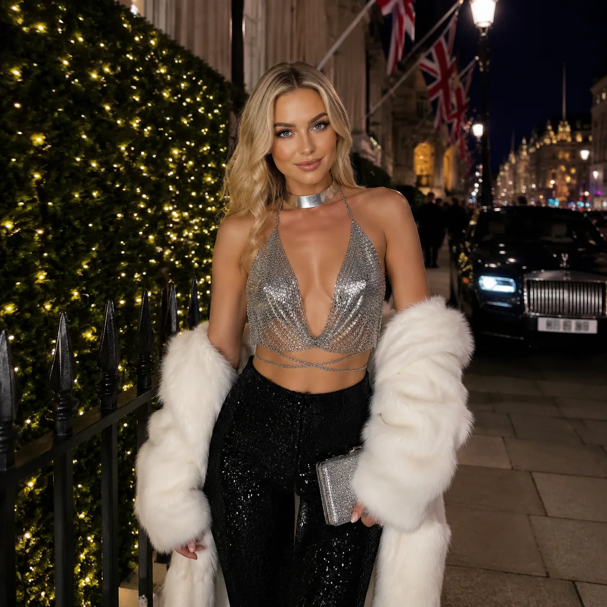

# Realistic, Cinematic

[← Back to the collection](../../README.md) · Category: [UI & Graphic](../../gallery/ui-graphic.md) · Model: `Vinano Studio` · ID: `vn-01902`

<a href="https://vinano.ai?utm_source=github&utm_medium=readme&utm_campaign=awesome-image-video-prompts-updating&utm_content=prompt-page-image"></a>

<sub>Preview generated with <a href="https://vinano.ai?utm_source=github&utm_medium=readme&utm_campaign=awesome-image-video-prompts-updating&utm_content=prompt-page-caption">vinano.ai</a></sub>

## Prompt

```text
{
 "canvas": {
 "width": 1200,
 "height": 1200
 },
 "subject": {
 "gender": "female",
 "age_range": "early to mid 20s",
 "ethnicity": "fair-skinned, European appearance",
 "hair": {
 "color": "golden blonde",
 "length": "long",
 "style": "loose, soft waves",
 "parting": "center part"
 },
 "face": {
 "shape": "oval",
 "skin_tone": "warm fair",
 "makeup": {
 "foundation": "smooth, natural finish",
 "eyes": "defined lashes, subtle smoky eyeliner",
 "eyebrows": "well-shaped, medium thickness",
 "lips": "nude peach matte lipstick",
 "blush": "soft warm pink"
 },
 "expression": "soft confident smile",
 "eye_color": "light blue"
 },
 "pose": {
 "body_position": "standing upright",
 "orientation": "facing the camera",
 "shoulders": "relaxed",
 "arms": "left arm holding clutch, right arm relaxed"
 }
 },
 "outfit": {
 "top": {
 "type": "metallic chainmail halter top",
 "color": "silver",
 "design": "deep plunging V neckline",
 "details": ["thin chain straps",
 "horizontal chain strap wrapped across midriff"]
 },
 "outerwear": {
 "type": "faux fur coat",
 "color": "white",
 "texture": "plush and fluffy",
 "wear_style": "draped off shoulders, resting around elbows"
 },
 "bottoms": {
 "type": "high-waisted trousers",
 "color": "black",
 "material": "sequined fabric",
 "fit": "slim fit"
 },
 "accessories": {
 "handbag": {
 "type": "small clutch",
 "color": "silver metallic",
 "finish": "glittered"
 }
 },
 "jewelry": {
 "neck": "wide silver choker collar",
 "connection": "choker attached to halter top chain"
 }
 },
 "environment": {
 "location": "luxury city street at night",
 "city_vibe": "London-inspired",
 "background_elements": ["grand stone building tall columns",
 "Union Jack flags mounted on building facade",
 "ornate black metal fencing",
 "large green hedge wrapped in warm fairy lights",
 "parked black luxury car resembling Rolls-Royce",
 "street lamps",
 "blurred pedestrians and traffic lights in distance"],
 "ground": "clean stone pavement"
 },
 "lighting": {
 "time": "night",
 "sources": ["warm decorative fairy lights",
 "soft street lighting",
 "ambient building lights"],
 "effect_on_subject": "even illumination on face and outfit",
 "color_temperature": "warm foreground cool background highlights"
 },
 "camera": {
 "shot_type": "medium shot",
 "angle": "eye-level",
 "focus": "sharp focus on subject",
 "depth_of_field": "shallow",
 "background": "cinematic bokeh"
 },
 "style": {
 "aesthetic": "luxury glamour",
 "mood": "confident, elegant, upscale nightlife",
 "photography_type": "high-end smartphone or mirrorless camera",
 "realism_level": "true-to-life photorealistic",
 "grain": "very subtle night grain"
 },
 "color_palette": {
 "primary_colors": ["silver", "white", "black"],
 "accent_colors": ["warm gold lights", "deep night blues"]
 }
}

Emphasise material texture and natural light so the final frame feels tactile and premium.
```

## Try it on vinano.ai

1. Copy the prompt above.
2. Open **[vinano.ai](https://vinano.ai?utm_source=github&utm_medium=readme&utm_campaign=awesome-image-video-prompts-updating&utm_content=prompt-page-try)**, paste it into the image generator and pick a model.
3. Swap any placeholders (brand, product, city, person…) for your own details, then generate.

More prompts like this: [UI & Graphic gallery](../../gallery/ui-graphic.md) · [all categories](../../README.md#contents)
