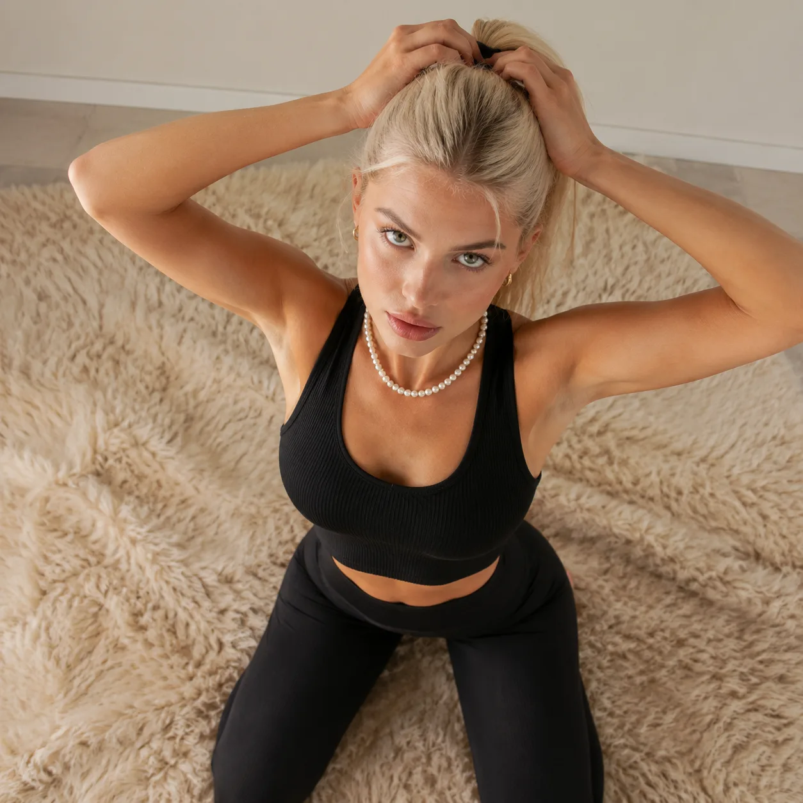

# Realistic, Minimalist

[← Back to the collection](../../README.md) · Category: [UI & Graphic](../../gallery/ui-graphic.md) · Model: `Vinano Studio` · ID: `vn-01911`

<a href="https://vinano.ai?utm_source=github&utm_medium=readme&utm_campaign=awesome-image-video-prompts-updating&utm_content=prompt-page-image"></a>

<sub>Preview generated with <a href="https://vinano.ai?utm_source=github&utm_medium=readme&utm_campaign=awesome-image-video-prompts-updating&utm_content=prompt-page-caption">vinano.ai</a></sub>

## Prompt

```text
{
 "meta": {
 "aspect_ratio": "4:5",
 "quality": "ultra_photorealistic, raw, professional fashion photography",
 "resolution": "8k",
 "camera": "Mirrorless camera (e.g., Sony A7R IV)",
 "lens": "24mm f/1.4 wide-angle lens",
 "style": "Clean girl aesthetic, refined minimalist, athletic lifestyle, high-end studio look",
 "composition": "Extreme high-angle shot looking directly down at a woman kneeling, centered framing, focus on face and upper body."
 },
 "scene": {
 "location": "A refined minimalist, bright interior room neutral tones.",
 "environment": ["Large, plush, shaggy beige faux-fur rug on the floor",
 "Plain off-white or light beige wall in the background",
 "Clean, uncluttered refined minimalist space"],
 "time": "Daytime, bright and airy indoor setting.",
 "atmosphere": "Confident, cozy, modern, polished."
 },
 "lighting": {
 "type": "Soft, diffused natural daylight or overhead softbox lighting.",
 "source": "Large window or professional studio light from above.",
 "effect": "Even, bright illumination that eliminates harsh shadows, highlighting the glow of the skin and the texture of the blonde hair."
 },
 "subject": {
 "identity": "A stunningly beautiful young woman sleek platinum blonde hair, fair skin, and light green eyes. She has distinctively plump, natural lips and defined eyebrows.",
 "body": {
 "pose": "Kneeling on the shaggy rug, leaning her body forward towards the lens, hands raised to her head as she adjusts a high ponytail.",
 "physique": "Fit, athletic build toned arms and shoulders."
 },
 "outfit": {
 "clothing": "Black sleeveless ribbed crop top, matching high-waisted black yoga leggings.",
 "accessories": "Elegant white pearl necklace, small gold hoop earrings."
 }
 },
 "realism_focus": {
 "textures": "Detailed fiber texture of the shaggy rug, ribbed fabric of the black top, individual strands and sheen of the blonde hair, smooth but realistic skin texture subtle pores.",
 "imperfections": "Natural highlights on the lips and eyes, soft shadows cast on the rug, realistic tension in the arms while holding the hair."
 }
}

Emphasise material texture and natural light so the final frame feels tactile and premium.
```

## Try it on vinano.ai

1. Copy the prompt above.
2. Open **[vinano.ai](https://vinano.ai?utm_source=github&utm_medium=readme&utm_campaign=awesome-image-video-prompts-updating&utm_content=prompt-page-try)**, paste it into the image generator and pick a model.
3. Swap any placeholders (brand, product, city, person…) for your own details, then generate.

More prompts like this: [UI & Graphic gallery](../../gallery/ui-graphic.md) · [all categories](../../README.md#contents)
