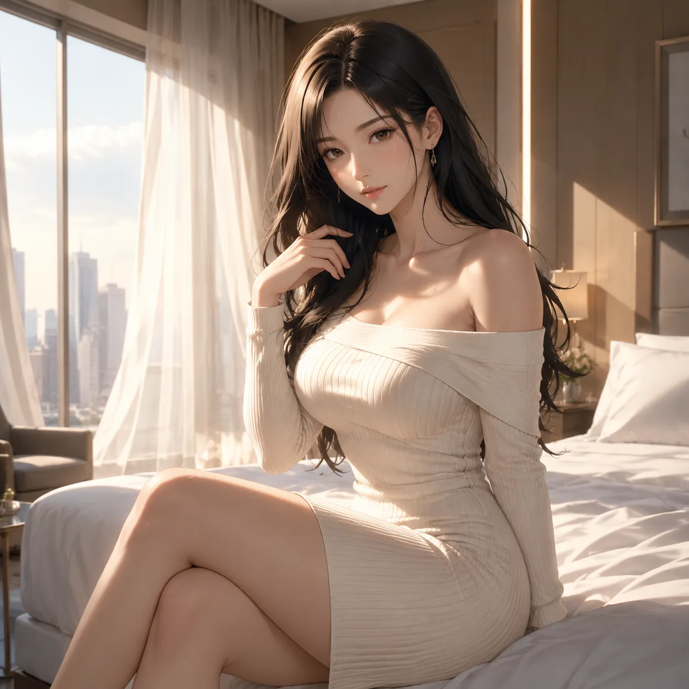

# Anime, Realistic

[← Back to the collection](../../README.md) · Category: [UI & Graphic](../../gallery/ui-graphic.md) · Model: `Vinano Studio` · ID: `vn-01944`

<a href="https://vinano.ai?utm_source=github&utm_medium=readme&utm_campaign=awesome-image-video-prompts-updating&utm_content=prompt-page-image"></a>

<sub>Preview generated with <a href="https://vinano.ai?utm_source=github&utm_medium=readme&utm_campaign=awesome-image-video-prompts-updating&utm_content=prompt-page-caption">vinano.ai</a></sub>

## Prompt

```text
9:16 aspect ratio, traditional anime style, premium cinematic illustration, ultra-detailed anime artwork, premium-quality Japanese animation aesthetics, elegant young Japanese woman (around 23 years old), refined and natural beauty, soft translucent skin, smooth complexion, no blush on cheeks, clean and sophisticated makeup, calm expression, slightly mature atmosphere.

Face design: delicate facial structure, slim jawline, elegant nose bridge, sharp almond-shaped eyes, slightly elongated eye shape, dark brown eyes, gentle but confident gaze directed at camera, subtle glossy lips, composed expression.

Hair: long glossy black hair soft waves, natural volume, silky highlights, flowing strands around shoulders.

Scene: luxury hotel bedroom in the morning, warm golden sunlight entering through floor-to-ceiling windows, sheer white curtains gently moving, quiet city skyline outside, beige and light wood refined minimalist interior, elegant modern furniture, white bed sheets illuminated by natural light, sophisticated and peaceful atmosphere.

Outfit: creamy white fitted off-shoulder knit dress, premium ribbed fabric, elegant neckline revealing shoulders and collarbone, refined silhouette, slim waist emphasis, smooth natural body lines, tasteful fashion styling.

Pose: sitting sideways on edge of bed, upper body softly turned toward camera, one hand touching hair near collarbone, legs elegantly crossed, relaxed posture, subtle S-curve body line, graceful shoulder angle, intimate but classy mood.

Body balance: mature natural proportions, elegant neck and shoulder lines, refined waist transition, smooth silhouette, feminine yet sophisticated presence.

Lighting: cinematic warm morning light, soft indoor illumination, delicate highlights on skin and fabric texture, subtle rim light around hair and shoulders, realistic shadows, atmospheric depth, premium fashion magazine feeling.

Camera composition: upper body to thighs framing, shallow depth of field, creamy bokeh, natural perspective, visual focus on eyes, collarbone, waistline and elegant silhouette.

Style tags: traditional anime illustration, high-end anime key visual, cinematic storytelling mood, luxury lifestyle aesthetic, detailed linework, soft rendering, elegant atmosphere, masterpiece quality, anime movie frame.

Emphasise material texture and natural light so the final frame feels tactile and premium.
```

## Try it on vinano.ai

1. Copy the prompt above.
2. Open **[vinano.ai](https://vinano.ai?utm_source=github&utm_medium=readme&utm_campaign=awesome-image-video-prompts-updating&utm_content=prompt-page-try)**, paste it into the image generator and pick a model.
3. Swap any placeholders (brand, product, city, person…) for your own details, then generate.

More prompts like this: [UI & Graphic gallery](../../gallery/ui-graphic.md) · [all categories](../../README.md#contents)
