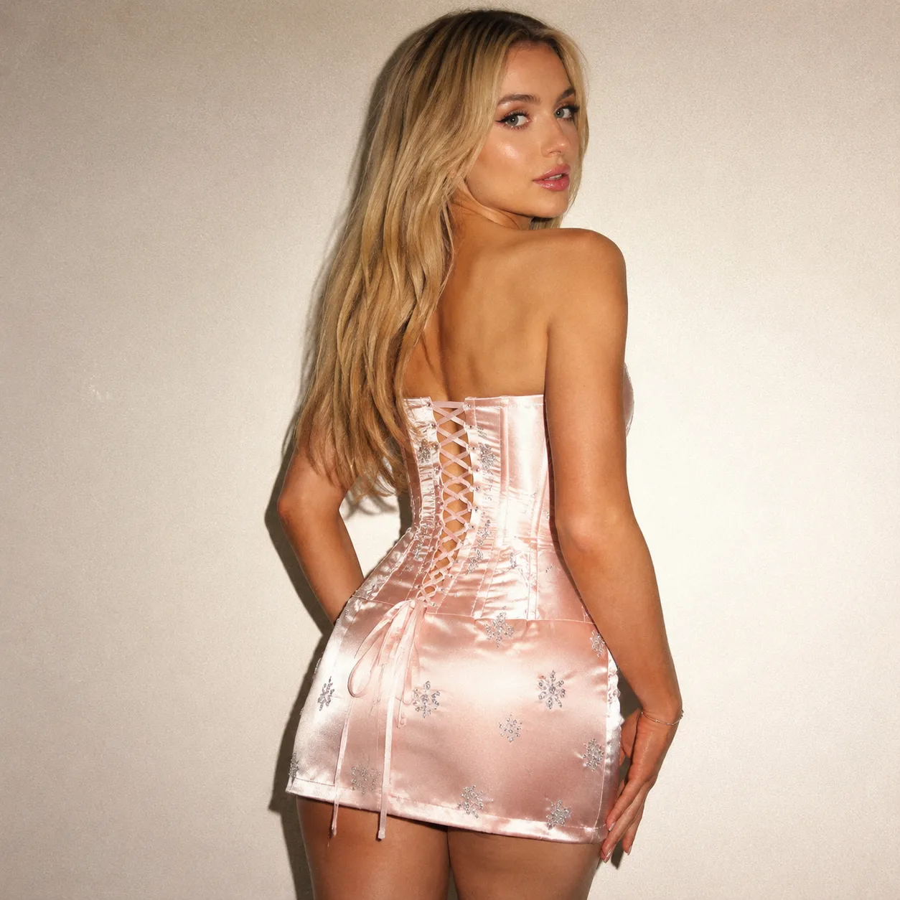

# Realistic, Portrait

[← Back to the collection](../../README.md) · Category: [UI & Graphic](../../gallery/ui-graphic.md) · Model: `Vinano Studio` · ID: `vn-01947`

<a href="https://vinano.ai?utm_source=github&utm_medium=readme&utm_campaign=awesome-image-video-prompts-updating&utm_content=prompt-page-image"></a>

<sub>Preview generated with <a href="https://vinano.ai?utm_source=github&utm_medium=readme&utm_campaign=awesome-image-video-prompts-updating&utm_content=prompt-page-caption">vinano.ai</a></sub>

## Prompt

```text
{
 "meta_data": {
 "prompt_version": "2.0",
 "use_case": "High-Fashion true-to-life photorealistic Image Generation",
 "main_subject_count": 1,
 "reference_image": {
 "face_consistency": true,
 "instruction": "Use the same face from the reference image without changing facial features"
 }
 },
 "subject_layer": {
 "anatomy": {
 "gender": "Female",
 "age_group": "Young adult",
 "ethnicity": "Western",
 "build": "Slim, elegant"
 },
 "pose_expression": {
 "pose": "Full-body portrait, body angled away, looking over her shoulder toward the camera",
 "expression": "Soft, glamorous, confident"
 },
 "hair_makeup": {
 "hair": {
 "color": "Blonde",
 "length": "Long",
 "style": "Smooth, flowing naturally over shoulders"
 },
 "makeup": {
 "eyes": "Soft winged eyeliner",
 "lips": "Glossy, luminous finish",
 "overall_style": "Polished, editorial glamour"
 }
 },
 "wardrobe": {
 "outfit": "Pale pink satin mini dress",
 "design_details": ["Structured corset back",
 "Lace-up detailing",
 "Crystal floral embellishments scattered across fabric"],
 "material_texture": "premium-quality satin subtle sheen",
 "embellishments": "Shimmering rhinestones sharp detail"
 }
 },
 "photography_style": {
 "aesthetic": "1990s vintage editorial",
 "camera_effects": ["Subtle film grain",
 "High contrast",
 "Warm, saturated color tones"],
 "lighting": {
 "type": "Direct hard flash",
 "effect": "Creates slight shadow on background",
 "vibe": "Paparazzi / disposable camera look"
 },
 "background": {
 "setting": "Plain studio wall",
 "color": "Off-white"
 },
 "focus_details": ["Sharp focus on corset lacing",
 "Visible satin texture",
 "Crisp rhinestone reflections"]
 },
 "image_quality": {
 "realism": "true-to-life photorealistic",
 "resolution": "Ultra high-definition",
 "detail_level": "Editorial-grade clarity and texture"
 }
}

Keep edges clean and the overall composition balanced for a polished, gallery-ready result.
```

## Try it on vinano.ai

1. Copy the prompt above.
2. Open **[vinano.ai](https://vinano.ai?utm_source=github&utm_medium=readme&utm_campaign=awesome-image-video-prompts-updating&utm_content=prompt-page-try)**, paste it into the image generator and pick a model.
3. Swap any placeholders (brand, product, city, person…) for your own details, then generate.

More prompts like this: [UI & Graphic gallery](../../gallery/ui-graphic.md) · [all categories](../../README.md#contents)
