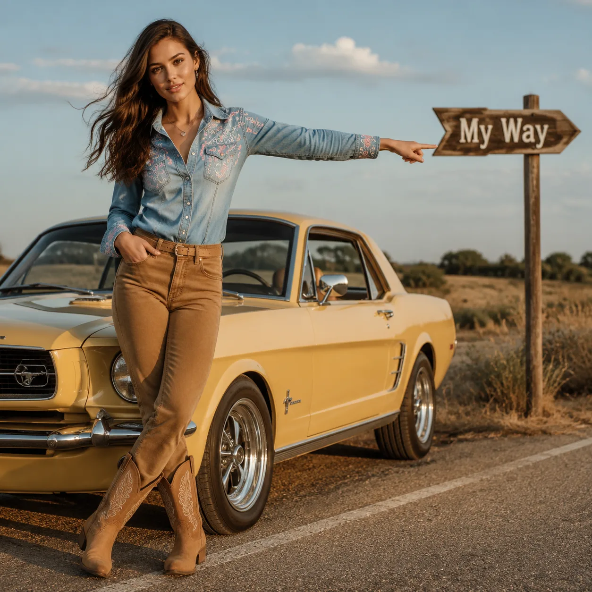

# Realistic, Portrait

[← Back to the collection](../../README.md) · Category: [UI & Graphic](../../gallery/ui-graphic.md) · Model: `Vinano Studio` · ID: `vn-01949`

<a href="https://vinano.ai?utm_source=github&utm_medium=readme&utm_campaign=awesome-image-video-prompts-updating&utm_content=prompt-page-image"></a>

<sub>Preview generated with <a href="https://vinano.ai?utm_source=github&utm_medium=readme&utm_campaign=awesome-image-video-prompts-updating&utm_content=prompt-page-caption">vinano.ai</a></sub>

## Prompt

```text
{
 "project": " – Maximalist Editorial Americana Scene",
 "version": "2.4",
 "engine_optimization": " (maximalist cinematic photorealism, high detail density, controlled imperfection)",
 "render_intent": "cohesive western color harmony refined fashion detail and narrative clarity",
 "frame": {
 "aspect_ratio": "3:4",
 "shot_type": "medium-full portrait",
 "camera_angle": "eye-level subtle cinematic parallax",
 "composition": "subject foreground dominant, pointing gesture aligned parallel to the sign, car balancing the frame",
 "lens_simulation": "50mm full-frame prime",
 "camera_metadata": {
 "iso": 100,
 "shutter_speed": "1/320",
 "aperture": "f/1.8"
 },
 "depth_of_field": "shallow, face and guiding hand crisp, background softly diffused"
 },
 "subject": {
 "type": "young woman",
 "approximate_age": "early to mid 20s",
 "identity_consistency": "single subject, realistic anatomy, natural proportions",
 "appearance": {
 "hair": {
 "color": "deep brunette",
 "length": "long",
 "style": "loose, softly flowing, gently wind-swept"
 },
 "face": {
 "beauty_level": "very beautiful, striking yet natural",
 "pose_detail": "face slightly tilted, enhancing elegance and approachability"
 },
 "skin": {
 "tone": "light to medium",
 "details": ["natural texture",
 "subtle freckles",
 "soft daylight glow"]
 },
 "eyes": {
 "color": "warm brown or hazel",
 "expression": "inviting, confident, gently persuasive"
 },
 "makeup": "minimal, clean editorial finish"
 },
 "expression": "calm confidence a subtle, encouraging smile",
 "pose": "standing beside the car, torso slightly angled, arm extended horizontally, pointing parallel to the sign as if signaling ‘follow that way, follow me’"
 },
 "wardrobe": {
 "top": "light pastel blue denim shirt visible weave, pink and white embroidery in refined western motifs",
 "fit": "relaxed yet tailored",
 "bottom": "light brown pants, soft twill or suede-like texture, tailored natural creases",
 "footwear": "warm tan suede cowboy boots, medium contrast, elegant western stitching, slightly worn for authenticity",
 "accessories": ["silver necklace",
 "small silver heart-shaped pendant, delicate and understated, resting just below the collarbone"],
 "fabric_behavior": "authentic material stiffness and drape, embroidered threads catching light, natural folds and tension"
 },
 "vehicle": {
 "type": "classic Ford Mustang",
 "color": "lemon yellow",
 "finish": "glossy paint realistic reflections and subtle surface imperfections",
 "positioning": "parked beside the subject at a slight diagonal, iconic profile visible"
 },
 "environment": {
 "location": "open roadside or rural edge",
 "background_elements": ["roadside sign clearly legible text: 'My Way'",
 "open sky",
 "soft greenery or distant fields"],
 "atmosphere": "freedom, direction, invitation, optimistic Americana mood"
 },
 "lighting": {
 "type": "natural daylight",
 "source": "open sky sunlight",
 "time_of_day": "late afternoon",
 "quality": "soft, directional, cinematic",
 "effects": ["gentle rim light on hair and shoulders",
 "subtle highlights on silver jewelry",
 "soft reflections on car paint"],
 "shadow_behavior": "clean, soft-edged, physically accurate"
 },
 "color_palette": {
 "dominant_colors": ["lemon yellow",
 "pastel denim blue",
 "light brown",
 "warm tan",
 "soft pink and white embroidery",
 "natural skin tones",
 "silver accents"],
 "grading_style": "warm cinematic editorial grading filmic highlight roll-off"
 }
}

Aim for an editorial, design-driven look with deliberate negative space.
```

## Try it on vinano.ai

1. Copy the prompt above.
2. Open **[vinano.ai](https://vinano.ai?utm_source=github&utm_medium=readme&utm_campaign=awesome-image-video-prompts-updating&utm_content=prompt-page-try)**, paste it into the image generator and pick a model.
3. Swap any placeholders (brand, product, city, person…) for your own details, then generate.

More prompts like this: [UI & Graphic gallery](../../gallery/ui-graphic.md) · [all categories](../../README.md#contents)
