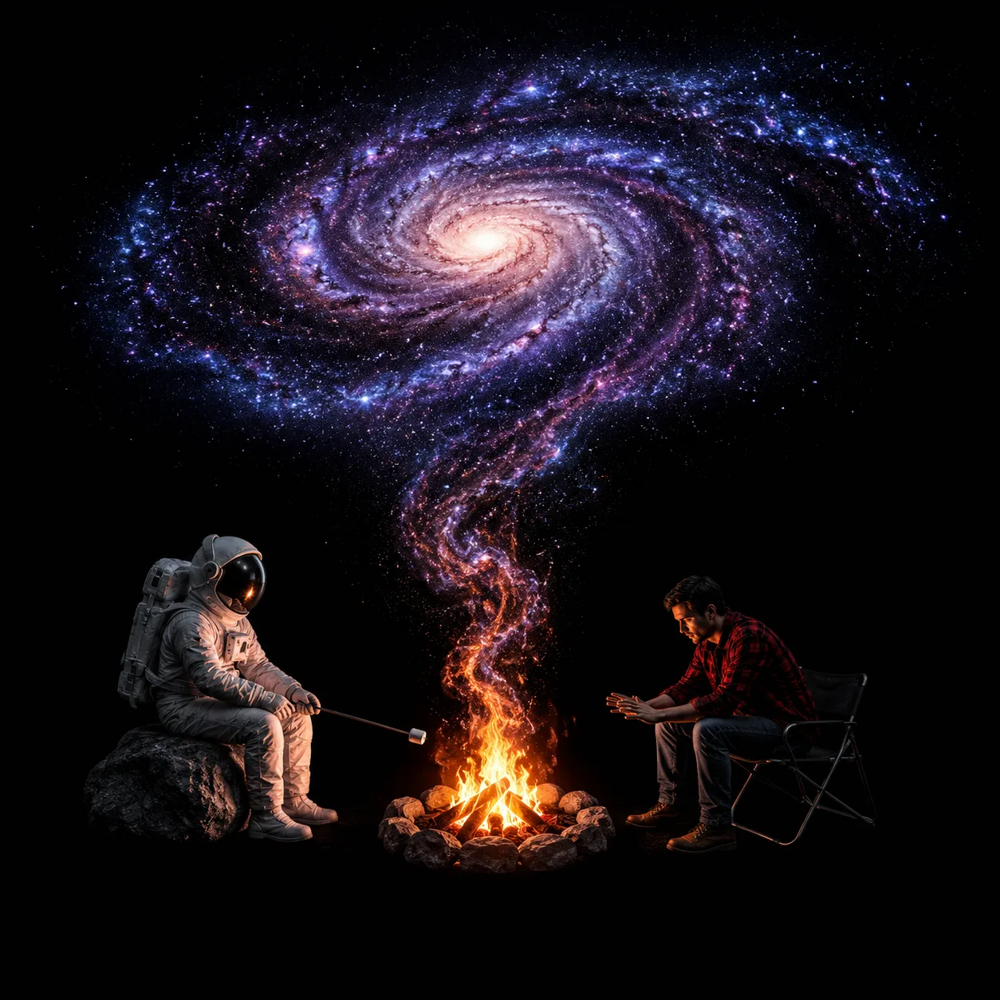

# Realistic, Character

[← Back to the collection](../../README.md) · Category: [UI & Graphic](../../gallery/ui-graphic.md) · Model: `Vinano Studio` · ID: `vn-01953`

<a href="https://vinano.ai?utm_source=github&utm_medium=readme&utm_campaign=awesome-image-video-prompts-updating&utm_content=prompt-page-image"></a>

<sub>Preview generated with <a href="https://vinano.ai?utm_source=github&utm_medium=readme&utm_campaign=awesome-image-video-prompts-updating&utm_content=prompt-page-caption">vinano.ai</a></sub>

## Prompt

```text
{
 "type": "image_generation_prompt",
 "style": "surreal, cinematic, conceptual art",
 "camera": {
 "angle": "high-angle",
 "shot": "full shot",
 "composition": "symmetrical balance central campfire dividing two characters",
 "background": "pitch-black void no visible environment"
 },
 "scene": {
 "setting": "abstract cosmic space",
 "environment": "dark void emphasizing isolation and contrast",
 "resolution": "8k",
 "render_style": "true-to-life photorealistic"
 },
 "characters": [{
 "position": "left",
 "subject": "astronaut",
 "pose": "sitting",
 "seat": "rough gray rock",
 "appearance": {
 "suit": "highly detailed realistic white space suit",
 "helmet": "on, reflective visor"
 },
 "action": "holding a stick and roasting a marshmallow over the fire"
 },
 {
 "position": "right",
 "subject": "young man",
 "pose": "sitting and leaning forward",
 "seat": "metal folding chair",
 "appearance": {
 "hair": "dark hair",
 "clothing": {
 "top": "red and black plaid flannel shirt",
 "bottom": "blue jeans",
 "footwear": "brown boots"
 }
 },
 "action": "warming hands by the fire"
 }],
 "central_element": {
 "object": "campfire",
 "style": "magical and surreal",
 "fire_behavior": "flames transition seamlessly into a spiral galaxy",
 "galaxy": {
 "type": "true-to-life photorealistic spiral galaxy",
 "details": ["glittering stars",
 "cosmic dust",
 "swirling motion"],
 "shape": "arching overhead like a celestial canopy"
 }
 },
 "lighting": {
 "primary_light": "warm orange glow from the campfire",
 "secondary_light": "cool blue and purple glow from the galaxy",
 "mood": "dramatic, cinematic, ethereal",
 "shadows": "soft but deep, emphasizing contrast"
 },
 "color_palette": {
 "dominant": ["black", "orange", "blue", "purple"],
 "accent": ["white", "red", "brown"]
 },
 "themes": ["human connection",
 "cosmic wonder",
 "contrast between the ordinary and the infinite",
 "shared warmth in an infinite universe"],
 "quality_tags": ["ultra-detailed",
 "true-to-life photorealistic textures",
 "filmic, cinematic lighting",
 "sharp focus",
 "high dynamic range"]
}

Aim for an editorial, design-driven look with deliberate negative space.
```

## Try it on vinano.ai

1. Copy the prompt above.
2. Open **[vinano.ai](https://vinano.ai?utm_source=github&utm_medium=readme&utm_campaign=awesome-image-video-prompts-updating&utm_content=prompt-page-try)**, paste it into the image generator and pick a model.
3. Swap any placeholders (brand, product, city, person…) for your own details, then generate.

More prompts like this: [UI & Graphic gallery](../../gallery/ui-graphic.md) · [all categories](../../README.md#contents)
