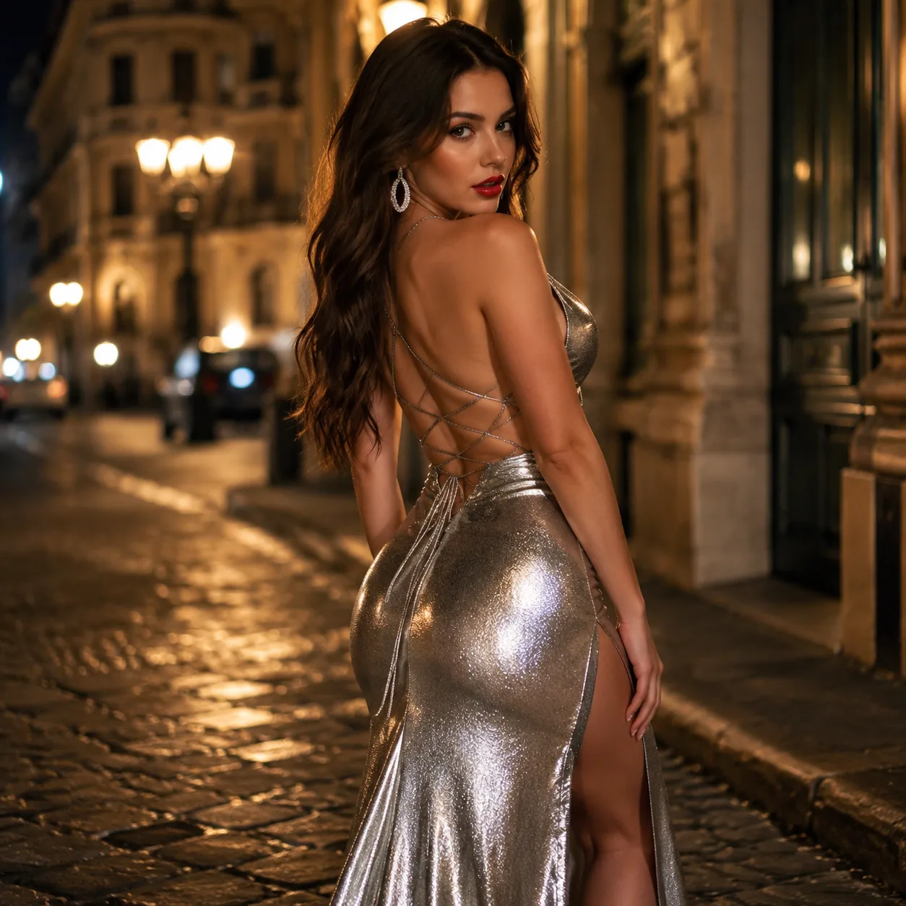

# Realistic, Portrait

[← Back to the collection](../../README.md) · Category: [UI & Graphic](../../gallery/ui-graphic.md) · Model: `Vinano Studio` · ID: `vn-01960`

<a href="https://vinano.ai?utm_source=github&utm_medium=readme&utm_campaign=awesome-image-video-prompts-updating&utm_content=prompt-page-image"></a>

<sub>Preview generated with <a href="https://vinano.ai?utm_source=github&utm_medium=readme&utm_campaign=awesome-image-video-prompts-updating&utm_content=prompt-page-caption">vinano.ai</a></sub>

## Prompt

```text
{
 "generation_parameters": {
 "type": "photorealistic_cinematic_portrait",
 "aspect_ratio": "3:4",
 "quality_preset": "ultra_high_definition",
 "model_reference": "Ana de Armas"
 },
 "subject_breakdown": {
 "identity": {
 "name": "Ana de Armas",
 "facial_features": {
 "skin_texture": "hyper-realistic pore detail, soft natural skin sheen",
 "eyes": "deep hazel-green, intense eye contact, sharp focus, catching the light",
 "lips": "bold classic red lipstick, matte finish, perfectly defined",
 "expression": "alluring, mysterious, looking back over shoulder"
 },
 "hair": {
 "color": "dark chocolate brown",
 "style": "long, loose waves cascading down the back",
 "texture": "silky, voluminous, high-shine"
 },
 "physique": {
 "body_type": "curvy hourglass figure",
 "silhouette": "form-fitting, accentuated curves"
 }
 },
 "attire_and_styling": {
 "main_garment": {
 "item": "maxi dress",
 "fit": "extremely tight, bodycon, second-skin fit",
 "material": "glittering metallic silver fabric, liquid metal effect, high reflectivity",
 "design_details": ["dramatic open back",
 "thin criss-cross lace-up straps across the back",
 "deep thigh-high side slit",
 "floor-length hem"]
 },
 "accessories": {
 "jewelry": "large oversized crystal hoop earrings, diamond sparkle",
 "shoes": "strappy silver high heels (partially visible)"
 }
 }
 },
 "environment_context": {
 "setting": {
 "location": "Luxurious Old European Street",
 "architecture": "Baroque facades, cobblestone pavement, vintage aesthetics",
 "atmosphere": "nightlife, sophisticated, romantic, moody"
 },
 "background_elements": {
 "details": "blurred city lights, bokeh effect, historic buildings in shadow",
 "depth": "shallow depth of field to isolate subject"
 }
 },
 "lighting_and_atmosphere": {
 "lighting_setup": {
 "primary_source": "warm golden street lamps",
 "ambient": "soft city glow",
 "accents": "rim lighting highlighting hair and shoulder profile",
 "shadows": "soft, cinematic contrast"
 },
 "color_palette": {
 "tones": ["silver", "gold", "deep midnight blue", "crimson red"],
 "temperature": "warm vs cool contrast"
 }
 },
 "technical_specifications": {
 "photography_style": "fashion editorial, cinematic glamour",
 "camera_settings": {
 "focal_length": "85mm portrait lens",
 "aperture": "f/1.8",
 "iso": "400",
 "shutter_speed": "1/125"
 },
 "render_quality": ["8k resolution",
 "unreal engine 5 style",
 "octane render",
 "ray tracing",
 "sharp focus on eyes"]
 }
}

Keep edges clean and the overall composition balanced for a polished, gallery-ready result.
```

## Try it on vinano.ai

1. Copy the prompt above.
2. Open **[vinano.ai](https://vinano.ai?utm_source=github&utm_medium=readme&utm_campaign=awesome-image-video-prompts-updating&utm_content=prompt-page-try)**, paste it into the image generator and pick a model.
3. Swap any placeholders (brand, product, city, person…) for your own details, then generate.

More prompts like this: [UI & Graphic gallery](../../gallery/ui-graphic.md) · [all categories](../../README.md#contents)
