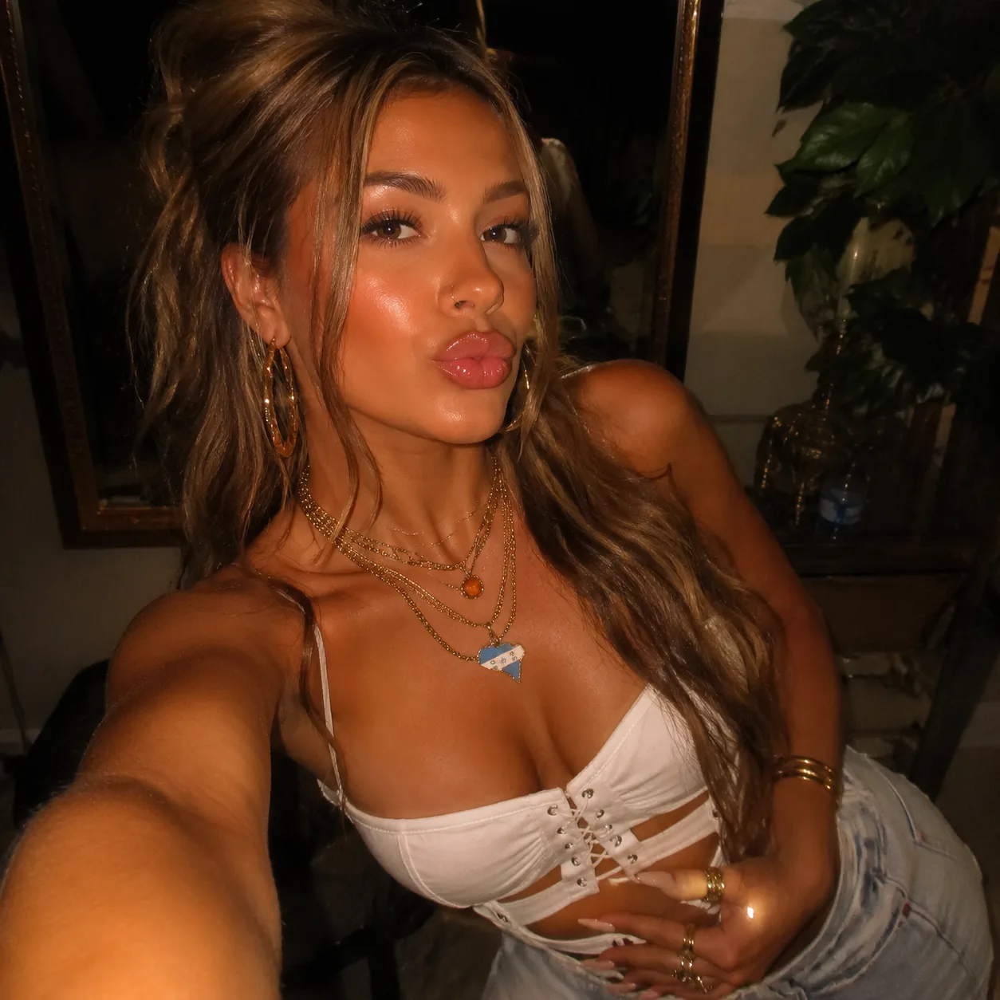

# Use the uploaded photo as inspiration for the woman’s

[← Back to the collection](../../README.md) · Category: [UI & Graphic](../../gallery/ui-graphic.md) · Model: `Vinano Studio` · ID: `vn-01961`

<a href="https://vinano.ai?utm_source=github&utm_medium=readme&utm_campaign=awesome-image-video-prompts-updating&utm_content=prompt-page-image"></a>

<sub>Preview generated with <a href="https://vinano.ai?utm_source=github&utm_medium=readme&utm_campaign=awesome-image-video-prompts-updating&utm_content=prompt-page-caption">vinano.ai</a></sub>

## Prompt

```text
Use the uploaded photo as inspiration for the woman’s appearance; do not change my physical features.

Her dark blonde hair is long, wavy, and voluminous, styled in an extra messy half-up hairstyle loose strands framing her cheeks, adding depth and realism.

She is wearing four layered chunky gold necklaces: one a small carnelian crystal pendant, one shaped like the map of Honduras the flag inside. She also wears extremely large gold hoop earrings, three gold bangles, and chunky gold rings on every finger. Her nails are long, almond-shaped, and neutral-toned. Her nose piercing is visible.

A young woman is taking a selfie from a slightly elevated angle. Her head is slightly tilted to one side, her lips pursed into a thin pout as if blowing a kiss. She looks directly at the camera a confident and sensual expression. Her eyes are emphasized long, natural lashes and perfectly defined eyebrows.

She has flawless, sun-kissed skin a soft blush on her cheeks, nose, and forehead. Her lips are full and glossy, painted in warm nude tones. Clean contouring and subtle texture.

She has very long, sleek, dark black straight hair, styled elegantly two strands framing her face.

She is wearing a white corset-style top straps crossing along the rib area, and light shabby jeans that are only partially visible. Her neck is adorned a thin gold chain, and her ears are decorated small gold hoop earrings.

The background is dark and softly blurred, featuring a large mirror in the back that does not distract from the face. Green plants are visible.

Lighting: A warm, soft flash light that enhances the glow of the skin and creates a typical early-2000s shine.

Effects: Soft skin glow, slightly saturated colors, a fine glossy effect on the lips and skin, warm golden highlights, and a shallow depth of field (bokeh).

Photography style: Y2K glamour, retro nighttime look, luxurious, sensual, and impeccably digitally edited, inspired by celebrity selfies.

Emphasise material texture and natural light so the final frame feels tactile and premium.
```

## Try it on vinano.ai

1. Copy the prompt above.
2. Open **[vinano.ai](https://vinano.ai?utm_source=github&utm_medium=readme&utm_campaign=awesome-image-video-prompts-updating&utm_content=prompt-page-try)**, paste it into the image generator and pick a model.
3. Swap any placeholders (brand, product, city, person…) for your own details, then generate.

More prompts like this: [UI & Graphic gallery](../../gallery/ui-graphic.md) · [all categories](../../README.md#contents)
