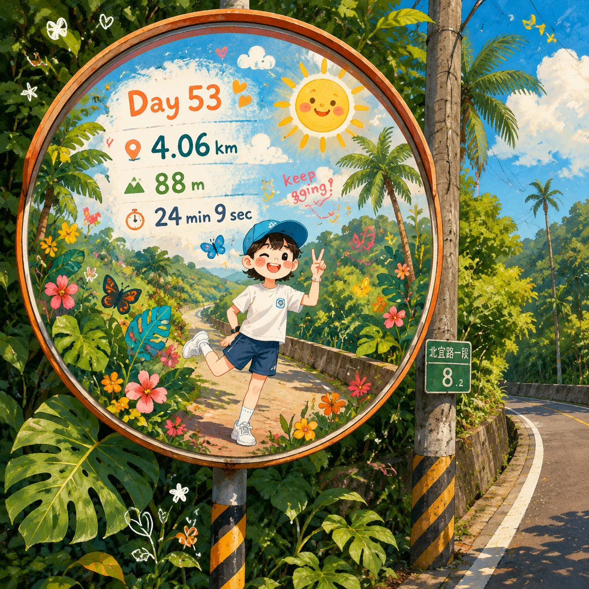

# Character, Infographic

[← Back to the collection](../../README.md) · Category: [UI & Graphic](../../gallery/ui-graphic.md) · Model: `Vinano Studio` · ID: `vn-01973`

<a href="https://vinano.ai?utm_source=github&utm_medium=readme&utm_campaign=awesome-image-video-prompts-updating&utm_content=prompt-page-image"></a>

<sub>Preview generated with <a href="https://vinano.ai?utm_source=github&utm_medium=readme&utm_campaign=awesome-image-video-prompts-updating&utm_content=prompt-page-caption">vinano.ai</a></sub>

## Prompt

```text
Transform the uploaded photo into a whimsical hand-painted storybook illustration. Keep the exact pose, perspective, convex traffic mirror reflection, road, utility pole, and surrounding tropical greenery. Reimagine the mirror reflection as a vibrant illustrated world lush jungle plants, palm trees, flowers, butterflies, doodle hearts, stars, swirls, smiling sun, fluffy clouds, and colorful hand-drawn decorations. The person is transformed into a cute cartoon character wearing a white t-shirt, navy shorts, white socks, and a blue cap, posing playfully one leg raised and a peace sign. Integrate fitness-tracker statistics inside the mirror in a charming infographic style: “Day 53”, “4.06 km”, “88 m”, “24 min 9 sec”. Bright pastel colors, textured gouache paint, children's book aesthetic, whimsical doodles, clean outlines, cozy and cheerful mood, highly detailed foliage, playful travel journal style, Strava-inspired adventure artwork, vibrant greens, oranges, blues, and pinks, ultra-detailed illustration, masterpiece, kawaii aesthetic, editorial quality, vertical composition, 4k. Render with rich micro-detail while keeping the layout uncluttered and intentional.
```

## Try it on vinano.ai

1. Copy the prompt above.
2. Open **[vinano.ai](https://vinano.ai?utm_source=github&utm_medium=readme&utm_campaign=awesome-image-video-prompts-updating&utm_content=prompt-page-try)**, paste it into the image generator and pick a model.
3. Swap any placeholders (brand, product, city, person…) for your own details, then generate.

More prompts like this: [UI & Graphic gallery](../../gallery/ui-graphic.md) · [all categories](../../README.md#contents)
